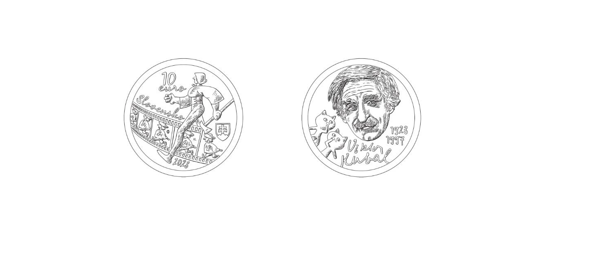

## 23

OZNÁMENIE

Národnej banky Slovenska

z 10. januára 2023

## o vydaní strieborných zberateľských euromincí v nominálnej hodnote 10 eur pri príležitosti 100. výročia narodenia Viktora Kubala

1. Úvodné ustanovenia

- a) Národná banka Slovenska podľa § 17h ods. 1 zákona Národnej rady Slovenskej republiky č. 566/1992 Zb. o Národnej banke Slovenska v znení neskorších predpisov a podľa § 12 ods. 1 písm. b) zákona č. 400/2015 Z. z. o tvorbe právnych predpisov a o Zbierke zákonov Slovenskej republiky a o zmene a doplnení niektorých zákonov v znení neskorších predpisov oznamuje, že vydáva do obehu strieborné zberateľské euromince v nominálnej hodnote 10 eur pri príležitosti 100. výročia narodenia Viktora Kubala (ďalej len „zberateľská eurominca“).

- b) Zberateľská eurominca má štatút zákonného platidla len v Slovenskej republike.

- c) Zberateľská eurominca sa razí zo zliatiny obsahujúcej 900 dielov striebra a 100 dielov medi; jej hmotnosť je 18 g a priemer 34 mm. Pri razbe zberateľskej euromince je povolená horná a dolná odchýlka v priemere 0,1 mm; povolená horná odchýlka v hmotnosti je 0,4 g a v obsahu striebra 10/1 000.

2. Vzhľad zberateľskej euromince

- a) Na líci zberateľskej euromince je v kompozícií postava zbojníka Juraja Jánošíka z celovečerného animovaného filmu Viktora Kubala „Zbojník Jurko“ doplnená o filmový pás zobrazujúci kráčajúcu postavu iného zbojníka z tohto filmu. Názov štátu „Slovensko“ je nad filmovým pásom a pod ním je letopočet „2023“. V pravej časti mincového poľa je do kompozície vsadený štátny znak Slovenskej republiky. Značka Mincovne Kremnica, štátny podnik, ktorú tvorí skratka „MK“ umiestnená medzi dvoma razidlami je v strednom okienku filmového pásu a v okienku napravo sú štylizované iniciálky autora zberateľskej euromince Karola Lička „KL“. Nominálna hodnota zberateľskej euromince „10 euro“ je v dvoch riadkoch v hornej časti mincového poľa.

- b) Na rube zberateľskej euromince je portrét Viktora Kubala, ktorý na ľavej strane dopĺňajú postavičky z animovaného seriálu Viktora Kubala „Puf a Muf“ a napravo v dvoch riadkoch letopočty jeho narodenia a úmrtia „1923“ a „1997“. Pod portrétom je v dvoch riadkoch faksimile podpisu Viktora Kubala.

- c) Na hrane zberateľskej euromince je nápis do hĺbky „• HUMOR BY NEMAL BYŤ NIKDY AGRESÍVNY“.

Štát vydania: Slovenská republika

Začiatok vydávania: marec 2023

v z. Ľudovít Ódor v. r.
