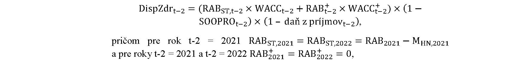

# § 16

(1) Maximálna cena za prístup do prenosovej sústavy a prenos elektriny CPt okrem strát elektriny pri prenose elektriny na rok t v eurách na jednotku množstva elektriny sa vypočíta podľa vzorca

kde

- a) PNt sú schválené alebo určené prevádzkové náklady v eurách na rok t súvisiace s regulovanou činnosťou okrem odpisov súvisiacich s regulovanou činnosťou, nákladov a odpisov na dispečerskú činnosť prevádzkovateľa prenosovej sústavy na zabezpečenie systémových služieb, a vypočítajú sa podľa vzorca

- 

- kde

  - 1. POOPEX sú schválené alebo určené priemerné ročné prevádzkové náklady v eurách vo východiskovom roku regulačného obdobia vypočítané ako priemer skutočných prevádzkových nákladov za obdobia 2019, 2020 a 2021 prevádzkovateľa prenosovej sústavy súvisiace s regulovanou činnosťou okrem odpisov a osobných nákladov,

  - 2. PPEREX sú schválené alebo určené ročné osobné náklady v eurách vo východiskovom roku regulačného obdobia určené ako skutočné osobné náklady za rok 2021 prevádzkovateľa prenosovej sústavy súvisiace s regulovanou činnosťou,

  - 3. IRMn aritmetický priemer indexov nominálnej mzdy v hospodárstve zverejnených štatistickým úradom, vyjadrených v percentách za obdobie od 3. kvartálu roku n-2 do 2. kvartálu roku n-1,

  - 4. JPIn je aritmetický priemer indexov jadrovej inflácie v percentách zverejnených štatistickým úradom za obdobie od júla roku n-2 vrátane do júna roku n-1 vrátane,

  - 5. X je faktor efektivity, ktorého hodnota v každom roku regulačného obdobia je 2,0 %; ak je hodnota rozdielu JPIn a X nižšia ako 0 %, na výpočet maximálnej ceny za prístup do prenosovej sústavy a prenos elektriny na rok t sa hodnota rozdielu JPIn a X rovná 0 %,

- b) Ot je schválená alebo určená hodnota odpisov regulovaného subjektu v eurách na rok t a vypočíta sa podľa vzorca

- 

- kde

  - 1. O2021 je schválená alebo určená hodnota odpisov prevádzkovateľa prenosovej sústavy v eurách, zodpovedajúca výške účtovných odpisov prevádzkovateľa prenosovej sústavy v roku 2021 z majetku, bez vplyvu precenenia majetku od 1. januára 2017, nevyhnutne využívaného na regulovanú činnosť v roku 2021 bez dispečerskej činnosti,

  - 2. SOn je schválená alebo určená hodnota odpisov prevádzkovateľa prenosovej sústavy v eurách, zodpovedajúca výške účtovných odpisov prevádzkovateľa prenosovej sústavy v roku n-1 z majetku, bez vplyvu precenenia majetku od 1. januára 2017, zaradeného do užívania na regulovanú činnosť bez dispečerskej činnosti v roku n-2,

  - 3. VOn je schválená alebo určená hodnota odpisov prevádzkovateľa prenosovej sústavy v eurách, ktorá zodpovedá výške účtovných odpisov prevádzkovateľa prenosovej sústavy v roku n-2 z majetku, bez vplyvu precenenia majetku od 1. januára 2017, vyradeného z užívania na regulovanú činnosť bez dispečerskej činnosti v roku n-2,

- c) POt je schválená alebo určená plánovaná hodnota odpisov prevádzkovateľa prenosovej sústavy v eurách, ktorá zodpovedá výške plánovaných účtovných odpisov prevádzkovateľa prenosovej sústavy v roku t z majetku, bez vplyvu precenenia majetku od 1. januára 2017, s plánovaným zaradením do užívania na regulovanú činnosť bez dispečerskej činnosti v roku t-1,

- d) KDZ je koeficient miery využitia disponibilných zdrojov do investícií súvisiacich s regulovanou činnosťou; KDZ sa na 6. regulačné obdobie určuje v intervale od 0,90 do 1,02, nezohľadňuje investície, ktoré sú financované zo zdrojov Európskej únie alebo iných grantov a štátnych podpôr, a vypočíta sa podľa vzorca

- 

- pričom, ak je výsledok podielu

- vyšší alebo sa rovná 0,7, tak KDZ = 1,02

- menší ako 0,7 a zároveň vyšší alebo sa rovná 0,6, tak KDZ = 1,01,

- menší ako 0,6 a zároveň vyšší alebo sa rovná 0,5, tak KDZ = 1,00,

- menší ako 0,5 a zároveň vyšší alebo sa rovná 0,4, tak KDZ = 0,98,

- menší ako 0,4 a zároveň vyšší alebo sa rovná 0,3, tak KDZ = 0,96,

- menší ako 0,3 a zároveň vyšší alebo sa rovná 0,2, tak KDZ = 0,94,

- menší ako 0,2 a zároveň vyšší alebo sa rovná 0,1, tak KDZ = 0,92,

- menší ako 0,1, tak KDZ = 0,90,

- kde

  - 1. INVt-2 je skutočná hodnota investícií zaradených do hodnoty regulačnej bázy aktív nevyhnutne využívaných pre regulovanú činnosť v roku t-2 v eurách, ktorá nezahŕňa majetok, ktorý je financovaný zo zdrojov Európskej únie alebo iných grantov a štátnych podpôr, a ktorá nezahŕňa majetok financovaný z výnosov z aukcií prenosovej kapacity na cezhraničných profiloch prenosovej sústavy,

  - 2. DispZdrt-2 je súčet schválených alebo určených odpisov súvisiacich s regulovanou činnosťou v roku t-2 v eurách, ktorý nezahŕňa odpisy majetku, ktorý je financovaný zo zdrojov Európskej únie alebo iných grantov a štátnych podpôr, a ktorý nezahŕňa odpisy majetku financovaného z výnosov z aukcií prenosovej kapacity na cezhraničných profiloch prenosovej sústavy, nevyhnutne využívaných pre regulovanú činnosť a zisku prevádzkovateľa prenosovej sústavy v roku t-2 v eurách po zdanení daňou z príjmov, a vypočíta sa podľa vzorca

  - 

  - kde

    - 2a. RABST,t-2, je schválená alebo určená hodnota regulačnej bázy aktív v eurách na rok t-2 a rovná sa hodnote majetku využívaného na regulovanú činnosť prevádzkovateľa prenosovej sústavy bez dispečerskej činnosti, okrem majetku, ktorý vznikne z investícií do aktív odsúhlasených úradom podľa § 5 ods. 1 písm. c) a d) v rámci cenového konania,

    - 2b. SOOPROt-2 je 12-násobok hodnoty mesačnej sadzby osobitného odvodu z podnikania v regulovaných odvetviach v roku t-2, ustanovená podľa osobitného predpisu,27)

    - 2c. WACCt-2 je miera výnosnosti regulačnej bázy aktív na 6. regulačné obdobie určená podľa § 5, vzťahujúca sa na rok t-2,

    - 2d. WACC+t-2 je miera výnosnosti regulačnej bázy aktív na 6. regulačné obdobie určená podľa § 5 ods. 5, vzťahujúca sa na rok t-2,

- e) RABST,t, je schválená alebo určená hodnota regulačnej bázy aktív v eurách na rok t a rovná sa hodnote majetku28) využívaného na regulovanú činnosť prevádzkovateľa prenosovej sústavy bez dispečerskej činnosti, okrem majetku, ktorý vznikne z investícií do aktív odsúhlasených úradom podľa § 5 ods. 1 písm. c) a d) v rámci cenového konania, a vypočíta sa podľa vzorca

  - 1. pre rok t = 2023

  - 

  - R

  - A

  - B

  - S

  - T

  - ,

  - t

  - =

  - R

  - A

  - B

  - 2021

  - -

  - M

  - 2021

  - ,

  - 2. pre rok t = 2024 a nasledujúce roky

  - 

  - kde

    - 2a. RAB2021 je schválená alebo určená hodnota regulačnej bázy aktív prevádzkovateľa prenosovej sústavy v eurách, vychádzajúca zo zostatkovej účtovnej hodnoty majetku k 31. decembru 2021, bez vplyvu precenenia majetku od 1. januára 2017, nevyhnutne využívaného na regulovanú činnosť bez dispečerskej činnosti,

    - 2b. M2021 je hodnota tej časti regulačnej bázy aktív RAB2021 v eurách, ktorá je financovaná zo zdrojov Európskej únie alebo iných grantov a štátnych podpôr, a z investícií do aktív financovaných z výnosov z aukcií prenosovej kapacity na cezhraničných profiloch prenosovej sústavy,

    - 2c. RABn je schválená alebo určená hodnota regulačnej bázy aktív prevádzkovateľa prenosovej sústavy v eurách, ktorá zodpovedá hodnote majetku bez vplyvu precenenia majetku od 1. januára 2017, zaradeného do užívania na regulovanú činnosť bez dispečerskej činnosti v roku n-2 v eurách okrem majetku zaradeného do RAB+n,

    - 2d. SOn je schválená alebo určená hodnota odpisov prevádzkovateľa prenosovej sústavy v eurách, ktorá zodpovedá výške účtovných odpisov prevádzkovateľa prenosovej sústavy v roku n-1 z majetku, bez vplyvu precenenia majetku od 1. januára 2017, zaradeného do užívania na regulovanú činnosť bez dispečerskej činnosti v roku n-2,

    - 2e. Mn je hodnota tej časti regulačnej bázy aktív RABn v eurách , ktorá je financovaná zo zdrojov Európskej únie alebo iných grantov a štátnych podpôr, a z investícií do aktív financovaných z výnosov z aukcií prenosovej kapacity na cezhraničných profiloch prenosovej sústavy,

- f) WACC je miera výnosnosti regulačnej bázy aktív na 6. regulačné obdobie určená podľa § 5,

- g) RAB+t je schválená alebo určená hodnota regulačnej bázy aktív bez vplyvu precenenia v eurách, schválená úradom na regulovanú činnosť bez dispečerskej činnosti v súlade s § 5 ods. 1 písm. c) a d) v rámci cenového konania, pričom

  - 1. pre rok t = 2023 má hodnotu 0,

  - 2. pre rok t = 2024 a nasledujúce roky sa vypočíta podľa vzorca

  - 

  - kde

    - 2a. RAB+n je schválená alebo určená hodnota regulačnej bázy aktív prevádzkovateľa prenosovej sústavy v eurách, ktorá zodpovedá hodnote majetku, bez vplyvu precenenia od 1. januára 2017, zaradeného do užívania na regulovanú činnosť bez dispečerskej činnosti v roku t-2 v eurách, odsúhlasená úradom podľa § 5 ods. 1 písm. c) a d) v rámci cenového konania,

    - 2b. M+n je hodnota tej časti regulačnej bázy aktív RAB+n v eurách, ktorá bola financovaná zo zdrojov Európskej únie alebo iných grantov a štátnych podpôr, a z investícií do aktív financovaných z výnosov z aukcii prenosovej kapacity na cezhraničných profiloch prenosovej sústavy,

- h) WACC+ je miera výnosnosti regulačnej bázy aktív na 6. regulačné obdobie určená podľa § 5 ods. 5,

- i) FINVPt je faktor investícií v eurách na rok t, pričom

  - 1. pre roky t = 2023 a t = 2024 má hodnotu 0,

  - 2. pre rok t = 2025 a nasledujúce roky sa vypočíta podľa vzorca

  - FINVPt = SOt–1 – POt–2,

  - kde

    - 2a. SOt-1 je schválená alebo určená hodnota odpisov prevádzkovateľa prenosovej sústavy v eurách, zodpovedajúca výške účtovných odpisov prevádzkovateľa prenosovej sústavy v roku t-2 z majetku, bez vplyvu precenenia majetku od 1. januára 2017, zaradeného do užívania na regulovanú činnosť bez dispečerskej činnosti v roku t-3,

    - 2b. POt-2 je schválená alebo určená plánovaná hodnota odpisov prevádzkovateľa prenosovej sústavy v eurách, zodpovedajúca výške plánovaných účtovných odpisov prevádzkovateľa prenosovej sústavy v roku t-2 z majetku, bez vplyvu precenenia majetku od 1. januára 2017, s plánovaným zaradením do užívania na regulovanú činnosť bez dispečerskej činnosti v roku t-3,

- j) CPITCt je alikvotná časť čistých výnosov alebo nákladov z ITC mechanizmu v eurách zahrnutá do ceny za prístup do prenosovej sústavy a prenos elektriny na rok t, o ktorej úrad rozhodne do 31. decembra roku t-1 a vypočíta sa podľa vzorca

- CPITCt = ITCplt–1 × mt × (1 – mstrt),

- kde

  - 1. ITCplt-1 je celkový rozdiel očakávaných výnosov a nákladov prevádzkovateľa prenosovej sústavy v eurách fakturovaných v rámci ITC mechanizmu v roku t-1, ktorý sa určí ako súčet

    - 1a. celkového rozdielu skutočných výnosov a nákladov prevádzkovateľa prenosovej sústavy v eurách fakturovaných v rámci ITC mechanizmu za všetky účtovne uzavreté mesiace roku t-1 v dobe vypracovania cenového návrhu a

    - 1b. celkového rozdielu očakávaných výnosov a nákladov prevádzkovateľa prenosovej sústavy v eurách fakturovaných v rámci ITC mechanizmu za tie mesiace roku t-1, ktoré v dobe vypracovania cenového návrhu nie sú účtovne uzavreté,

  - 2. mt je koeficient zahrnutia ITC mechanizmu do taríf určený cenovým rozhodnutím úradu na rok t v rozsahu 0 až 1, o ktorom úrad rozhodne do 31. decembra roku t-1. Pre rok t = 2023 je rovný 0,

  - 3. mstrt je koeficient zahrnutia ITC mechanizmu do tarify za straty elektriny pri prenose elektriny určený cenovým rozhodnutím úradu na rok t v rozsahu 0 až 1, o ktorom úrad rozhodne do 31. decembra roku t-1,

- k) CPVAt je alikvotná časť čistých výnosov alebo nákladov z aukcií prenosovej kapacity na cezhraničných profiloch prenosovej sústavy v eurách zahrnutá do ceny za prístup do prenosovej sústavy a prenos elektriny na rok t, o ktorej úrad rozhodne do 31. decembra roku t-1, a vypočíta sa podľa vzorca

- CPVAt = VAplt–1 × nt × (1 – nstrt – ntsst),

- kde

  - 1. VAplt-1 je celkový rozdiel očakávaných výnosov a nákladov prevádzkovateľa prenosovej sústavy v eurách fakturovaných v rámci aukcií prenosovej kapacity na cezhraničných profiloch prenosovej sústavy v roku t-1, ktorý sa určí ako súčet

    - 1a. celkového rozdielu skutočných výnosov a nákladov prevádzkovateľa prenosovej sústavy v eurách fakturovaných v rámci aukcií prenosovej kapacity na cezhraničných profiloch prenosovej sústavy za všetky účtovne uzavreté mesiace roku t-1 v dobe vypracovania cenového návrhu a

    - 1b. celkového rozdielu očakávaných výnosov a nákladov prevádzkovateľa prenosovej sústavy v eurách fakturovaných v rámci aukcií prenosovej kapacity na cezhraničných profiloch prenosovej sústavy za tie mesiace roku t-1, ktoré v dobe vypracovania cenového návrhu nie sú účtovne uzavreté,

  - 2. nt je koeficient zahrnutia aukcií prenosovej kapacity na cezhraničných profiloch prenosovej sústavy do taríf určený cenovým rozhodnutím úradu na rok t v rozsahu 0 až 1, o ktorom úrad rozhodne do 31. decembra roku t-1,

  - 3. nstrt je koeficient zahrnutia aukcií prenosovej kapacity na cezhraničných profiloch prenosovej sústavy do tarify za straty elektriny pri prenose elektriny určený cenovým rozhodnutím úradu na rok t v rozsahu 0 až 1, o ktorom úrad rozhodne do 31. decembra roku t-1,

  - 4. ntsst je koeficient zahrnutia aukcií prenosovej kapacity na cezhraničných profiloch prenosovej sústavy do tarify za systémové služby určený cenovým rozhodnutím úradu na rok t v rozsahu 0 až 1, o ktorom úrad rozhodne do 31. decembra roku t-1,

- l) KCPt je faktor ITC a aukcií prenosovej kapacity v eurách na rok t, ktorý sa pre roky t = 2023 a t = 2024 rovná 0 a pre rok t = 2025 a nasledujúce roky sa vypočíta podľa vzorca

- KCPt = ITCskt–2 – ITCplt–2 + VAskt–2 – VAplt–2,

- kde

  - 1. ITCskt-2 je celkový rozdiel skutočných výnosov a nákladov prevádzkovateľa prenosovej sústavy v eurách fakturovaných v rámci ITC mechanizmu v roku t-2,

  - 2. ITCplt-2 je celkový rozdiel očakávaných výnosov a nákladov prevádzkovateľa prenosovej sústavy v eurách fakturovaných v rámci ITC mechanizmu v roku t-2,

  - 3. VAskt-2 je celkový rozdiel skutočných výnosov a nákladov prevádzkovateľa prenosovej sústavy v eurách fakturovaných v rámci aukcií prenosovej kapacity na cezhraničných profiloch prenosovej sústavy v roku t-2,

  - 4. VAplt-2 je celkový rozdiel očakávaných výnosov a nákladov prevádzkovateľa prenosovej sústavy v eurách fakturovaných v rámci aukcií prenosovej kapacity na cezhraničných profiloch prenosovej sústavy v roku t-2,

- m) DVt sú skutočné výnosy v roku t-2 v eurách z uplatnenia úhrad nákladov užívateľov prenosovej sústavy za pripojenie do sústavy,

- n) QPPt je plánované priemerné množstvo prenesenej elektriny odobratej z prenosovej sústavy koncovými odberateľmi elektriny, ktorí sú priamo pripojení do prenosovej sústavy, výrobcami elektriny, ktorí sú priamo pripojení do prenosovej sústavy, a prevádzkovateľmi distribučnej sústavy v jednotkách množstva elektriny na rok t vypočítané ako priemer ročných hodnôt skutočného príslušného množstva elektriny za roky t-3 a t-2, očakávaného príslušného množstva za rok t-1 a plánovaného príslušného množstva za roky t,

- o) NPSZt sú náklady na projekty spoločného záujmu na rok t v eurách,

- p) CACMt sú schválené náklady na projekty prideľovania kapacity a riadenia preťaženia sústavy, ktoré nie sú evidované v majetku prevádzkovateľa prenosovej sústavy na rok t v eurách,

- q) SOGLt sú schválené náklady na projekty súvisiace s implementáciou povinností prevádzkovateľa prenosovej sústavy podľa osobitného predpisu29) na rok t v eurách,

- r) NOCACMt sú schválené náklady na nápravné opatrenia použité v procese prideľovania prenosových kapacít podľa osobitného predpisu30) na rok t v eurách,

- s) NOSOGLt sú schválené náklady na nápravné opatrenia použité v procese riadenia prevádzky prenosovej sústavy na zabezpečenie spoľahlivosti a bezpečnosti dodávok elektriny podľa osobitného predpisu31) na rok t v eurách,

- t) EBGLt sú schválené náklady na zriadenie, zmenu a prevádzkovanie európskych platforiem podľa osobitného predpisu32) na rok t v eurách,

- u) FTt sú schválené mimoriadne náklady, ktoré vznikli až počas regulačného obdobia na rok t v eurách.

(2) Súčet koeficientov nstrt a ntsst, ktoré sú ustanovené v odseku 1 písm. k) bodoch 3. a 4, je menší alebo sa rovná 1.

(3) Na účely platby za prístup do prenosovej sústavy sa dohodnutá rezervovaná kapacita v MW v roku t v každom odbernom mieste určuje ako aritmetický priemer ročných hodnôt skutočného ročného maxima štvrťhodinového výkonu za roky t-2 až t-4. Hodnoty výkonov sa určujú v MW s rozlíšením na tri desatinné miesta. Do celkového objemu rezervovanej kapacity sa započíta aj rezervovaná kapacita pre každého výrobcu elektriny a prevádzkovateľa zariadenia na uskladňovanie elektriny určená podľa § 15 ods. 8 až 10 a 15.

(4) Ak nie je do odberných miest užívateľa prenosovej sústavy vykonávaný prenos elektriny v roku t-4, použije sa aritmetický priemer z rokov t-2 a t-3. Ak nie je do odberných miest užívateľa prenosovej sústavy vykonávaný prenos elektriny v rokoch t-4 a t-3, použije sa hodnota skutočného ročného maxima štvrťhodinového výkonu za rok t-2. Ak nie je do odberných miest užívateľa prenosovej sústavy vykonávaný prenos elektriny v rokoch t-4, t-3 a t-2, rezervovaná kapacita pre odber zo sústavy užívateľa prenosovej sústavy a výrobcu elektriny, ktorého zariadenie na výrobu elektriny je pripojené do prenosovej sústavy výlučne na odber elektriny a prevádzkovateľa zariadenia na uskladňovanie elektriny, ktorého zariadenie na uskladňovanie elektriny je pripojené do prenosovej sústavy výlučne na odber elektriny sa určuje prevádzkovateľom prenosovej sústavy mesačne na základe nameraného mesačného maxima štvrťhodinového činného výkonu. Hodnoty výkonov sa určujú v MW s rozlíšením na tri desatinné miesta. Takto určená rezervovaná kapacita nesmie byť vyššia ako kapacita pripojenia uvedená v zmluve o pripojení do prenosovej sústavy.

(5) Podiel výnosov z platieb za rezerváciu kapacity sa z celkových výnosov z platieb za rezerváciu kapacity a z platieb za prenesenú elektrinu určuje koeficientom do 0,8. Podiel výnosov z platieb za prenesenú elektrinu sa z celkových výnosov z platieb za rezerváciu kapacity a z platieb za prenesenú elektrinu určuje koeficientom najmenej 0,2.

(6) Spolu s cenovým návrhom na rok t sa predkladá spôsob výpočtu navrhovaných zložiek taríf za rezervovanú kapacitu v MW a za prenesenú elektrinu. Návrh taríf zohľadňuje plánované výnosy v roku t v eurách z platieb za rezervovanú kapacitu pri výrobe elektriny od výrobcov elektriny pripojených do prenosovej sústavy, prevádzkovateľov zariadení na uskladňovanie elektriny a charakter odberu elektriny koncových odberateľov elektriny priamo pripojených do prenosovej sústavy, ich spotrebu elektriny a rezervovanú kapacitu pripojených užívateľov prenosovej sústavy takto:

- a) ak rezervovaná kapacita na rok t v odbernom mieste koncového odberateľa elektriny priamo pripojeného do prenosovej sústavy je viac ako 150 MW a zároveň prenos elektriny pre koncového odberateľa elektriny priamo pripojeného do prenosovej sústavy v roku t-2 bol viac ako 1 TWh, koncovým odberateľom elektriny priamo pripojeným do prenosovej sústavy v roku t sa uhrádzajú prevádzkovateľovi prenosovej sústavy platby za prístup do prenosovej sústavy a prenos elektriny, ktoré sa vypočítajú ako súčin hodnoty rezervovanej kapacity a 75 % z tarify za rezervovanú kapacitu a súčin hodnoty prenesenej elektriny a 75 % z tarify za prenesenú elektrinu,

- b) ak rezervovaná kapacita na rok t v odbernom mieste koncového odberateľa elektriny priamo pripojeného do prenosovej sústavy je viac ako 250 MW a zároveň prenos elektriny pre koncového odberateľa elektriny priamo pripojeného do prenosovej sústavy v roku t-2 je viac ako 1,5 TWh, koncovým odberateľom elektriny priamo pripojeným do prenosovej sústavy v roku t sa uhrádzajú prevádzkovateľovi prenosovej sústavy platby za prístup do prenosovej sústavy a prenos elektriny, ktoré sa vypočítajú ako súčin hodnoty rezervovanej kapacity a 50 % z tarify za rezervovanú kapacitu a súčin hodnoty prenesenej elektriny a 50 % z tarify za prenesenú elektrinu,

- c) ak rezervovaná kapacita na rok t v odbernom mieste koncového odberateľa elektriny priamo pripojeného do prenosovej sústavy je viac ako 350 MW a zároveň prenos elektriny pre koncového odberateľa elektriny priamo pripojeného do prenosovej sústavy v roku t-2 je viac ako 2,5 TWh, koncovým odberateľom elektriny priamo pripojeným do prenosovej sústavy v roku t sa uhrádzajú prevádzkovateľovi prenosovej sústavy platby za prístup do prenosovej sústavy a prenos elektriny, ktoré sa vypočítajú ako súčin hodnoty rezervovanej kapacity a 25 % z tarify za rezervovanú kapacitu a súčin hodnoty prenesenej elektriny a 25 % z tarify za prenesenú elektrinu,

- d) ak celoročné využitie rezervovanej kapacity za rok t-2 v odbernom mieste koncového odberateľa elektriny priamo pripojeného do prenosovej sústavy je viac ako 80 %, koncovým odberateľom elektriny priamo pripojeným do prenosovej sústavy v roku t sa uhrádzajú prevádzkovateľovi prenosovej sústavy platby za prístup do prenosovej sústavy a prenos elektriny podľa písmen a) až c) násobené koeficientom 0,8,

- e) priemerné celoročné využitie rezervovanej kapacity odberného miesta odberateľa elektriny za rok t-2 v percentách sa na účely odseku 6 písm. d) vypočíta podľa vzorca

- 

- kde

  - 1. OPS,t-2 je skutočné odobraté množstvo elektriny v odbernom mieste odberateľa elektriny priamo pripojeného do prenosovej sústavy za rok t-2 v jednotkách množstva elektriny,

  - 2. RKt-2 je hodnota rezervovanej kapacity v odbernom mieste odberateľa elektriny priamo pripojeného do prenosovej sústavy za rok t-2 v MW.

(7) Do faktora trhu FTt je možné zahrnúť mimoriadne náklady prevádzkovateľa prenosovej sústavy, ktoré nie sú zahrnuté do schválených alebo určených ekonomicky oprávnených ročných prevádzkových nákladov PNvych súvisiacich s regulovanou činnosťou. Týmito nákladmi sú najmä náklady súvisiace so zmenou právnych predpisov, zmenou právne záväzných aktov Európske únie, vývojom situácie na trhu alebo náklady, ktoré vzniknú pri likvidácii živelných pohrôm, ktoré nie sú pokryté poistením a preukázateľné náklady regulovaného subjektu na vedu a výskum podľa § 4 ods. 1 písm. o), a to po schválení úradom.

(8) Návrh na schválenie mimoriadnych nákladov vstupujúcich do faktora trhu FTt pre príslušný rok možno podať aj samostatne mimo predkladaného návrhu na určenie ceny. V odôvodnených prípadoch na predchádzanie významným medziročným zmenám regulovaných cien, sa určí, že schválené mimoriadne náklady sú do faktora trhu FTt zahrnuté rozložene na viac rokov regulačného obdobia alebo sú pre nasledujúce regulačné obdobie zahrnuté do uznaných oprávnených nákladov vstupujúcich do základného výpočtu oprávnených výnosov pre jednotlivé roky nasledujúceho regulačného obdobia.
