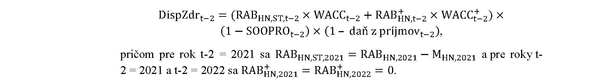

# § 25

(1) Maximálna cena za prístup do distribučnej sústavy a distribúciu elektriny na príslušnej napäťovej úrovni CDHN,t zohľadňuje vlastnú distribúciu elektriny a prenos elektriny vrátane strát pri prenose elektriny v eurách na jednotku množstva elektriny distribuovanej koncovým odberateľom elektriny v roku t = 2023 a v roku t = 2024 a nasledujúcich rokoch. Maximálna cena za prístup do distribučnej sústavy a distribúciu elektriny na príslušnej napäťovej úrovni CDHN,t zohľadňuje vlastnú distribúciu elektriny a prenos elektriny bez strát pri prenose elektriny v eurách na jednotku množstva elektriny distribuovanej koncovým odberateľom elektriny a vypočíta sa podľa vzorca

C

D

H

N

,

t

=

C

D

E

H

N

,

t

+

C

P

D

H

N

,

t

,

kde

- a) CDEHN,t je schválená alebo určená zložka maximálnej ceny za prístup do distribučnej sústavy a distribúciu elektriny na príslušnej napäťovej úrovni na rok t v eurách na jednotku množstva elektriny zohľadňujúca náklady a primeraný zisk vlastnej distribúcie elektriny podľa odseku 2,

- b) CPDHN,t je priemerná zložka ceny za prístup do prenosovej sústavy a prenos elektriny vrátane strát pri prenose elektriny v eurách na jednotku množstva elektriny na príslušnej napäťovej úrovni pre rok t = 2023 podľa odseku 4 a CPDHN,t je priemerná zložka ceny za prístup do prenosovej sústavy a prenos elektriny bez strát pri prenose elektriny v eurách na jednotku množstva elektriny na príslušnej napäťovej úrovni pre rok t = 2024 a nasledujúce roky podľa odseku 5.

(2) Schválená alebo určená zložka maximálnej ceny za prístup do distribučnej sústavy a distribúciu elektriny na príslušnej napäťovej úrovni CDEHN,t na rok t v eurách na jednotku množstva elektriny zohľadňujúca náklady a primeraný zisk vlastnej distribúcie elektriny sa vypočíta podľa vzorca

C

D

E

H

N

,

t

=

V

V

D

H

N

+

1

,

t

+

V

V

D

H

N

,

t

V

y

s

t

E

H

N

,

t

,

kde

- a) VystEHN,t je plánované množstvo distribuovanej elektriny v jednotkách množstva elektriny na rok t vystupujúce z príslušnej napäťovej úrovne vypočítané podľa vzorca

- 

- V

- y

- s

- t

- E

- H

- N

- ,

- t

- =

- V

- y

- s

- t

- E

- O

- H

- N

- ,

- t

- +

- V

- y

- s

- t

- E

- T

- R

- H

- N

- ,

- t

- ,

- kde

  - 1. VystEOHN,t je plánované množstvo elektriny v jednotkách množstva elektriny na rok t distribuované na príslušnej napäťovej úrovni koncovým odberateľom elektriny a prevádzkovateľom miestnej distribučnej sústavy vypočítané ako ročný priemer zo súčtu skutočného príslušného množstva elektriny za roky t-3 a t-2, očakávaného príslušného množstva za rok t-1 a plánovaného príslušného množstva za roky t a t+1,

  - 2. VystETRHN,t je plánované množstvo elektriny v jednotkách množstva elektriny na rok t vystupujúce z príslušnej napäťovej úrovne do transformácie na nižšiu napäťovú úroveň vypočítané ako ročný priemer zo súčtu skutočného príslušného množstva elektriny za roky t-3 a t-2, očakávaného príslušného množstva za rok t-1 a plánovaného príslušného množstva za roky t a t+1,

- b) VVDHN+1,t je alikvotná časť povolených nákladov a zisku za distribúciu elektriny na rok t v eurách priradených z vyššej napäťovej úrovne a vypočíta sa podľa vzorca

- 

- V

- V

- D

- H

- N

- +

- 1

- ,

- t

- =

- C

- D

- E

- H

- N

- +

- 1

- ,

- t

- ×

- V

- y

- s

- t

- E

- T

- R

- H

- N

- +

- 1

- ,

- t

- ,

- kde

  - 1. CDEHN+1,t je zložka maximálnej ceny za prístup do distribučnej sústavy a distribúciu elektriny na vyššej napäťovej úrovni na rok t v eurách na jednotku množstva elektriny; pri napäťovej úrovni veľmi vysokého napätia sa CDEHN+1,t na vstupe do napäťovej úrovne veľmi vysokého napätia rovná 0,

  - 2. VystETRHN+1,t je plánované množstvo elektriny v jednotkách množstva elektriny na rok t vystupujúce z vyššej napäťovej úrovne HN+1 do transformácie na napäťovú úroveň HN vypočítané ako ročný priemer zo súčtu skutočného príslušného množstva elektriny za roky t-3 a t-2, očakávaného príslušného množstva za rok t-1 a plánovaného príslušného množstva za roky t a t+1,

- c) VVDHN,t sú schválené alebo určené náklady a zisk za prístup do distribučnej sústavy a distribúciu elektriny na rok t v eurách na príslušnej napäťovej úrovni, okrem alikvotnej časti povolených nákladov a zisku za distribúciu elektriny priradených z vyššej napäťovej úrovne, vypočítané podľa odseku 3.

(3) Schválené alebo určené náklady a zisk za prístup do distribučnej sústavy a distribúciu elektriny na rok t v eurách na príslušnej napäťovej úrovni okrem alikvotnej časti povolených nákladov a zisku za distribúciu elektriny priradených z vyššej napäťovej úrovne VVDHN,t sa vypočítajú podľa vzorca

kde

- a) PNHN,t sú schválené alebo určené prevádzkové náklady pre rok t v eurách na príslušnej napäťovej úrovni súvisiace s regulovanou činnosťou a vypočítajú sa podľa vzorca

- 

- kde

  - 1. POOPEX sú schválené alebo určené priemerné ročné prevádzkové náklady v eurách vo východiskovom roku regulačného obdobia vypočítané ako priemer skutočných prevádzkových nákladov za roky 2019, 2020 a 2021 na príslušnej napäťovej úrovni súvisiace s regulovanou činnosťou okrem odpisov a osobných nákladov,

  - 2. PPEREX sú schválené alebo určené ročné osobné náklady v eurách vo východiskovom roku regulačného obdobia určené ako skutočné osobné náklady prevádzkovateľa regionálnej distribučnej sústavy za rok 2021 na príslušnej napäťovej úrovni súvisiace s regulovanou činnosťou,

  - 3. IRMn je aritmetický priemer indexov nominálnej mzdy v hospodárstve zverejnený štatistickým úradom vyjadrený v percentách za obdobie od 3. kvartálu roka n-2 do 2. kvartálu roka n-1,

  - 4. JPIn je aritmetický priemer indexov jadrovej inflácie v percentách zverejnených štatistickým úradom za obdobie od júla roku n-2 do júna roku n-1,

  - 5. X je faktor efektivity v každom roku regulačného obdobia, ktorého hodnota je 2,0 %; ak je hodnota rozdielu JPIn a X nižšia ako 0, na výpočet najvyššej ceny za prístup do distribučnej sústavy a distribúciu elektriny na rok t sa hodnota daného rozdielu rovná 0 %,

- b) OHN,t je schválená alebo určená hodnota odpisov regulovaného subjektu na rok t v eurách, ktorá sa vypočíta podľa vzorca

- 

- kde

  - 1. OHN,2021 je schválená alebo určená hodnota odpisov prevádzkovateľa regionálnej distribučnej sústavy v eurách, zodpovedajúca výške účtovných odpisov prevádzkovateľa regionálnej distribučnej sústavy v roku 2021 z majetku, bez vplyvu precenenia majetku od 1. januára 2017 nevyhnutne využívaného na regulovanú činnosť v roku 2021 na príslušnej napäťovej úrovni,

  - 2. SOHN,n je schválená alebo určená hodnota odpisov prevádzkovateľa regionálnej distribučnej sústavy v eurách, zodpovedajúca výške účtovných odpisov prevádzkovateľa regionálnej distribučnej sústavy v roku n-1 z majetku, bez vplyvu precenenia majetku od 1. januára 2017, zaradeného do užívania v roku n-2 na príslušnej napäťovej úrovni,

  - 3. VOHN,n je schválená alebo určená hodnota odpisov prevádzkovateľa regionálnej distribučnej sústavy v eurách, zodpovedajúca výške účtovných odpisov prevádzkovateľa regionálnej distribučnej sústavy v roku n-2 z majetku, bez vplyvu precenenia majetku od 1. januára 2017, vyradeného z užívania na regulovanú činnosť v roku n-2 na príslušnej napäťovej úrovni,

- c) POHN,t je schválená alebo určená plánovaná hodnota odpisov prevádzkovateľa regionálnej distribučnej sústavy v eurách, zodpovedajúca plánovaným účtovným odpisom prevádzkovateľa regionálnej distribučnej sústavy na príslušnej napäťovej úrovni v roku t z majetku, bez vplyvu precenenia majetku od 1. januára 2017, s plánovaným zaradením do užívania na regulovanú činnosť v roku t-1,

- d) KDZ je koeficient miery využitia disponibilných zdrojov do investícií súvisiacich s regulovanou činnosťou; KDZ sa na regulačné obdobie určuje v intervale od 0,90 do 1,02 a nezohľadňuje investície, ktoré sú financované zo zdrojov Európskej únie alebo iných grantov a štátnych podpôr a vypočíta sa podľa vzorca

- 

- ak je výsledok podielu

- vyšší alebo sa rovná 0,7, tak KDZ = 1,02,

- menší ako 0,7 a zároveň vyšší alebo sa rovná 0,6, tak KDZ = 1,01,

- menší ako 0,6 a zároveň vyšší alebo sa rovná 0,5, tak KDZ = 1,00,

- menší ako 0,5 a zároveň vyšší alebo sa rovná 0,4, tak KDZ = 0,98,

- menší ako 0,4 a zároveň vyšší alebo sa rovná 0,3, tak KDZ = 0,96,

- menší ako 0,3 a zároveň vyšší alebo sa rovná 0,2, tak KDZ = 0,94,

- menší ako 0,2 a zároveň vyšší alebo sa rovná 0,1, tak KDZ = 0,92,

- menší ako 0,1, tak KDZ= 0,90,

- kde

  - 1. INVt-2je skutočná hodnota investícií na príslušnej napäťovej úrovni v eurách zaradených do hodnoty regulačnej bázy aktív na napäťovej úrovni nevyhnutne využívaných pre regulovanú činnosť v roku t-2, ktorá nezahŕňa investície zo zdrojov Európskej únie alebo iných grantov a štátnych podpôr,

  - 2. DispZdrt-2 je súčet schválených alebo určených odpisov na príslušnej napäťovej úrovni v eurách súvisiacich s regulovanou činnosťou v roku t-2, ktorý nezahŕňa odpisy majetku, ktorý je financovaný zo zdrojov Európskej únie alebo iných grantov a štátnych podpôr a zisku prevádzkovateľa distribučnej sústavy v roku t-2 v eurách po zdanení daňou z príjmov, a vypočíta sa podľa vzorca

  - 

  - kde

    - 2a. RABHN,ST,t-2 je schválená alebo určená hodnota regulačnej bázy aktív na príslušnej napäťovej úrovni v eurách na rok t-2 a rovná sa hodnote majetku regulačnej bázy aktív nevyhnutne súvisiacej s regulovanou činnosťou na rok t-2, nezahŕňajúca majetok, ktorý vznikol z investícií do aktív odsúhlasených úradom podľa § 5 ods. 1 písm. c) a d) v rámci cenového konania,

    - 2b. SOOPROt-2 je 12-násobok hodnoty mesačnej sadzby osobitného odvodu z podnikania v regulovaných odvetviach v roku t-2, ustanovená podľa osobitného predpisu,27)

    - 2c. WACCt-2 je miera výnosnosti regulačnej bázy aktív na 6. regulačné obdobie určená podľa § 5, vzťahujúca sa na rok t-2,

    - 2d. WACC+t-2 je miera výnosnosti regulačnej bázy aktív na 6. regulačné obdobie určená podľa § 5 ods. 5, vzťahujúca sa na rok t-2,

- e) RABHN,ST,t je schválená alebo určená hodnota regulačnej bázy aktív na príslušnej napäťovej úrovni v eurách a sa rovná hodnote majetku28) regulačnej bázy aktív nevyhnutne súvisiacej s regulovanou činnosťou na rok t, nezahŕňajúca majetok, ktorý vznikol z investícií do aktív odsúhlasených úradom podľa § 5 ods. 1 písm. c) a d) v rámci cenového konania a vypočíta sa podľa vzorca

  - 1. pre rok t = 2023

  - RABHN,ST,t = RABHN,2021 – MHN,2021,

  - 2. pre rok t = 2024 a nasledujúce roky

  - 

  - kde

    - 2a. RABHN,2021 je schválená alebo určená hodnota regulačnej bázy aktív prevádzkovateľa regionálnej distribučnej sústavy v eurách, vychádzajúca zo zostatkovej účtovnej hodnoty majetku k 31. decembru 2021, bez vplyvu precenenia majetku od 1. januára 2017 na príslušnej napäťovej úrovni nevyhnutne využívaného na regulovanú činnosť,

    - 2b. MHN,2021 je zostatková účtovná hodnota tej časti regulačnej bázy aktív prevádzkovateľa regionálnej distribučnej sústavy RABHN,2021 v eurách, bez vplyvu precenenia majetku na napäťovej úrovni nevyhnutne využívaného na regulovanú činnosť k 31. decembru 2021, ktorá bola financovaná zo zdrojov Európskej únie alebo iných grantov a štátnych podpôr,

    - 2c. RABHN,n je schválená alebo určená hodnota regulačnej bázy aktív prevádzkovateľa regionálnej distribučnej sústavy, zodpovedajúca zostatkovej účtovnej hodnote majetku bez vplyvu precenenia majetku na príslušnej napäťovej úrovni v eurách, zaradená do užívania na regulovanú činnosť v roku n-2 okrem majetku zaradeného do RAB+HN,n,

    - 2d. MHN,n je schválená alebo určená hodnota regulačnej bázy aktív prevádzkovateľa regionálnej distribučnej sústavy, vychádzajúca zo zostatkovej účtovnej hodnoty tej časti majetku bez vplyvu precenenia majetku na príslušnej napäťovej úrovni v eurách zaradená do užívania v roku n-2, ktorá bola financovaná zo zdrojov Európskej únie alebo iných grantov a štátnych podpôr,

    - 2e. SOHN,n je schválená alebo určená hodnota odpisov prevádzkovateľa regionálnej distribučnej sústavy v eurách, ktorá zodpovedá výške účtovných odpisov prevádzkovateľa regionálnej distribučnej sústavy v roku n-1 z majetku na príslušnej napäťovej úrovni, bez vplyvu precenenia majetku od 1. januára 2017, zaradeného do užívania na regulovanú činnosť v roku n-2,

- f) WACC je miera výnosnosti regulačnej bázy aktív na regulačné obdobie určená podľa § 5,

- g) RAB+HN,t je schválená alebo určená hodnota regulačnej bázy aktív vychádzajúca zo zostatkovej účtovnej hodnoty majetku bez vplyvu precenenia na napäťovej úrovni v eurách, odsúhlasená úradom podľa § 5 ods. 1 písm. c) a d) v rámci cenového konania, pričom

  - 1. pre rok t = 2023 má hodnotu 0,

  - 2. pre rok t = 2024 a nasledujúce roky sa vypočíta sa podľa vzorca

  - 

  - kde

    - 2a. RAB+HN,n je schválená alebo určená hodnota regulačnej bázy aktív prevádzkovateľa regionálnej distribučnej sústavy v eurách, ktorá zodpovedá hodnote majetku na príslušnej napäťovej úrovni bez vplyvu precenenia od 1. januára 2017, zaradeného do užívania v roku n-2, odsúhlasená úradom podľa § 5 ods. 1 písm. c) a d) v rámci cenového konania,

    - 2b. M+HN,n je schválená alebo určená hodnota regulačnej bázy aktív RAB+HN,n, ktorá bola financovaná zo zdrojov Európskej únie alebo iných grantov a štátnych podpôr, vychádzajúca zo zostatkovej účtovnej hodnoty časti majetku bez vplyvu precenenia na príslušnej napäťovej úrovni v eurách zaradená do užívania v roku n-2, odsúhlasená úradom podľa § 5 ods. 1 písm. c) a d) v rámci cenového konania,

- h) WACC+ je miera výnosnosti regulačnej bázy aktív na 6. regulačné obdobie určená podľa § 5 ods. 5,

- i) FINVPHN,t je faktor investícií na napäťovej úrovni v eurách na rok t, pričom

  - 1. pre rok t = 2023 má hodnotu 0,

  - 2. pre rok t = 2024 a nasledujúce roky sa vypočíta podľa vzorca

  - FINVPHN,t = SOHN,t–1 – POHN,t–2,

  - kde

    - 2a. SOHN,t-1 je schválená alebo určená hodnota odpisov prevádzkovateľa regionálnej distribučnej sústavy na príslušnej napäťovej úrovni v eurách, zodpovedajúca výške účtovných odpisov prevádzkovateľa regionálnej distribučnej sústavy v roku t-2 z majetku, bez vplyvu precenenia majetku od 1. januára 2017, zaradeného do užívania v roku t-3 na danej napäťovej úrovni,

    - 2b. POHN,t-2 je schválená alebo určená plánovaná hodnota odpisov prevádzkovateľa regionálnej distribučnej sústavy v eurách na príslušnej napäťovej úrovni, zodpovedajúca výške plánovaných účtovných odpisov prevádzkovateľa regionálnej distribučnej sústavy v roku t-2 z majetku, bez vplyvu precenenia majetku od 1. januára 2017, s plánovaným zaradením do užívania na regulovanú činnosť v roku t-3,

- j) DVHN,t sú skutočné dodatočné výnosy na príslušnej napäťovej úrovni v roku t-2 v eurách, ktoré sú zložené z celkových skutočných výnosov

  - 1. z uplatnenia ceny za pripojenie do sústavy sa zohľadnia vo výške 100 %,

  - 2. zo sankcií za prekročenie rezervovanej kapacity sa zohľadnia vo výške 100 %,

  - 3. z taríf za dodávku jalovej elektriny do distribučnej sústavy na základe cenového rozhodnutia úradu sa zohľadnia vo výške 100 %,

  - 4. z taríf za nedodržanie predpísanej hodnoty účinníka cos φ účtované užívateľom sústavy na základe cenového rozhodnutia úradu sa zohľadnia vo výške 100 %,

  - 5. z výnosov cenníka služieb za distribúciu elektriny, podľa prílohy č. 9 tejto vyhlášky, sa zohľadnia vo výške 50 % pre roky t = 2026 a nasledujúce roky,

- k) FTt sú schválené mimoriadne náklady vyvolané počas regulačného obdobia v eurách na rok t.

(4) Zložka maximálnej ceny za prístup do distribučnej sústavy a distribúciu elektriny v eurách na jednotku množstva elektriny pre rok t = 2023 CPDHN,t súvisiaca s nákladmi za prístup do prenosovej sústavy a prenos elektriny vrátane strát pri prenose elektriny na príslušnej napäťovej úrovni sa rovná priemernej zložke ceny za prístup do prenosovej sústavy a prenos elektriny vrátane nákladov na straty pri prenose elektriny v eurách na jednotku množstva elektriny na príslušnej napäťovej úrovni v roku t = 2023 CPEHN,t, ktorá sa vypočíta podľa odseku 6.

(5) Zložka maximálnej ceny za prístup do distribučnej sústavy a distribúciu elektriny v eurách na jednotku množstva elektriny pre roky t = 2024 a nasledujúce roky sa CPDHN,t súvisiaca s nákladmi za prístup do prenosovej sústavy a prenos elektriny bez strát pri prenose elektriny na príslušnej napäťovej úrovni rovná priemernej zložke ceny za prístup do prenosovej sústavy a prenos elektriny bez nákladov na straty pri prenose elektriny v eurách na jednotku množstva elektriny na príslušnej napäťovej úrovni pre roky t = 2024 a nasledujúce roky CPEHN,t, ktorá sa vypočíta podľa odseku 7.

(6) Priemerná zložka ceny za prístup do prenosovej sústavy a prenos elektriny vrátane nákladov na straty pri prenose elektriny v eurách na jednotku množstva elektriny na príslušnej napäťovej úrovni v roku t = 2023 sa vypočíta podľa vzorca

C

P

E

H

N

,

t

=

V

V

P

H

N

,

t

V

y

s

t

E

H

N

,

t

,

kde

- a) VVPHN,t sú vstupujúce náklady za prístup do prenosovej sústavy a prenos elektriny vrátane nákladov na straty pri prenose elektriny na príslušnej napäťovej úrovni v eurách v roku t vypočítané podľa vzorca

- 

- V

- V

- P

- H

- N

- ,

- t

- =

- C

- P

- E

- H

- N

- +

- 1

- ,

- t

- ×

- V

- y

- s

- t

- E

- T

- R

- H

- N

- +

- 1

- ,

- t

- ,

- kde

  - 1. CPEHN+1,t je cena za prístup do prenosovej sústavy a prenos elektriny vrátane strát pri prenose elektriny v eurách na jednotku množstva elektriny na vyššej napäťovej úrovni distribúcie elektriny v roku t, z ktorej sa transformuje elektrina do príslušnej napäťovej úrovne,

  - 2. VystETRHN+1,t je plánované množstvo elektriny v jednotkách množstva elektriny vstupujúce do príslušnej napäťovej úrovne cez transformáciu z vyššej napäťovej úrovne v roku t, vypočítané ako ročný priemer zo súčtu skutočného príslušného množstva elektriny za roky t-3 a t-2, očakávaného príslušného množstva za rok t-1 a plánovaného príslušného množstva za rok t,

- b) VystEHN,t je celkové plánované množstvo elektriny v jednotkách množstva elektriny vystupujúce z príslušnej napäťovej úrovne v roku t vypočítané podľa vzorca

- 

- V

- y

- s

- t

- E

- H

- N

- ,

- t

- =

- V

- y

- s

- t

- E

- O

- H

- N

- ,

- t

- +

- V

- y

- s

- t

- E

- T

- R

- H

- N

- ,

- t

- ,

- kde

  - 1. VystEOHN,t je plánované množstvo elektriny v jednotkách množstva elektriny distribuované na príslušnej napäťovej úrovni ku koncovým odberateľom elektriny v roku t,

  - 2. VystETRHN,t je plánované množstvo elektriny v jednotkách množstva elektriny vystupujúce z príslušnej napäťovej úrovne do transformácie na nižšiu napäťovú úroveň v roku t, vypočítané ako ročný priemer zo súčtu skutočného príslušného množstva elektriny za roky t-3 a t-2, očakávaného príslušného množstva za rok t-1 a plánovaného príslušného množstva za rok t.

(7) Priemerná zložka ceny za prístup do prenosovej sústavy a prenos elektriny bez nákladov na straty pri prenose elektriny v eurách na jednotku množstva elektriny na príslušnej napäťovej úrovni pre rok t = 2024 a nasledujúce roky sa vypočíta podľa vzorca

C

P

E

H

N

,

t

=

V

V

P

H

N

,

t

V

y

s

t

E

H

N

,

t

,

kde

- a) VVPHN,t sú vstupujúce náklady za prístup do prenosovej sústavy a prenos elektriny bez nákladov na straty pri prenose elektriny na príslušnej napäťovej úrovni v eurách v roku t vypočítané podľa vzorca

- 

- V

- V

- P

- H

- N

- ,

- t

- =

- C

- P

- E

- H

- N

- +

- 1

- ,

- t

- ×

- V

- y

- s

- t

- E

- T

- R

- H

- N

- +

- 1

- ,

- t

- ,

- kde

  - 1. CPEHN+1,t je cena za prístup do prenosovej sústavy a prenos elektriny bez strát pri prenose elektriny v eurách na jednotku množstva elektriny na vyššej napäťovej úrovni distribúcie elektriny v roku t, z ktorej sa transformuje elektrina do príslušnej napäťovej úrovne,

  - 2. VystETRHN+1,t je plánované množstvo elektriny v jednotkách množstva elektriny vstupujúce do príslušnej napäťovej úrovne cez transformáciu z vyššej napäťovej úrovne v roku t, vypočítané ako ročný priemer zo súčtu skutočného príslušného množstva elektriny za roky t-3 a t-2, očakávaného príslušného množstva za rok t-1 a plánovaného príslušného množstva za rok t,

- b) VystEHN,t je celkové plánované množstvo elektriny v jednotkách množstva elektriny vystupujúce z príslušnej napäťovej úrovne v roku t vypočítané podľa vzorca

- 

- V

- y

- s

- t

- E

- H

- N

- ,

- t

- =

- V

- y

- s

- t

- E

- O

- H

- N

- ,

- t

- +

- V

- y

- s

- t

- E

- T

- R

- H

- N

- ,

- t

- ,

- kde

  - 1. VystEOHN,t je plánované množstvo elektriny v jednotkách množstva elektriny distribuované na príslušnej napäťovej úrovni ku koncovým odberateľom elektriny v roku t,

  - 2. VystETRHN,t je plánované množstvo elektriny v jednotkách množstva elektriny vystupujúce z príslušnej napäťovej úrovne do transformácie na nižšiu napäťovú úroveň v roku t, vypočítané ako ročný priemer zo súčtu skutočného príslušného množstva elektriny za roky t-3 a t-2, očakávaného príslušného množstva za rok t-1 a plánovaného príslušného množstva za rok t.

(8) Priemerná cena za prenos i-tého prevádzkovateľa regionálnej distribučnej sústavy na rok t v eurách na jednotku množstva CPit sa uplatňuje na jednotku množstva elektriny odobratej z distribučnej sústavy i-tého prevádzkovateľa regionálnej distribučnej sústavy iným prevádzkovateľom regionálnej distribučnej sústavy za mesiac na všetkých napäťových úrovniach a na rok t = 2024 a nasledujúce roky sa vypočíta podľa vzorca

C

P

t

i

=

R

K

P

t

x

C

R

K

t

V

y

s

t

E

T

R

V

V

N

∓

1

,

t

+

P

E

t

+

P

S

s

t

r

a

t

y

t

,

kde

- a) RKPt je rezervovaná kapacita v MW na rok t uplatňovaná regulovanému subjektu prevádzkovateľom prenosovej sústavy,

- b) CRKt je cena za rezervovanú kapacitu v roku t v eurách na MW na rok t uplatňovaná pre regulovaný subjekt prevádzkovateľom prenosovej sústavy,

- c) VystETRVVN+1,t je plánované množstvo elektriny v jednotkách množstva elektriny na rok t vstupujúce do napäťovej úrovne veľmi vysokého napätia regulovaného subjektu z prenosovej sústavy,

- d) PEt je cena za prenesenú elektrinu v eurách na jednotku množstva elektriny na rok t uplatňovaná regulovanému subjektu prevádzkovateľom prenosovej sústavy,

- e) PSstratyt je tarifa za straty pri prenose elektriny v eurách na jednotku množstva elektriny na rok t uplatňovaná regulovanému subjektu prevádzkovateľom prenosovej sústavy.

(9) Cena za prístup do prenosovej sústavy a prenos elektriny v eurách na jednotku množstva elektriny CPEVVN+1,t na vstupe do napäťovej úrovne veľmi vysokého napätia distribučnej sústavy je jednozložková cena zahŕňajúca náklady regulovaného subjektu na rezervovaný výkon a prenesenú elektrinu v roku t, určené na základe schváleného návrhu ceny za prístup do prenosovej sústavy a prenos elektriny na rok t, vypočítaná podľa vzorca

C

P

E

V

V

N

+

1

,

t

=

R

K

P

t

×

C

R

K

t

+

K

P

t

+

O

P

N

P

t

V

y

s

t

E

T

R

V

V

N

+

1

,

t

+

P

E

t

+

P

S

s

t

r

a

t

y

t

,

kde

- a) RKPt je rezervovaná kapacita v MW na rok t uplatňovaná regulovanému subjektu prevádzkovateľom prenosovej sústavy,

- b) CRKtje cena za rezervovanú kapacitu v roku t v eurách na MW na rok t uplatňovaná regulovanému subjektu prevádzkovateľom prenosovej sústavy,

- c) VystETRVVN+1,t je plánované množstvo elektriny v jednotkách množstva elektriny na rok t vstupujúce do napäťovej úrovne veľmi vysokého napätia regulovaného subjektu z prenosovej sústavy,

- d) PEt je cena za prenesenú elektrinu v eurách na jednotku množstva elektriny na rok t uplatňovaná regulovanému subjektu prevádzkovateľom prenosovej sústavy,

- e) OPNPtsú ostatné plánované náklady prenosu súvisiace s odberom elektriny zo susednej regionálnej distribučnej sústavy v eurách na rok t = 2023 sa rovnajú 0 a uplatnia sa na rok t = 2024 a nasledujúce roky,

- f) PSstratyt je tarifa za straty pri prenose elektriny v eurách na jednotku množstva elektriny na rok t = 2023 uplatňovaná pre regulovaný subjekt prevádzkovateľom prenosovej sústavy; pre rok t = 2024 a nasledujúce roky sa rovná 0,

- g) KPt je faktor vyrovnania ceny za prístup do prenosovej sústavy a prenos elektriny v eurách pre rok t = 2024 a nasledujúce roky, ktorý sa vypočíta podľa vzorca

- KPt = KPnak,t – KPvyn,t,

- kde

  - 1. KPnak,t je korekcia nákladov za prístup do prenosovej sústavy a prenos elektriny v eurách, ktorá sa vypočíta podľa vzorca

  - 

  - kde

    - 1a. SVystETRVVN+1 je skutočné množstvo elektriny v jednotkách množstva elektriny vstupujúce do príslušnej napäťovej úrovne cez transformáciu z vyššej napäťovej úrovne v roku t-2,

    - 1b. VystETRVVN+1,t-2 je plánované množstvo elektriny v jednotkách množstva elektriny vstupujúce do príslušnej napäťovej úrovne cez transformáciu z vyššej napäťovej úrovne v roku t-2,

    - 1c. PEt-2 je cena za prenesenú elektrinu v eurách na jednotku množstva elektriny v roku t-2 uplatňovaná regulovanému subjektu prevádzkovateľom prenosovej sústavy,

    - 1d. PSstratyt-2 je tarifa za straty pri prenose elektriny v eurách na jednotku množstva elektriny v roku t-2 uplatňovaná prevádzkovateľom prenosovej sústavy do roku t = 2025; pre rok t = 2026 a nasledujúce roky sa rovná 0,

    - 1e. OSNPt-2 sú ostatné skutočné náklady na prenos za rok t-2, ktoré predstavujú platbu za odber elektriny z inej regionálnej distribučnej sústavy v roku t-2, ktoré sa uplatňujú na rok t = 2026 a nasledujúce roky, a vypočítajú sa podľa vzorca

    - 

    - kde

      - 1ea. CPi,t-2 je priemerná cena za prenos i-tého prevádzkovateľa regionálnej distribučnej sústavy na rok t-2 v eurách na jednotku množstva elektriny,

      - 1eb. SVstEPDSi,t-2je skutočné množstvo elektriny v jednotkách množstva elektriny na rok t-2 vstupujúce do distribučnej sústavy regulovaného subjektu zo susednej regionálnej distribučnej sústavy i-tého prevádzkovateľa regionálnej distribučnej sústavy,

      - 1ec. OPNPtsú ostatné plánované náklady prenosu súvisiace s odberom elektriny zo susednej regionálnej distribučnej sústavy v eurách na rok t = 2023 sa rovnajú 0 a uplatnia sa na rok t = 2024 a nasledujúce roky,

  - 2. KPvyn,t je korekcia výnosov z účtovania ceny CPDHN,t-2, ktorá sa vypočíta podľa vzorca

  - 

  - kde

    - 2a. SVystEOHN,t-2 je skutočné množstvo elektriny v jednotkách množstva elektriny distribuované na príslušnej napäťovej úrovni ku koncovým odberateľom elektriny v roku t-2,

    - 2b. VystEOHN,t-2je plánované množstvo elektriny v jednotkách množstva elektriny distribuované na príslušnej napäťovej úrovni koncovým odberateľom elektriny v roku t-2,

    - 2c. CPDHN,t-2 je priemerná zložka ceny za prístup do prenosovej sústavy a prenos elektriny bez strát pri prenose elektriny v eurách na jednotku množstva elektriny na príslušnej napäťovej úrovni pre rok t = 2026 a nasledujúce roky.

(10) Do faktora trhu FTt je možné zahrnúť mimoriadne náklady prevádzkovateľa distribučnej sústavy, ktoré nie sú zahrnuté do schválených alebo určených ekonomicky oprávnených prevádzkových ročných nákladov PNHN,vych súvisiacich s regulovanou činnosťou. Týmito nákladmi sú najmä náklady súvisiace so zmenou právnych predpisov, zmenou právne záväzných aktov Európske únie, vývojom situácie na trhu alebo náklady, ktoré vzniknú pri likvidácii živelných pohrôm, ktoré nie sú pokryté poistením a preukázateľné náklady regulovaného subjektu na vedu a výskum podľa § 4 ods. 1 písm. o), a to po schválení úradom.

(11) Návrh na schválenie mimoriadnych nákladov vstupujúcich do faktora trhu FTt pre príslušný regulačný rok možno podať aj samostatne mimo predkladaného cenového návrhu. V odôvodnených prípadoch na predchádzanie významným medziročným zmenám regulovaných cien, sa určí, že schválené mimoriadne náklady sú do faktora trhu FTt zahrnuté rozložene do viacerých rokov regulačného obdobia alebo sú pre nasledujúce regulačné obdobie zahrnuté do uznaných oprávnených nákladov vstupujúcich do základného výpočtu oprávnených výnosov pre jednotlivé roky nasledujúceho regulačného obdobia.
