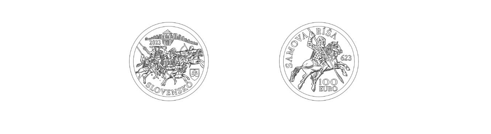

## 324

OZNÁMENIE

Národnej banky Slovenska

z 24. júla 2023

## o vydaní zlatých zberateľských euromincí v nominálnej hodnote 100 eur pri príležitosti 1 400. výročia vzniku Samovej ríše

1. Úvodné ustanovenia

- a) Národná banka Slovenska podľa § 17h ods. 1 zákona Národnej rady Slovenskej republiky č. 566/1992 Zb. o Národnej banke Slovenska v znení neskorších predpisov a podľa § 12 ods. 1 písm. b) zákona č. 400/2015 Z. z. o tvorbe právnych predpisov a o Zbierke zákonov Slovenskej republiky a o zmene a doplnení niektorých zákonov oznamuje, že pri príležitosti 1 400. výročia vzniku Samovej ríše vydáva do obehu zlaté zberateľské euromince v nominálnej hodnote 100 eur (ďalej len „zberateľská eurominca“).

- b) Zberateľská eurominca má štatút zákonného platidla len v Slovenskej republike.

- c) Zberateľská eurominca sa razí zo zliatiny obsahujúcej 900 dielov zlata, 75 dielov striebra a 25 dielov medi; jej hmotnosť je 9,5 g a priemer 26 mm. Pri razbe euromince je povolená horná a dolná odchýlka v priemere 0,1 mm; povolená horná odchýlka v hmotnosti je 0,08 g a v obsahu zlata 10/1 000.

2. Vzhľad zberateľskej euromince

- a) Na líci zberateľskej euromince je v kompozícii zobrazený dobový súboj stredovekých jazdcov na koňoch. Nad nimi je náznak fragmentu drevených palisád prerušených strážnou vežou, pod ktorým je letopočet 2023. Kompozíciu dopĺňa štátny znak Slovenskej republiky v pravej spodnej časti mincového poľa. Značka Mincovne Kremnica, štátny podnik, ktorú tvorí skratka „MK“ umiestnená medzi dvoma razidlami a štylizované iniciálky autora zberateľskej euromince Karola Lička „KL“ sú v spodnej časti kompozície. Názov štátu „SLOVENSKO“ je v opise v spodnej časti mincového poľa.

- b) Na rube zberateľskej euromince je fiktívne zobrazenie Sama cválajúceho na koni držiac v ruke kopiju. Vpravo od neho je letopočet 623 a pod ním v dvoch riadkoch nominálna hodnota „100 EURO“. V hornej časti mincového poľa je v opise nápis „SAMOVA RÍŠA“.

- c) Hrana zberateľskej euromince je vrúbkovaná.

- 

Štát vydania: Slovenská republika

Začiatok vydávania: november 2023

v z. Dušan Jurčák v. r.
