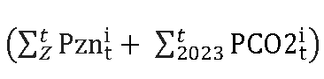
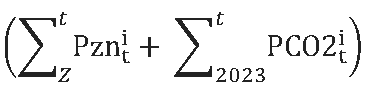
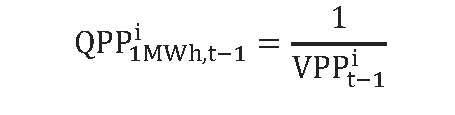
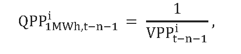
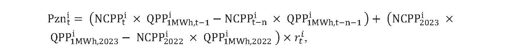
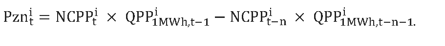

# § 7 Určenie korekcie zohľadňujúcej vývoj ceny primárneho paliva a emisných kvót

(1) Cena elektriny podľa § 6 ods. 1 písm. a) zákona o podpore na rok t v eurách na jednotku množstva elektriny za elektrinu vyrobenú i-tou technológiou j-tého zariadenia výrobcu elektriny CEPSDit,j sa pre výrobcu elektriny vypočíta podľa vzorca

pričom ak

 je menej ako nula, potom CEPSDit,j = CEPSDiz,j, to neplatí pre zariadenia výrobcov elektriny uvedené do prevádzky od 1. marca 2013,

kde

- a) CEPSDiz,j je určená alebo schválená cena elektriny podľa § 6 ods. 1 písm. a) zákona o podpore na rok Z vyrobenej i-tou technológiou j-tého zariadenia výrobcu elektriny na základe roku uvedenia zariadenia výrobcu elektriny do prevádzky alebo poslednej uplatnenej rekonštrukcie alebo modernizácie technologickej časti zariadenia na výrobu elektriny v eurách na jednotku množstva elektriny,

- b) Pznit je korekcia v eurách na jednotku množstva elektriny na rok t uplatňovaná podľa odseku 4 a na základe výpočtu podľa odseku 3,

- c) rok Z je rok uvedenia zariadenia výrobcu elektriny do prevádzky alebo rok poslednej uplatnenej rekonštrukcie alebo modernizácie technologickej časti zariadenia na výrobu elektriny,

- d) PCO2i2024 je korekcia na emisné kvóty v eurách na jednotku množstva elektriny na rok 2024 pre výrobcov, ktorí sú účastníkom systému obchodovania s emisnými kvótami skleníkových plynov a vykonávajú činnosť podľa osobitného predpisu,25) vypočíta sa podľa odseku 7,

- e) PCO2it je korekcia na emisné kvóty v eurách na jednotku množstva elektriny na rok t pre výrobcov, ktorí sú účastníkom systému obchodovania s emisnými kvótami skleníkových plynov a vykonávajú činnosť podľa osobitného predpisu,25) vypočíta sa podľa odseku 8.

(2) Cena elektriny podľa § 6 ods. 1 písm. d) zákona o podpore na rok t v eurách na jednotku množstva elektriny za elektrinu vyrobenú i-tou technológiou j-tého zariadenia výrobcu elektriny CEPSPit,j sa pre výrobcu elektriny vypočíta podľa vzorca

pričom ak

 je menej ako nula, potom CEPSPit,j = CEPSPiz,j,

kde

- a) CEPSPiz,j je cena elektriny pre stanovenie príplatku na rok Z vyrobenej i-tou technológiou j-tého zariadenia výrobcu elektriny na základe roku uvedenia zariadenia výrobcu elektriny do prevádzky alebo poslednej uplatnenej rekonštrukcie alebo modernizácie technologickej časti zariadenia na výrobu elektriny v eurách na jednotku množstva elektriny,

- b) Pznit je korekcia v eurách na jednotku množstva elektriny na rok t uplatňovaná v hodnote podľa odseku 4; Pznit sa vypočíta podľa odseku 3,

- c) rok Z je rok uvedenia zariadenia výrobcu elektriny do prevádzky alebo rok poslednej uplatnenej rekonštrukcie alebo modernizácie technologickej časti zariadenia na výrobu elektriny,

- d) PCO2i2024 je korekcia na emisné kvóty v eurách na jednotku množstva elektriny na rok 2024 pre výrobcov, ktorí sú účastníkom systému obchodovania s emisnými kvótami skleníkových plynov a vykonávajú činnosť podľa osobitného predpisu,25) vypočíta sa podľa odseku 7,

- e) PCO2it je korekcia na emisné kvóty v eurách na jednotku množstva elektriny na rok t pre výrobcov, ktorí sú účastníkom systému obchodovania s emisnými kvótami skleníkových plynov a vykonávajú činnosť podľa osobitného predpisu,25) vypočíta sa podľa odseku 8.

(3) Korekcia Pznit v eurách na jednotku množstva elektriny na rok t pre i-té technológie výroby elektriny s primárnymi palivami podľa odseku 5 zohľadňujúca výrazné zvýšenie alebo zníženie ceny vstupných surovín, ktoré sa použili na výrobu elektriny i-tou technológiou na výrobu elektriny z obnoviteľných zdrojov energie alebo výrazné zvýšenie alebo zníženie ceny vstupných surovín, ktoré sa použili na výrobu elektriny z neobnoviteľných zdrojov energie i-tou technológiou na výrobu elektriny vysoko účinnou kombinovanou výrobou, sa vypočíta podľa vzorca

- a) pre rok t = 2024

- 

- kde

  - 1. NCPPit je určená nákupná cena primárneho paliva pre i-tú technológiu výroby elektriny v eurách na jednotku množstva v roku t; primerane sa zohľadní využiteľnosť primárneho paliva použiteľného pri výrobe elektriny v i-tej technológii,

  - 2. QPPi1MWh,t–1 je množstvo primárneho paliva v jednotkách množstva zodpovedajúceho 1 MWh i-tej technológie výroby elektriny v roku t-1, ktoré sa vypočíta podľa vzorca

  - 

  - 3. VPPit–1 je určená výhrevnosť primárneho paliva pre i-tú technológiu výroby elektriny v megawatthodinách na jednotku množstva v roku t-1,

  - 4. NCPPit–n–1 je určená nákupná cena primárneho paliva pre i-tú technológiu výroby elektriny v eurách na jednotku množstva v roku t-n-1; primerane sa zohľadní využiteľnosť primárneho paliva použiteľného pri výrobe elektriny v i-tej technológii

  - 5. QPPi1MWh,t–n–1 je množstvo primárneho paliva v jednotkách množstva zodpovedajúceho 1 MWh i-tej technológie výroby elektriny v roku t-n-1, ktoré sa vypočíta podľa vzorca

  - 

  - 6. VPPit–n–1 je určená výhrevnosť primárneho paliva pre i-tú technológiu výroby elektriny v megawatthodinách na jednotku množstva v roku t-n-1,

  - 7. NCPPi2023 je určená nákupná cena primárneho paliva pre i-tú technológiu výroby elektriny v eurách na jednotku množstva v roku t = 2023; primerane sa zohľadní využiteľnosť primárneho paliva použiteľného pri výrobe elektriny v i-tej technológii,

  - 8. QPPi1MWh,2023 je množstvo primárneho paliva v jednotkách množstva zodpovedajúceho 1 MWh i-tej technológie výroby elektriny v roku t = 2023, ktoré sa vypočíta podľa vzorca

  - 

  - Q

  - P

  - P

  - 1

  - M

  - W

  - h

  - ,

  - 2023

  - i

  - =

  - 1

  - V

  - P

  - P

  - 2023

  - i

  - ,

  - 9. VPPi2023 je určená výhrevnosť primárneho paliva pre i-tú technológiu výroby elektriny v megawatthodinách na jednotku množstva v roku 2023,

  - 10. NCPPi2022 je určená nákupná cena primárneho paliva pre i-tú technológiu výroby elektriny v eurách na jednotku množstva v roku t = 2022; primerane sa zohľadní využiteľnosť primárneho paliva použiteľného pri výrobe elektriny v i-tej technológii,

  - 11. QPPi1MWh,2022 je množstvo primárneho paliva v jednotkách množstva zodpovedajúceho 1 MWh i-tej technológie výroby elektriny v roku t = 2022, ktoré sa vypočíta podľa vzorca

  - 

  - Q

  - P

  - P

  - 1

  - M

  - W

  - h

  - ,

  - 2022

  - i

  - =

  - 1

  - V

  - P

  - P

  - 2022

  - i

  - 12. VPPi2022 je určená výhrevnosť primárneho paliva pre i-tú technológiu výroby elektriny v megawatthodinách na jednotku množstva v roku 2022

  - 13. n je počet rokov medzi rokom t a rokom, na ktorý bola naposledy uplatnená korekcia Pznit,

  - 14. rit je koeficient, ktorý zohľadňuje rozloženie hodnoty nákladov na primárne palivo i-tej technológie od poslednej uplatnenej korekcie, ktorý sa uplatní počas obdobia rokov 2024 až 2026,

- b) pre roky t = 2025 a t = 2026

- 

- kde

  - 1. NCPPit–n je určená nákupná cena primárneho paliva pre i-tú technológiu výroby elektriny v eurách na jednotku množstva v roku t-n; primerane sa zohľadní využiteľnosť primárneho paliva použiteľného pri výrobe elektriny v i-tej technológii,

- c) pre rok t = 2027

- 

- d) pre ďalšie roky

- 

(4) Korekcia Pznit vypočítaná podľa odseku 3 sa uplatní na rok t, ak je hodnota zmeny väčšia ako 8 % zo súčinu nákupnej ceny NCPPit–n a množstva primárneho paliva QPPi1MWh,t–n–1 určených podľa odseku 3.

(5) Hodnota korekcie Pznit v eurách na jednotku množstva elektriny vypočítaná podľa odseku 3 písm. a) je uvedená v prílohe č. 2. Hodnota korekcie Pznit v eurách na jednotku množstva elektriny vypočítaná podľa odseku 3 písm. b), c) a d) pre i-té technológie výroby elektriny sa zverejňuje každoročne na webovom sídle úradu najneskôr do 31. júla roku

t-1.

(6) Ak má výrobca elektriny na rok t-1 určenú alebo schválenú cenu elektriny CEPSDiz,j a zároveň si uplatňuje na rok t cenu elektriny podľa § 6 ods. 1 písm. a) zákona o podpore na základe rekonštrukcie alebo modernizácie technologickej časti zariadenia na výrobu elektriny, táto cena elektriny sa na rok t určí podľa § 6 ods. 11.

(7) Korekcia na emisné kvóty v eurách na jednotku množstva elektriny na rok t = 2024 sa vypočíta ako pomerné náklady vynaložené na výrobu elektrickej energie kombinovanou výrobou podľa vzorca

CO22024 = NCP2024 × EF2021 × k,

kde

- a) NCP2024 je cena povoleniek v eurách na tonu CO2 určená ako aritmetický priemer denných uzatváracích cien (settlement price) oficiálneho kurzového lístka zverejneného burzou EEX (European Energy Exchange) na jej webovom sídle za produkt EUAA FUTURES DEC/24 v eurách na tonu CO2 za obdobie od 1. januára roku 2023 do 30. júna roku 2023,

- b) EF2021 je priemerný emisný faktor na rok 2021 v tonách CO2 na jednotku množstva elektriny pre palivá spaľované v zariadeniach, zohľadňujúci priemerné hodnoty emisných faktorov a výhrevnosti vybraných palív za Slovenskú republiku použitých pri energetickej bilancii emisií skleníkových plynov určené metodikou zhora nadol, ktorý je zverejnený na webovom sídle Ministerstva životného prostredia Slovenskej republiky,

- c) k je koeficient pomernej časti výroby elektriny na celkovej vyrobenej energii v zariadení výrobcu elektriny, ktorý je pre regulačné obdobie ustanovený vo výške 0,366.

(8) Medziročné zvýšenie alebo zníženie korekcie na emisné kvóty na rok t = 2025 a nasledujúce roky sa vypočíta podľa vzorca

PCO2t = NCPt × EFt–3 × k – NCPt–1 × EFt–4 × k,

kde

- a) NCPt je cena povoleniek v eurách na tonu CO2 na rok t určená ako aritmetický priemer denných uzatváracích cien (settlement price) oficiálneho kurzového lístka zverejneného burzou EEX (European Energy Exchange) na jej webovom sídle za produkt EEX EUA FUTURES DECt v eurách na tonu CO2 za obdobie od 1. januára roku t-1 do 30. júna roku t-1,

- b) EFt–3 je priemerný emisný faktor na rok t-3 v tonách CO2 na jednotku množstva energie pre palivá spaľované v zariadeniach, zohľadňujúci priemerné hodnoty emisných faktorov a výhrevnosti vybraných palív za Slovenskú republiku použitých pri energetickej bilancii emisií skleníkových plynov určené metodikou zhora nadol, ktorý je zverejnený na webovom sídle Ministerstva životného prostredia Slovenskej republiky,

- c) NCPt–1 je cena povoleniek v eurách na tonu CO2 na rok t-1 určená ako aritmetický priemer denných uzatváracích cien (settlement price) oficiálneho kurzového lístka zverejneného burzou EEX (European Energy Exchange) na jej webovom sídle za produkt EEX EUA FUTURES DECt-1 v eurách na tonu CO2 za obdobie od 1. januára roku t-2 do 30. júna roku t-2,

- d) EFt–4 je priemerný emisný faktor na obdobie t-4 v tonách CO2 na jednotku množstva energie pre palivá spaľované v zariadeniach, zohľadňujúci priemerné hodnoty emisných faktorov a výhrevnosti vybraných palív za Slovenskú republiku použitých pri energetickej bilancii emisií skleníkových plynov určené metodikou zhora nadol, ktorý je zverejnený na webovom sídle Ministerstva životného prostredia Slovenskej republiky,

- e) k je koeficient pomernej časti výroby elektriny na celkovej vyrobenej energii v zariadení výrobcu elektriny, ktorý je pre regulačné obdobie ustanovený vo výške 0,366.

(9) Hodnota medziročného zvýšenia alebo zníženia korekcie na emisné kvóty PCO2t sa uplatní na rok t, ak je hodnota zmeny od poslednej uplatnenej korekcie väčšia ako 8 % zo súčinu ceny povoleniek NCPt-1, emisného faktora EFt-4 a koeficientu k, určených podľa odseku 8.

(10) Hodnota korekcie na emisné kvóty v eurách na jednotku množstva elektriny na rok t = 2024 sa zverejní na webovom sídle úradu najneskôr 1. októbra roku 2023. Hodnota medziročného zvýšenia alebo zníženia korekcie na emisné kvóty PCO2t v eurách na jednotku množstva elektriny sa na rok t zverejňuje na webovom sídle úradu najneskôr do 31. júla roku t-1 .

(11) Výrobcovi elektriny, ktorému uplynie doba podpory doplatkom podľa § 3 ods. 1 písm. c) zákona o podpore pred rokom 2027, sa korekcia Pznit vypočíta v konaní o cenovej regulácii primerane podľa § 7 ods. 3 tak, aby zohľadňovala zostávajúcu dobu trvania podpory a jej vplyv na určenie korekcie Pznit.
