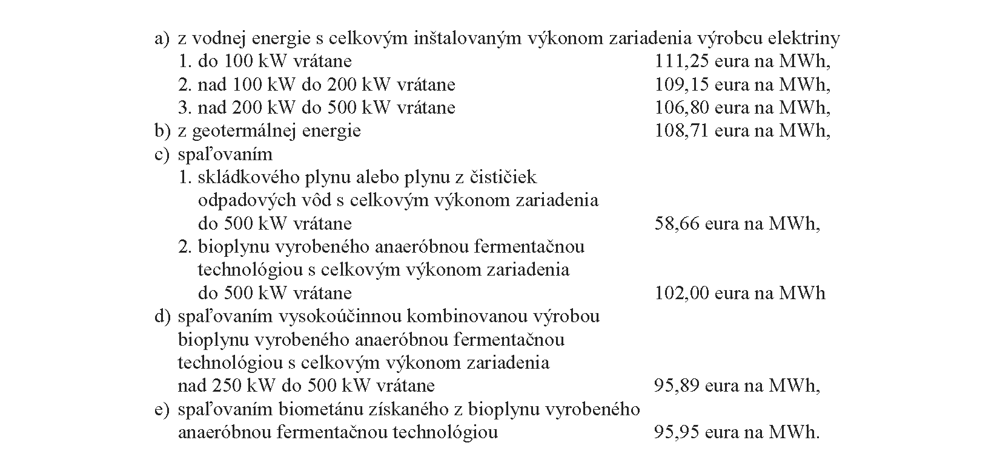
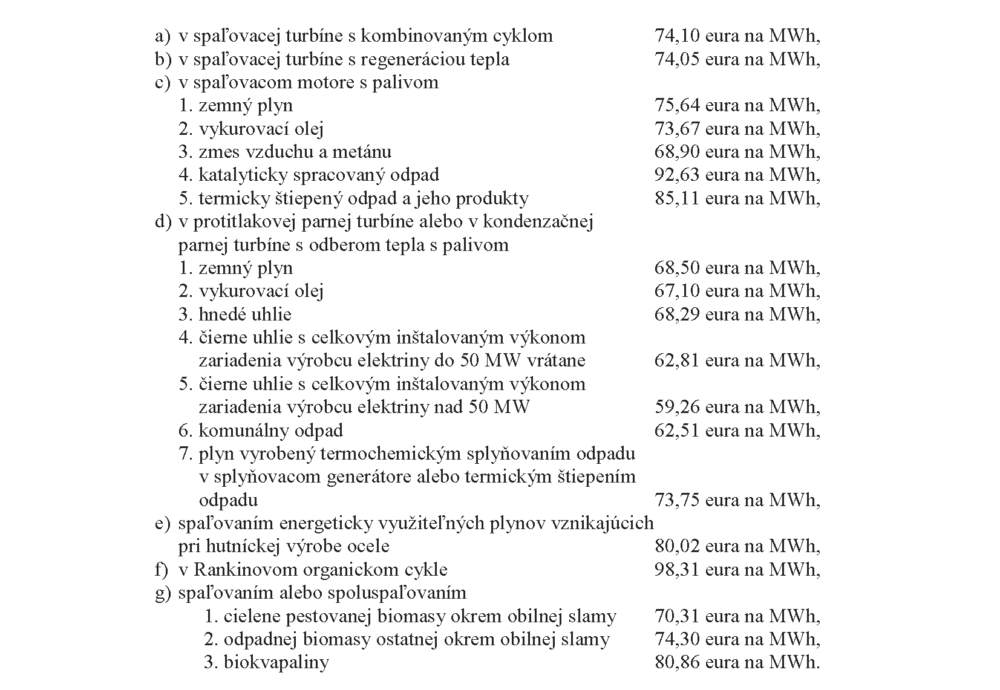
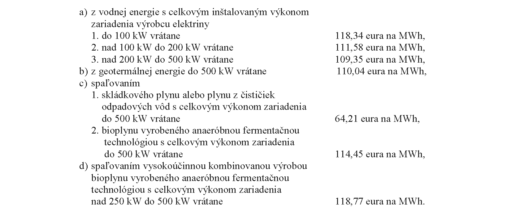
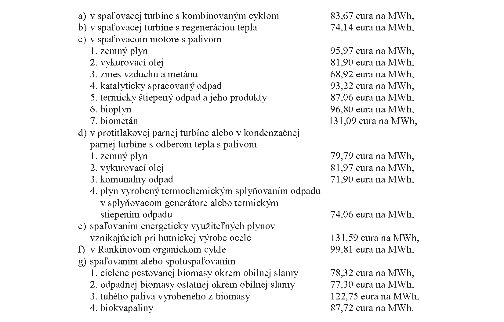

# § 10

(1) Cena elektriny vyrobenej z obnoviteľných zdrojov energie v zariadení výrobcu elektriny uvedenom do prevádzky v období od 1. januára 2020 do 30. septembra 2023 sa určuje priamym určením ceny elektriny v eurách na jednotku množstva elektriny takto:

(2) Cena elektriny vyrobenej vysoko účinnou kombinovanou výrobou v zariadení výrobcu elektriny s celkovým inštalovaným výkonom do 1 MW vrátane uvedenom do prevádzky v období od 1. januára 2020 do 30. septembra 2023 alebo v zariadení výrobcu elektriny, ktoré prešlo rekonštrukciou alebo modernizáciou technologickej časti zariadenia výrobcu elektriny podľa § 3c zákona o podpore, sa určuje priamym určením ceny elektriny v eurách na jednotku množstva elektriny takto:

(3) Cena elektriny vyrobenej z obnoviteľných zdrojov energie v zariadení výrobcu elektriny uvedenom do prevádzky v období od 1. októbra 2023 sa určuje priamym určením ceny elektriny v eurách na jednotku množstva elektriny takto:

(4) Cena elektriny vyrobenej vysoko účinnou kombinovanou výrobou v zariadení výrobcu elektriny s celkovým inštalovaným výkonom do 1 MW vrátane uvedenom do prevádzky v období od 1. októbra 2023 alebo v zariadení výrobcu elektriny, ktoré prešlo rekonštrukciou alebo modernizáciou technologickej časti zariadenia výrobcu elektriny podľa § 3c zákona o podpore, sa určuje priamym určením ceny elektriny v eurách na jednotku množstva elektriny takto:

(5) Cena elektriny vyrobenej vysoko účinnou kombinovanou výrobou spaľovaním biometánu v zariadení výrobcu elektriny s celkovým inštalovaným výkonom do 125 MW vrátane je vo výške 128,78 eura na MWh, pričom sa nezohľadňuje čas uvedenia zariadenia výrobcu elektriny do prevádzky.

(6) Cena elektriny podľa odseku 1 písm. c) až e) a odseku 3 písm. c) a d) sa uplatní len pre jedného výrobcu elektriny a pre jedno zariadenie výrobcu elektriny, ktoré obsahuje všetky technologické časti zariadenia výrobcu elektriny, ktorými sa vykonáva celý proces premeny energie obsiahnutej v biomase na elektrinu; to neplatí pre výrobu elektriny zo spaľovania biometánu podľa odseku 5, ak je biometán distribuovaný distribučnou sieťou a množstvo biometánu na výrobu elektriny zodpovedá zmluvnému množstvu biometánu dohodnutému podľa § 10 ods. 2 písm. b) zákona o podpore.

(7) Pri technológii podľa odseku 2 písm. c) štvrtého bodu a piateho bodu, technológii podľa odseku 2 písm. d) siedmeho bodu, technológii podľa odseku 2 písm. e), technológii podľa odseku 4 písm. c) štvrtého bodu a piateho bodu, technológii podľa odseku 4 písm. d) štvrtého bodu a technológii podľa odseku 4 písm. e) sa spolu so žiadosťou výrobcu elektriny o vydanie potvrdenia o pôvode elektriny vyrobenej vysoko účinnou kombinovanou výrobou predkladá aj potvrdenie o pôvode paliva, v ktorom sa uvedie názov výrobcu paliva, chemické zloženie paliva a jeho výhrevnosť, ktoré je preskúšané v akreditovanom laboratóriu podľa osobitného predpisu.26)

(8) Cena elektriny podľa odseku 2 písm. f) a odseku 4 písm. f) sa uplatní, ak je elektrina vyrábaná výhradne v tomto zariadení výrobcu elektriny a zároveň zariadenie výrobcu elektriny obsahuje všetky technologické časti zariadenia výrobcu elektriny, ktorými sa vykonáva celý proces premeny energie obsiahnutej v primárnom palive na elektrinu.

(9) Cena elektriny podľa odsekov 3 a 4 sa pre zariadenie výrobcu elektriny upravuje podľa roku uvedenia zariadenia výrobcu elektriny do prevádzky korekciou Pznit podľa § 7 ods. 3 až 5, ktorá zohľadňuje výrazné zvýšenie alebo zníženie ceny vstupných surovín použitých na výrobu elektriny, okrem prvého roku regulačného obdobia.
