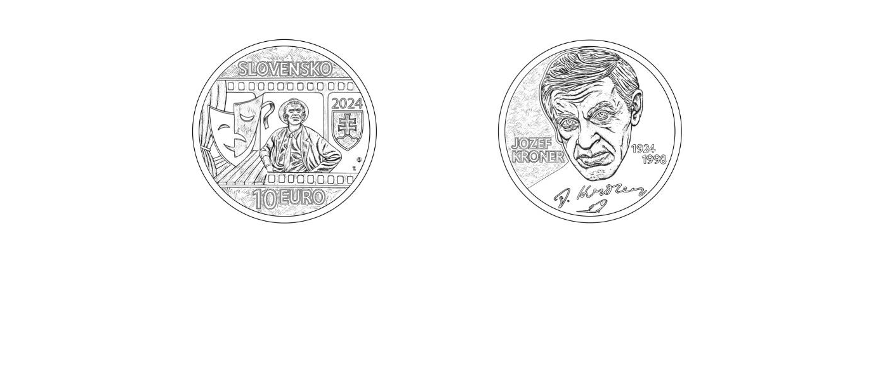

## 514

OZNÁMENIE

Národnej banky Slovenska

z 5. decembra 2023

## o vydaní strieborných zberateľských euromincí v nominálnej hodnote 10 eur pri príležitosti 100. výročia narodenia Jozefa Kronera

1. Úvodné ustanovenia

- a) Národná banka Slovenska podľa § 17h ods. 1 zákona Národnej rady Slovenskej republiky č. 566/1992 Zb. o Národnej banke Slovenska v znení neskorších predpisov a podľa § 12 ods. 1 písm. b) zákona č. 400/2015 Z. z. o tvorbe právnych predpisov a o Zbierke zákonov Slovenskej republiky a o zmene a doplnení niektorých zákonov v znení neskorších predpisov oznamuje, že vydáva do obehu strieborné zberateľské euromince v nominálnej hodnote 10 eur pri príležitosti 100. výročia narodenia Jozefa Kronera (ďalej len „zberateľská eurominca“).

- b) Zberateľská eurominca má štatút zákonného platidla len v Slovenskej republike.

- c) Zberateľská eurominca sa razí zo zliatiny obsahujúcej 900 dielov striebra a 100 dielov medi; jej hmotnosť je 18 g a priemer 34 mm. Pri razbe zberateľskej euromince je povolená horná a dolná odchýlka v priemere 0,1 mm; povolená horná odchýlka v hmotnosti je 0,4 g a v obsahu striebra 10/1 000.

2. Vzhľad zberateľskej euromince

- a) Na líci zberateľskej euromince je filmový pás ako odkaz na filmovú a televíznu tvorbu Jozefa Kronera, s centrálne vloženou postavou Tóna Brtka, ktorého stvárnil vo filme Obchod na korze. V ľavom políčku filmového pásu je prostredníctvom divadelnej masky, opony a divadelných dosiek vyjadrený odkaz na divadlo, v ktorom Jozef Kroner strávil podstatnú časť svojho profesijného života. V pravom políčku filmového pásu je štátny znak Slovenskej republiky, nad ním letopočet „2024“ a v spodnej časti značka Mincovne Kremnica, štátny podnik, ktorú tvorí skratka „MK“ umiestnená medzi dvoma razidlami, a štylizované iniciálky autora zberateľskej euromince Tomáša Lamača, Dis. „TL“. Názov štátu „SLOVENSKO“ je v hornej časti mincového poľa a v jeho spodnej časti je nominálna hodnota „10 EURO“.

- b) Na rube zberateľskej euromince je portrét Jozefa Kronera, pod ktorým je faksimile jeho podpisu doplnené o kresbu ryby odkazujúcu na jeho záľubu v rybárstve. Vľavo od portrétu je v dvoch riadkoch meno a priezvisko „JOZEF KRONER“ a vpravo v dvoch riadkoch rok narodenia a rok úmrtia Jozefa Kronera „1924“ a „1998“.

- c) Na hrane zberateľskej euromince je nápis do hĺbky „• SLOVENSKÝ DIVADELNÝ A FILMOVÝ HEREC • SPISOVATEĽ“.

- 

Štát vydania: Slovenská republika

Začiatok vydávania: marec 2024

Peter Kažimír v. r.
