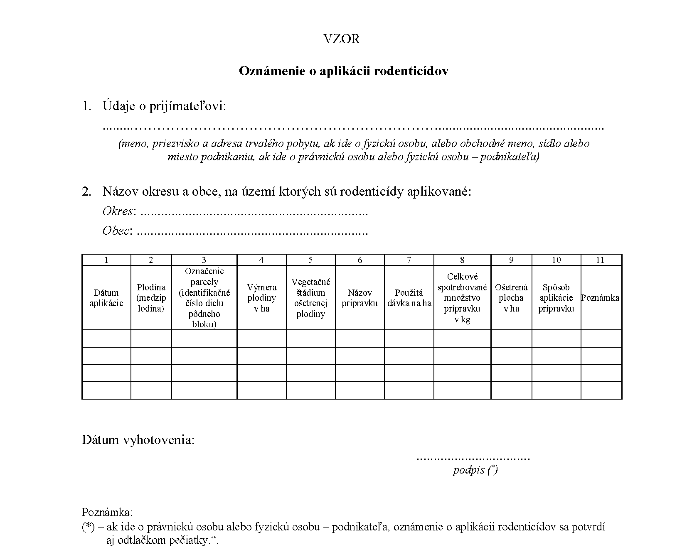

# Čl. I

Nariadenie vlády Slovenskej republiky č. 436/2022 Z. z., ktorým sa ustanovujú pravidlá poskytovania podpory v poľnohospodárstve formou priamych platieb v znení nariadenia vlády Slovenskej republiky č. 121/2023 Z. z. sa mení a dopĺňa takto:

- 1. V § 4 ods. 5 sa za slovo „agentúre“ vkladajú slová „(ďalej len „platobná agentúra“)“.

- 2. V § 5 ods. 1 písm. a) sa slová „miezd súvisiacich s poľnohospodárskou činnosťou za kalendárny rok predchádzajúci roku podania žiadosti podľa osobitného predpisu23)“ nahrádzajú slovami „mesačných miezd zamestnancov v odvetví poľnohospodárstva zverejnených Štatistickým úradom Slovenskej republiky za kalendárny rok predchádzajúci roku podania žiadosti“.

  - Poznámka pod čiarou k odkazu 23 sa vypúšťa.

- 3. V § 5 ods. 1 písm. b) sa slová „mzdy súvisiace s poľnohospodárskou činnosťou“ nahrádzajú slovami „mesačné mzdy zamestnancov v odvetví poľnohospodárstva zverejnené Štatistickým úradom Slovenskej republiky“.

- 4. V § 7 ods. 2 sa slová „150 ha“ nahrádzajú slovami „150,99 ha“.

- 5. V § 11 ods. 1 písm. c) sa za slová „50 ha“ vkladá bodkočiarka a slová „prípustná odchýlka z najväčšej výmery ornej pôdy nesmie presiahnuť 1,5 ha“.

- 6. V § 12 písm. c) prvý bod znie:

- „1.

- najviac 50 ha, ak druhý bod neustanovuje inak; prípustná odchýlka z najväčšej výmery ornej pôdy nesmie presiahnuť 1,5 ha,“.

- 7. V § 12 písm. c) druhom bode časť vety pred bodkočiarkou znie: „najviac 20 ha v časti chráneného územia, ktoré sa nachádza v chránenom vtáčom území alebo v území európskeho významu, pričom prípustná odchýlka z najväčšej výmery ornej pôdy nesmie presiahnuť 0,7 ha“.

- 8. V § 13 ods. 1 písmeno d) znie:

- „d)

- aplikovať slamu, ktorou sa rozumejú nadzemné pozberové zvyšky tráv alebo iných bylinných krmovín na ornej pôde pestované na osivo alebo nadzemné pozberové zvyšky plodín patriace do skupiny obilnín, olejnín alebo strukovín; zoznam plodín patriacich do skupiny obilnín, olejnín alebo strukovín je uvedený v prílohe č. 1a.“.

- 9. V § 13 ods. 5 sa na konci bodka nahrádza čiarkou a pripájajú sa tieto slová: „ak nepostupuje podľa osobitného predpisu.32a)“.

  - Poznámka pod čiarou k odkazu 32a znie:

  - „32a) Príloha č. 7 VI. časť bod 10.5.3 vyhlášky Ministerstva životného prostredia Slovenskej republiky č. 248/2023 Z. z. o požiadavkách na stacionárne zdroje znečisťovania ovzdušia.“.

- 10. Poznámka pod čiarou k odkazu 33 znie:

- „33) Príloha č. 2 časť A položka DPEP 8 písm. a) prvý bod a tretí bod nariadenia vlády Slovenskej republiky č. 435/2022 Z. z. v znení nariadenia vlády Slovenskej republiky č. 515/2023.“.

- 11. V § 14 ods. 3 sa na konci pripájajú tieto vety: „Ak Ústredný kontrolný a skúšobný ústav poľnohospodársky v Bratislave na základe rastlinolekárskej kontroly35a) vykonanej u prijímateľa na jeho žiadosť, zistí35b) silný výskyt hraboša poľného, prijímateľ môže aplikovať rodenticídy, ktoré sú autorizovanými alebo povolenými prípravkami na ochranu rastlín.35c) Ak ide o chránené územie, aplikácia rodenticídov podľa druhej vety sa môže vykonať len vkladaním do nôr, a to na základe súhlasného stanoviska organizácie ochrany prírody a krajiny;35d) tým nie sú dotknuté ustanovenia osobitného predpisu.35e) Prijímateľ oznámi aplikáciu rodenticídov Ústrednému kontrolnému a skúšobnému ústavu poľnohospodárskemu v Bratislave do troch pracovných dní odo dňa ich aplikácie. Vzor oznámenia o aplikácii rodenticídov je uvedený v prílohe č. 1b.“.

  - Poznámky pod čiarou k odkazom 35a až 35e znejú:

  - „35a) § 2 písm. b) a § 9 ods. 1 písm. c) zákona č. 405/2011 Z. z. o rastlinolekárskej starostlivosti a o zmene zákona Národnej rady Slovenskej republiky č. 145/1995 Z. z. o správnych poplatkoch v znení neskorších predpisov.

  - 35b) § 4 písm. e) zákona č. 405/2011 Z. z.

  - 35c) § 8 ods. 1 písm. c) zákona č. 405/2011 Z. z.

  - 35d) § 65a a 65b zákona č. 543/2002 Z. z. v znení neskorších predpisov.

  - 35e) Napríklad § 13 ods. 2 písm. h), § 14 ods. 2 písm. c), § 15 ods. 1 písm. d), § 26 ods. 5 a § 28 ods. 4 zákona č. 543/2002 Z. z. v znení neskorších predpisov.“.

- 12. V § 14 ods. 4 sa za prvú vetu vkladá nová druhá veta a tretia veta, ktoré znejú: „Pri výskyte inváznych nepôvodných druhov rastlín36a) alebo húževnatých burín36b) prijímateľ môže v období podľa prvej vety vykonať agrotechnické operácie. Prijímateľ oznámi platobnej agentúre vykonanie agrotechnickej operácie spolu s fotodokumentáciou preukazujúcou výskyt inváznych nepôvodných druhov rastlín alebo húževnatých burín a s údajom o ich geografickej polohe do siedmich pracovných dní odo dňa vykonania agrotechnickej operácie.“.

  - Poznámky pod čiarou k odkazom 36a a 36b znejú:

  - „36a) § 1 ods. 1 nariadenia vlády Slovenskej republiky č. 449/2019 Z. z., ktorým sa vydáva zoznam inváznych nepôvodných druhov vzbudzujúcich obavy Slovenskej republiky.

  - 36b) § 2 písm. j) nariadenia vlády Slovenskej republiky č. 435/2022 Z. z. v znení nariadenia vlády Slovenskej republiky č. 515/2023.“.

- 13. V § 15 ods. 2 písmeno f) znie:

- „f)

- biopás obhospodaruje spôsobom podľa osobitného predpisu37) a

- 1.

- môže ho kosiť najviac dvakrát ročne, pričom prvé kosenie biopásu môže vykonať najskôr od 23. júna a druhé kosenie biopásu najskôr dva mesiace po prvom kosení,

- 2.

- odstráni pokosenú hmotu po každom kosení do 14 dní,

- 3.

- pre biopás kosený od 23. júna do 31. júla sa použije váhový faktor 1 a pre biopás kosený po 31. júli váhový faktor 1,5,

- 4.

- pri udržiavaní biopásu kosením môže vykonať aj mulčovanie tak, že biopás obhospodaruje kosením ako hlavnou agrotechnickou operáciou a mulčovanie vykonáva len ako vedľajšiu činnosť pred vykonaním hlavnej agrotechnickej operácie alebo po vykonaní hlavnej agrotechnickej operácie,“.

  - Poznámka pod čiarou k odkazu 37 znie:

  - „37) § 3 ods. 2 nariadenia vlády Slovenskej republiky č. 435/2022 Z. z. v znení nariadenia vlády Slovenskej republiky č. 515/2023.“.

- 14. V § 15 ods. 2 písm. g) a § 17 ods. 3 písm. d) sa na konci bodka nahrádza bodkočiarkou a pripájajú sa tieto slová: „pri silnom výskyte hraboša poľného postupuje podľa § 14 ods. 3.“.

- 15. § 15 sa dopĺňa odsekmi 10 a 11, ktoré znejú:

- „(10)

- Prijímateľ môže biopás zrušiť po 1. septembri, ak pred jeho zrušením založí nový biopás podľa odseku 2 písm. a) až c) a e) až g) na tej istej súvislej ploche ornej pôdy podľa odseku 1. Prijímateľ oznámi platobnej agentúre zrušenie biopásu a založenie nového biopásu podľa prvej vety spolu s fotodokumentáciou preukazujúcou založenie nového biopásu a s údajom o jeho geografickej polohe do siedmich pracovných dní od zrušenia biopásu.

- (11)

- Pri výskyte inváznych nepôvodných druhov rastlín alebo húževnatých burín na ploche biopásu prijímateľ môže v období podľa odseku 2 písm. f) postupovať podľa § 14 ods. 4.“.

- 16. V § 16 ods. 3 sa nad slovom „predpisu“ odkaz 37 nahrádza odkazom 38aa.

  - Poznámka pod čiarou k odkazu 38aa znie:

  - „38aa) § 3 ods. 5 nariadenia vlády Slovenskej republiky č. 435/2022 Z. z. v znení nariadenia vlády Slovenskej republiky č. 515/2023.“.

- 17. § 17 sa dopĺňa odsekom 5, ktorý znie:

- „(5)

- Pri výskyte inváznych nepôvodných druhov rastlín alebo húževnatých burín na ploche vysiatej zmesami pre opeľovače prijímateľ môže v období podľa odseku 3 písm. c) postupovať podľa § 14 ods. 4.“.

- 18. V § 21 sa nad slovom „rastlín“ vypúšťa odkaz 41 vrátane poznámky pod čiarou k odkazu 41.

- 19. V § 22 ods. 6 prvej vete sa za slovo „poskytne“ vkladajú slová „pre chov vybranej kategórie zvierat podľa odseku 5 písm. a) alebo písm. c)“.

- 20. § 22 sa dopĺňa odsekom 7, ktorý znie:

- „(7)

- Podpora pastevného chovu sa poskytne pre chov vybranej kategórie zvierat podľa odseku 5 písm. b) na počet zvierat evidovaných v registri v období podľa odseku 1, ktorých držiteľom je prijímateľ, a ktoré sú uvedené v žiadosti, po prepočte na dobytčie jednotky. Prepočet počtu zvierat na dobytčie jednotky sa vykoná prostredníctvom koeficientov podľa prílohy č. 5 a zaokrúhľuje sa na dve desatinné miesta nadol. Prijímateľ môže v období podľa odseku 1 nahradiť zviera vybranej kategórie iným zvieraťom tej istej vybranej kategórie najneskôr v deň premiestnenia mimo chovu. Pri dočasnom premiestnení zvieraťa v trvaní najviac 14 dní do iného chovu na účel výstavy alebo súťaže, prijímateľ zviera nenahrádza.“.

- 21. V § 24 ods. 1 úvodnej vete a § 25 ods. 1 úvodnej vete sa slovo „v“ nahrádza slovami „k 31. máju“.

- 22. V § 24 ods. 4 sa slovo „dojníc“ nahrádza slovami „zvierat podľa odseku 2“.

- 23. V § 25 ods. 5 sa slová „oprávnených zvierat“ nahrádzajú slovami „zvierat podľa odseku 3“.

- 24. Za prílohu č. 1 sa vkladajú prílohy č. 1a a 1b, ktoré vrátane nadpisov znejú:

- „Príloha č. 1a

- k nariadeniu vlády č. 436/2022 Z. z.

- Zoznam plodín patriacich do skupiny obilnín, olejnín alebo strukovín

- Skupina obilnín | Skupina olejnín | Skupina strukovín

- Pšenica letná | Sója fazuľová | Hrach siaty

- Pšenica tvrdá | Kapusta repková pravá | Bôb obyčajný

- Pšenica špaldová | Slnečnica ročná | Vika siata

- Raž siata | Mak siaty | Šošovica jedlá

- Tritikale | Horčica biela | Fazuľa záhradná (obyčajná)

- Jačmeň siaty | Repica olejnatá | Fazuľa ostrolistá

- Ovos siaty | Ľan siaty olejný | Fazuľa šarlátová

- Kukurica siata* | | Fazuľa mesiacovitá

- Pohánka jedlá | | Cícer baraní

- Proso siate | | Lupina biela

- Lesknica kanárska | | Lupina žltá

- Cirok dvojfarebný* | | Lupina úzkolistá

- Cirok sudánsky* | |

- Poznámka:

- *

- - do skupiny obilnín na účely zlepšenia štruktúry ornej pôdy podľa § 13 ods. 1 písm. d) patrí kukurica siata pestovaná na zrno, kukurica siata pestovaná na účely výroby siláže pri ponechaní výšky strniska najmenej 40 cm, cirok dvojfarebný pestovaný na zrno, cirok dvojfarebný pestovaný na účely výroby siláže pri ponechaní výšky strniska najmenej 40 cm, cirok sudánsky pestovaný na zrno alebo cirok sudánsky pestovaný na účely výroby siláže pri ponechaní výšky strniska najmenej 40 cm.

- Príloha č. 1b

- k nariadeniu vlády č. 436/2022 Z. z.“.

- 

- 25. V prílohe č. 6 sa za slovo „sója“ vkladá slovo „fazuľová“ a v tabuľke stĺpci „Druh bielkovinovej plodiny“ sa za slovo „šošovica“ vkladá slovo „jedlá“.
