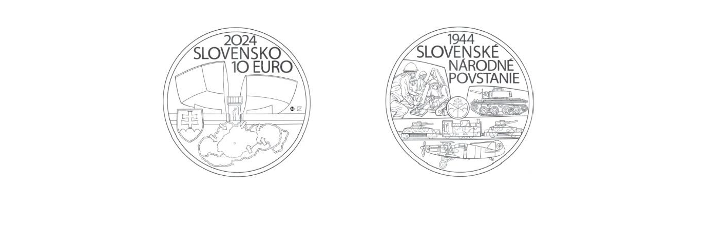

## 174

OZNÁMENIE

Národnej banky Slovenska

z 25. júna 2024

## o vydaní strieborných zberateľských euromincí v nominálnej hodnote 10 eur pri príležitosti 80. výročia Slovenského národného povstania

1. Úvodné ustanovenia

- a) Národná banka Slovenska podľa § 17h ods. 1 zákona Národnej rady Slovenskej republiky č. 566/1992 Zb. o Národnej banke Slovenska v znení neskorších predpisov a podľa § 12 ods. 1 písm. b) zákona č. 400/2015 Z. z. o tvorbe právnych predpisov a o Zbierke zákonov Slovenskej republiky a o zmene a doplnení niektorých zákonov v znení neskorších predpisov oznamuje, že vydáva do obehu strieborné zberateľské euromince v nominálnej hodnote 10 eur pri príležitosti 80. výročia Slovenského národného povstania (ďalej len „zberateľská eurominca“).

- b) Zberateľská eurominca má štatút zákonného platidla len v Slovenskej republike.

- c) Zberateľská eurominca sa razí zo zliatiny obsahujúcej 900 dielov striebra a 100 dielov medi; jej hmotnosť je 18 g a priemer 34 mm. Pri razbe zberateľskej euromince je povolená horná a dolná odchýlka v priemere 0,1 mm; povolená horná odchýlka v hmotnosti je 0,4 g a v obsahu striebra 10/1 000.

2. Vzhľad zberateľskej euromince

- a) Na líci zberateľskej euromince je budova Múzea Slovenského národného povstania v Banskej Bystrici. Kompozíciu v spodnej časti mincového poľa dopĺňa historická mapa Slovenskej republiky, v ktorej je vyznačené povstalecké územie s bodovým označením Banskej Bystrice ako srdca povstania a šípkami označujúcimi smer vojenských útokov na potlačenie povstania. Štátny znak Slovenskej republiky je v ľavej časti mincového poľa. V hornej časti mincového poľa je letopočet „2024“, pod ktorým sú v dvoch riadkoch názov štátu „SLOVENSKO“ a nominálna hodnota „10 EURO“. Vpravo od budovy Múzea Slovenského národného povstania je značka Mincovne Kremnica, štátny podnik, ktorú tvorí skratka „MK“ umiestnená medzi dvoma razidlami a štylizované iniciálky autora zberateľskej euromince ak. soch. Zbyňka Fojtů „ZF“.

- b) Na rube zberateľskej euromince je v strede umiestnený znak povstaleckého letectva, ktorý na pravej strane dopĺňa tank a na ľavej strane skupinový výjav mínometníkov v bojovej akcii. V spodnej časti mincového poľa je povstalecké lietadlo a nad ním fragment povstaleckého pancierového vlaku. V hornej časti mincového poľa je letopočet „1944“ a pod ním v troch riadkoch text „SLOVENSKÉ NÁRODNÉ POVSTANIE“.

- c) Na hrane zberateľskej euromince je nápis do hĺbky „• JÁN GOLIAN • ZAČNITE S VYSŤAHOVANÍM! • 29. 8. 1944“.

- 

Štát vydania: Slovenská republika

Začiatok vydávania: august 2024

v z. Vladimír Dvořáček v. r.
