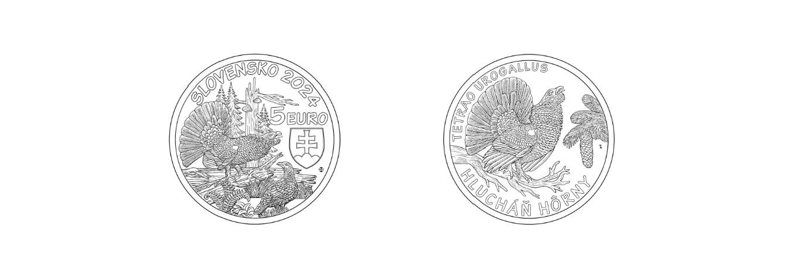

## 225

OZNÁMENIE

Národnej banky Slovenska

z 22. augusta 2024

## o vydaní zberateľských euromincí z obyčajných kovov v nominálnej hodnote 5 eur s tematikou Fauna a flóra na Slovensku – hlucháň hôrny

1. Úvodné ustanovenia

- a) Národná banka Slovenska podľa § 17h ods. 1 zákona Národnej rady Slovenskej republiky č. 566/1992 Zb. o Národnej banke Slovenska v znení neskorších predpisov a podľa § 12 ods. 1 písm. b) zákona č. 400/2015 Z. z. o tvorbe právnych predpisov a o Zbierke zákonov Slovenskej republiky a o zmene a doplnení niektorých zákonov v znení neskorších predpisov oznamuje, že vydáva do obehu zberateľské euromince z obyčajných kovov v nominálnej hodnote 5 eur s tematikou Fauna a flóra na Slovensku – hlucháň hôrny (ďalej len „zberateľská eurominca“).

- b) Zberateľská eurominca má štatút zákonného platidla len v Slovenskej republike.

- c) Zberateľská eurominca sa razí z mosadze MS63 (Cu63Zn37); jej hmotnosť je 19,1 g a priemer 34 mm. Pri razbe zberateľskej euromince je povolená horná a dolná odchýlka v priemere 0,1 mm; povolená horná odchýlka v hmotnosti je 0,76 g.

2. Vzhľad zberateľskej euromince

- a) Na líci zberateľskej euromince je v kompozícii samec hlucháňa hôrneho spolu so samicou

- na vresovisku. Kompozíciu dotvárajú polámané kmene stromov a ihličnany v pozadí. Vpravo od kompozície je štátny znak Slovenskej republiky, nad ktorým je nominálna hodnota „5 EURO“. V hornej časti mincového poľa je v opise názov štátu „SLOVENSKO“ a letopočet „2024“. Značka Mincovne Kremnica, štátny podnik, ktorú tvorí skratka „MK“ umiestnená medzi dvoma razidlami, je vpravo od štátneho znaku Slovenskej republiky.

- b) Na rube zberateľskej euromince je tokajúci samec hlucháňa hôrneho na konári. V spodnej časti mincového poľa je v opise slovenský názov „HLUCHÁŇ HÔRNY“ a v hornej časti mincového poľa je v opise latinský názov „TETRAO UROGALLUS“. Vpravo od hlucháňa je vetva so šiškou doplnená o štylizované iniciálky autora zberateľskej euromince Tomáša Lamača, Dis. „TL“.

- c) Hrana zberateľskej euromince je vrúbkovaná.

- 

- Štát vydania: Slovenská republika

- Začiatok vydávania: október 2024

Peter Kažimír v. r.
