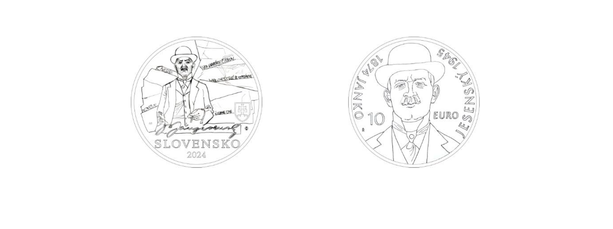

## 227

OZNÁMENIE

Národnej banky Slovenska

z 22. augusta 2024

## o vydaní strieborných zberateľských euromincí v nominálnej hodnote 10 eur pri príležitosti 150. výročia narodenia Janka Jesenského

1. Úvodné ustanovenia

- a) Národná banka Slovenska podľa § 17h ods. 1 zákona Národnej rady Slovenskej republiky č. 566/1992 Zb. o Národnej banke Slovenska v znení neskorších predpisov a podľa § 12 ods. 1 písm. b) zákona č. 400/2015 Z. z. o tvorbe právnych predpisov a o Zbierke zákonov Slovenskej republiky a o zmene a doplnení niektorých zákonov v znení neskorších predpisov oznamuje, že vydáva do obehu strieborné zberateľské euromince v nominálnej hodnote 10 eur pri príležitosti 150. výročia narodenia Janka Jesenského (ďalej len „zberateľská eurominca“).

- b) Zberateľská eurominca má štatút zákonného platidla len v Slovenskej republike.

- c) Zberateľská eurominca sa razí zo zliatiny obsahujúcej 900 dielov striebra a 100 dielov medi; jej hmotnosť je 18 g a priemer 34 mm. Pri razbe zberateľskej euromince je povolená horná a dolná odchýlka v priemere 0,1 mm; povolená horná odchýlka v hmotnosti je 0,4 g a v obsahu striebra 10/1 000.

2. Vzhľad zberateľskej euromince

- a) Na líci zberateľskej euromince je portrét Janka Jesenského, ktorý v spodnej časti dopĺňa faksimile jeho podpisu. Na pozadí sú listy papiera s názvami diel Janka Jesenského „NOVELY“, „VERŠE“, „ZO STARÝCH ČASOV“, „MALOMESTSKÉ ROZPRÁVKY“ a „ČIERNE DNI“. Štátny znak Slovenskej republiky je vpravo od portrétu. V spodnej časti mincového poľa je nápis „SLOVENSKO“ a pod ním letopočet „2024“. Značka Mincovne Kremnica, štátny podnik, ktorú tvorí skratka „MK“ umiestnená medzi dvoma razidlami, je vpravo od faksimile podpisu a štylizované iniciálky autora averznej strany zberateľskej euromince Mgr. art. Martina Sabola „MS“ sú vľavo od neho.

- b) Na rube zberateľskej euromince je portrét Janka Jesenského, ktorý rozdeľuje označenie nominálnej hodnoty tak, že vľavo od portrétu je vyjadrenie číselnej hodnoty „10“ a vpravo označenie meny „EURO“. V ľavej časti je v opise dátum narodenia „1874“ a meno „JANKO“ a v pravej časti je v opise priezvisko „JESENSKÝ“ a dátum úmrtia „1945“. Štylizované iniciálky autora reverznej strany zberateľskej euromince akad. soch. Ivana Řeháka „IŘ“ sú v ľavej časti mincového poľa nad plecom Janka Jesenského.

- c) Na hrane zberateľskej euromince je nápis do hĺbky „• AUTENTICKÝ GLOSÁTOR SLOVENSKÉHO MALOMESTSKÉHO ŽIVOTA“.

- 

- Štát vydania: Slovenská republika

- Začiatok vydávania: november 2024

Peter Kažimír v. r.
