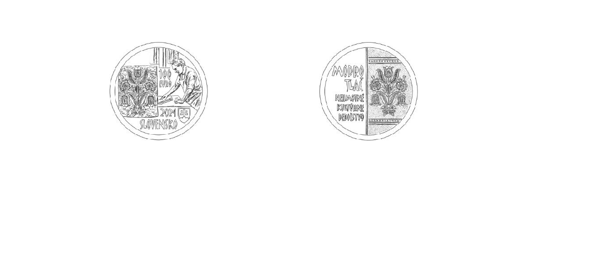

## 250

OZNÁMENIE

Národnej banky Slovenska

z 23. septembra 2024

## o vydaní zlatých zberateľských euromincí v nominálnej hodnote 100 eur s tematikou Nehmotné kultúrne dedičstvo Slovenska – Modrotlač

1. Úvodné ustanovenia

- a) Národná banka Slovenska podľa § 17h ods. 1 zákona Národnej rady Slovenskej republiky č. 566/1992 Zb. o Národnej banke Slovenska v znení neskorších predpisov a podľa § 12 ods. 1 písm. b) zákona č. 400/2015 Z. z. o tvorbe právnych predpisov a o Zbierke zákonov Slovenskej republiky a o zmene a doplnení niektorých zákonov v znení neskorších predpisov oznamuje, že vydáva do obehu zlaté zberateľské euromince v nominálnej hodnote 100 eur s tematikou Nehmotné kultúrne dedičstvo Slovenska – Modrotlač (ďalej len „zberateľská eurominca“).

- b) Zberateľská eurominca má štatút zákonného platidla len v Slovenskej republike.

- c) Zberateľská eurominca sa razí zo zliatiny obsahujúcej 900 dielov zlata, 75 dielov striebra a 25 dielov medi; jej hmotnosť je 9,5 g a priemer 26 mm. Pri razbe euromince je povolená horná a dolná odchýlka v priemere 0,1 mm; povolená horná odchýlka v hmotnosti je 0,08 g a v obsahu zlata 10/1 000.

2. Vzhľad zberateľskej euromince

- a) Na líci zberateľskej euromince je vpravo vyobrazená postava remeselníka pri výrobe plátna s modrotlačou tradičnou technikou, doplnená modrotlačovou formou s kvetinovým ornamentom v ľavej časti a visiacimi látkami v hornej časti mincového poľa. Vedľa remeselníka je v dvoch riadkoch označenie nominálnej hodnoty zberateľskej euromince

- „100 EURO“. V spodnej časti mincového poľa je štátny znak Slovenskej republiky. Vľavo od neho je nápis „SLOVENSKO“ a nad ním letopočet „2024“. Značka Mincovne Kremnica, štátny podnik, ktorú tvorí skratka „MK“ umiestnená medzi dvoma razidlami je v ľavej časti modrotlačovej formy a štylizované iniciálky autora zberateľskej euromince Karola Lička „KL“ sú v jej pravej časti.

- b) Rub zberateľskej euromince je opticky rozdelený na dve časti. V ľavej časti mincového poľa je v dvoch riadkoch nápis „MODROTLAČ“. Pod ním je v troch riadkoch nápis „NEHMOTNÉ KULTÚRNE DEDIČSTVO“. Pravú časť mincového poľa tvorí visiaca látka, na ktorej je zopakovaný kvetinový ornament z lícnej strany doplnený o horizontálne ornamentálne vzory v hornej aj v spodnej časti.

- c) Hrana zberateľskej euromince je vrúbkovaná.

- 

- Štát vydania: Slovenská republika

- Začiatok vydávania: december 2024

v z. Vladimír Dvořáček v. r.
