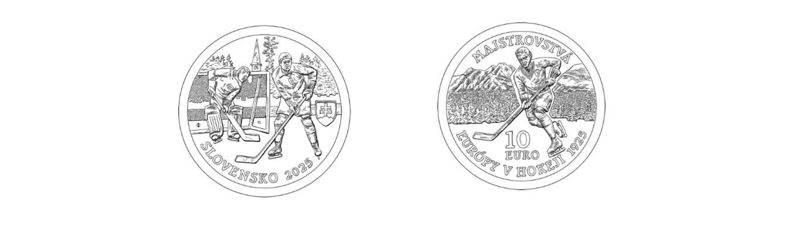

## 331

OZNÁMENIE

Národnej banky Slovenska

z 19. novembra 2024

## o vydaní strieborných zberateľských euromincí v nominálnej hodnote 10 eur pri príležitosti 100. výročia prvého medzinárodného športového turnaja na území Slovenskej republiky – majstrovstiev Európy v hokeji

1. Úvodné ustanovenia

- a) Národná banka Slovenska podľa § 17h ods. 1 zákona Národnej rady Slovenskej republiky č. 566/1992 Zb. o Národnej banke Slovenska v znení neskorších predpisov a podľa § 12 ods. 1 písm. b) zákona č. 400/2015 Z. z. o tvorbe právnych predpisov a o Zbierke zákonov Slovenskej republiky a o zmene a doplnení niektorých zákonov v znení neskorších predpisov oznamuje, že vydáva do obehu strieborné zberateľské euromince v nominálnej hodnote 10 eur pri príležitosti 100. výročia prvého medzinárodného športového turnaja na území Slovenskej republiky – majstrovstiev Európy v hokeji (ďalej len „zberateľská eurominca“).

- b) Zberateľská eurominca má štatút zákonného platidla len v Slovenskej republike.

- c) Zberateľská eurominca sa razí zo zliatiny obsahujúcej 900 dielov striebra a 100 dielov medi; jej hmotnosť je 18 g a priemer 34 mm. Pri razbe zberateľskej euromince je povolená horná a dolná odchýlka v priemere 0,1 mm; povolená horná odchýlka v hmotnosti je 0,4 g a v obsahu striebra 10/1 000.

2. Vzhľad zberateľskej euromince

- a) Na líci zberateľskej euromince je v kompozícii zachytená pozičná momentka hokejovej akcie pred bránkou s brániacim brankárom a hokejistom pripraveným zasiahnuť do deja zo zápasu v Starom Smokovci. Vpravo od kompozície je štátny znak Slovenskej republiky. Vľavo od brankára je značka Mincovne Kremnica, štátny podnik, ktorú tvorí skratka „MK“ umiestnená medzi dvoma razidlami, a vpravo od neho sú štylizované iniciálky autora výtvarného návrhu Karola Lička „KL“. V spodnej časti mincového poľa je v opise názov štátu „SLOVENSKO“ a letopočet „2025“.

- b) Na rube zberateľskej euromince je hokejista v pohybe oblečený v dobovom výstroji. Na pozadí je panoráma pohoria Vysoké Tatry. V spodnej časti mincového poľa je v dvoch riadkoch nominálna hodnota zberateľskej euromince „10 EURO“. V hornej časti mincového poľa je v opise nápis „MAJSTROVSTVÁ“, ktorý je v spodnej časti mincového poľa doplnený v opise textom „EURÓPY V HOKEJI“ a letopočtom „1925“.

- c) Na hrane zberateľskej euromince je nápis do hĺbky „• MAJSTROVSTVÁ EURÓPY V KANADSKOM HOKEJI 1925“.

- 

- Štát vydania: Slovenská republika

- Začiatok vydávania: január 2025

Peter Kažimír v. r.
