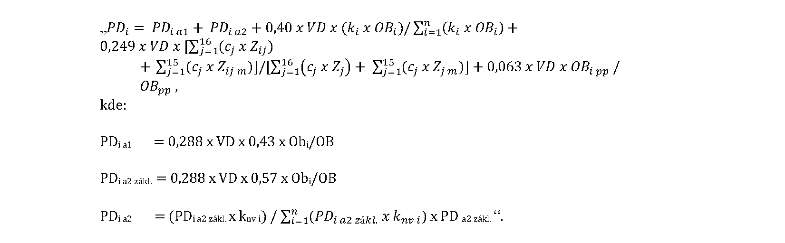

# Čl. I

Nariadenie vlády Slovenskej republiky č. 668/2004 Z. z. o rozdeľovaní výnosu dane z príjmov územnej samospráve v znení nariadenia vlády Slovenskej republiky č. 519/2006 Z. z., nariadenia vlády Slovenskej republiky č. 623/2007 Z. z., nariadenia vlády Slovenskej republiky č. 412/2008 Z. z., nariadenia vlády Slovenskej republiky č. 276/2010 Z. z., nariadenia vlády Slovenskej republiky č. 531/2010 Z. z., nariadenia vlády Slovenskej republiky č. 415/2012 Z. z., nariadenia vlády Slovenskej republiky č. 417/2014 Z. z., nariadenia vlády Slovenskej republiky č. 370/2016 Z. z., nariadenia vlády Slovenskej republiky č. 356/2017 Z. z., nariadenia vlády Slovenskej republiky č. 363/2020 Z. z. a nariadenia vlády Slovenskej republiky č. 472/2022 Z. z. sa mení takto:

- 1. V § 2 ods. 1 písm. a) sa číslo „23“ nahrádza číslom „28,8“.

- 2. V § 2 ods. 1 písm. b) sa číslo „32“ nahrádza číslom „40“.

- 3. V § 2 ods. 1 písm. c) sa číslo „40“ nahrádza číslom „24,9“.

- 4. V § 2 ods. 1 písm. d) sa číslo „5“ nahrádza číslom „6,3“.

- 5. Príloha č. 3 vrátane nadpisu znie:

- „Príloha č. 3

- k nariadeniu vlády č. 668/2004 Z. z.

- KOEFICIENTY ZÁKLADNEJ UMELECKEJ ŠKOLY, JAZYKOVEJ ŠKOLY A ŠKOLSKÉHO ZARIADENIA PRE KATEGÓRIE ZÁKLADNÝCH UMELECKÝCH ŠKÔL, JAZYKOVÝCH ŠKÔL A ŠKOLSKÝCH ZARIADENÍ, KOEFICIENT NA ZÁUJMOVÉ VZDELÁVANIE, KOEFICIENT NA STRAVOVANIE A KOEFICIENT NA SPRÁVU ŠKOLSKÝCH OBJEKTOV

- Index j | Subjekt indexu | Koeficient

- 1 | Žiak základnej umeleckej školy v individuálnej forme vzdelávania | 14,7

- 2 | Žiak základnej umeleckej školy v skupinovej forme vzdelávania | 4,8

- 3 | Dieťa v školskom klube detí | 6

- 4 | Dieťa v školskom klube detí pri základnej škole pre žiakov so špeciálnymi výchovno-vzdelávacími potrebami vrátane internátnych škôl | 13,2

- 5 | Dieťa v školskom klube detí pri zdravotníckom zariadení | 7,9

- 6 | Potenciálny stravník – dieťa materskej školy, dieťa materskej školy pre deti so špeciálnymi výchovno-vzdelávacími potrebami | 2,5

- 7 | Potenciálny stravník – dieťa materskej školy internátnej pre deti so špeciálnymi výchovno-vzdelávacími potrebami | 5

- 8 | Potenciálny stravník – žiak základnej školy, základnej školy pre žiakov so špeciálnymi výchovno-vzdelávacími potrebami, stredných škôl vrátane gymnázia, konzervatória | 1,8

- 9 | Potenciálny stravník – žiak základnej školy internátnej, základnej školy internátnej pre žiakov so špeciálnymi výchovno-vzdelávacími potrebami, stredných škôl internátnych vrátane internátneho gymnázia, internátneho konzervatória | 3,6

- 10 | Poslucháč jazykovej školy | 0,5

- 11 | Dieťa školského internátu z materskej školy, základnej školy, strednej školy | 15

- 12 | Dieťa školského internátu zo školy pre deti a žiakov so špeciálnymi výchovno-vzdelávacími potrebami | 75

- 13 | Na záujmové vzdelávanie detí v centre voľného času | 1,1

- 14 | Dieťa v reedukačnom centre | 117

- 15 | Dieťa v liečebno-výchovnom sanatóriu | 113

- 16 | Na správu školských objektov podľa počtu detí materskej školy a základnej školy v zriaďovateľskej pôsobnosti obce | 1,5

- “.

- 6. V prílohe č. 4 vzorec znie:

- 
