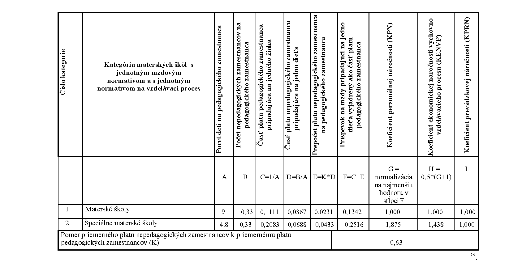
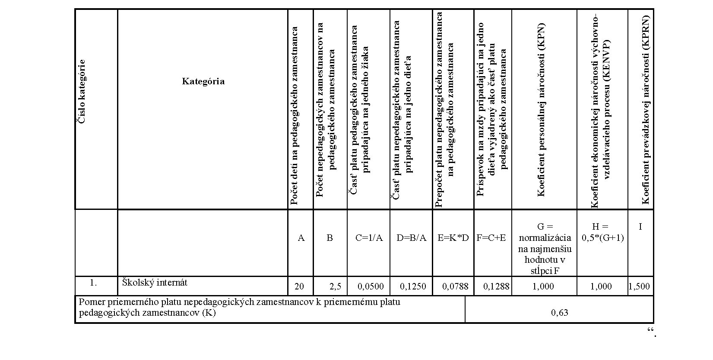

# Čl. I

Nariadenie vlády Slovenskej republiky č. 630/2008 Z. z., ktorým sa ustanovujú podrobnosti rozpisu finančných prostriedkov zo štátneho rozpočtu pre školy a školské zariadenia v znení nariadenia vlády Slovenskej republiky č. 29/2009 Z. z., nariadenia vlády Slovenskej republiky č. 598/2009 Z. z., nariadenia vlády Slovenskej republiky č. 517/2010 Z. z., nariadenia vlády Slovenskej republiky č. 494/2011 Z. z., nariadenia vlády Slovenskej republiky č. 443/2012 Z. z., nariadenia vlády Slovenskej republiky č. 102/2013 Z. z., nariadenia vlády Slovenskej republiky č. 507/2013 Z. z., nariadenia vlády Slovenskej republiky č. 418/2014 Z. z., nariadenia vlády Slovenskej republiky č. 208/2015 Z. z., nariadenia vlády Slovenskej republiky č. 355/2017 Z. z., nariadenia vlády Slovenskej republiky č. 401/2018 Z. z., nariadenia vlády Slovenskej republiky č. 269/2019 Z. z., nariadenia vlády Slovenskej republiky č. 105/2020 Z. z., nariadenia vlády Slovenskej republiky č. 402/2020 Z. z., nariadenia vlády Slovenskej republiky č. 460/2021 Z. z., nariadenia vlády Slovenskej republiky č. 489/2022 Z. z. a nariadenia vlády Slovenskej republiky č. 518/2023 Z. z. sa mení a dopĺňa takto:

- 1. V § 1 sa za slová „rozpočtu pre“ vkladajú slová „materské školy,“.

- 2. V § 3 ods. 1 úvodnej vete sa slová „vedy, výskumu a športu“ nahrádzajú slovami „výskumu, vývoja a mládeže“.

- 3. V § 3 ods. 1 písmeno a) znie:

- „a)

- materské školy a špeciálne materské školy,“.

- 4. V § 3 ods. 1 sa za písmeno a) vkladá nové písmeno b), ktoré znie:

- „b)

- školské internáty,“.

  - Doterajšie písmená b) až d) sa označujú ako písmená c) až e).

- 5. Nadpis § 4 znie: „Osobitné ustanovenia na určovanie normatívov pre školy, v ktorých sa vzdelávanie považuje za sústavnú prípravu na povolanie“.

- 6. V § 4 ods. 1 sa slovo „kompenzačný“ nahrádza slovom „veľkostný“, vypúšťajú sa slová „(ďalej len „príspevok“)“ a na konci sa pripája táto veta: „Hodnoty zvýšených koeficientov pre školy s počtom žiakov do 250 sú uvedené v prílohe č. 7.“.

- 7. V § 4 odsek 2 znie:

- „(2)

- Mzdový normatív a normatív na ďalšie vzdelávanie pedagogických zamestnancov na

- a)

- žiaka úvodného ročníka základnej školy je 250 % normatívu na žiaka príslušnej základnej školy,

- b)

- žiaka alebo účastníka výchovy a vzdelávania triedy elokovaného pracoviska školy v ústave na výkon väzby a v ústave na výkon trestu odňatia slobody vzdelávajúceho sa v dennej forme štúdia je 300 % normatívu na žiaka vzdelávajúceho sa v dennej forme štúdia,

- c)

- žiaka alebo účastníka výchovy a vzdelávania elokovaného pracoviska školy v ústave na výkon väzby a v ústave na výkon trestu odňatia slobody vzdelávajúceho sa formou individuálneho vzdelávania je 30 % normatívu na žiaka vzdelávajúceho sa v dennej forme štúdia.“.

- 8. V § 4 ods. 4 sa vypúšťa druhá veta a číslo „108“ sa nahrádza číslom „110“.

- 9. V § 4 ods. 4 písm. a) a ods. 6 písm. h) prvom bode sa slová „7, 8, 11 až 21“ nahrádzajú slovami „8, 9, 12 až 22“.

- 10. V § 4 ods. 4 písm. b) a ods. 6 písm. h) druhom bode sa slová „bodoch 9 a 10“ nahrádzajú slovami „bode 10 alebo bode 11“.

- 11. V § 4 ods. 6 písm. g) sa číslo „1,08“ nahrádza číslom „1,1“.

- 12. V § 4 ods. 7 úvodnej vete sa slová „5, 16 až 18“ nahrádzajú slovami „5 a 16“.

- 13. V § 4 ods. 8 písm. b) sa slová „detašovanej triedy“ nahrádzajú slovami „triedy elokovaného pracoviska“ a slovo „pre“ sa nahrádza slovom „na“.

- 14. V § 4 ods. 8 písm. c) sa slová „detašovanej triedy“ nahrádzajú slovami „elokovaného pracoviska“ a slovo „pre“ sa nahrádza slovom „na“.

- 15. V § 4 ods. 12 sa slovo „Normatív“ nahrádza slovami „Mzdový normatív a normatív na ďalšie vzdelávanie pedagogických zamestnancov“.

- 16. § 6 vrátane nadpisu znie:

- 㤠6

- Postup pri výpočte normatívov pre materské školy a špeciálne materské školy

- (1)

- Pri výpočte normatívov pre materské školy a špeciálne materské školy sa postupuje ako pri výpočte normatívov pre školy podľa § 3 ods. 2 až 18.

- (2)

- Na účely výpočtu normatívov okrem normatívu na teplo sú materské školy a špeciálne materské školy samostatnými kategóriami s jednotnými normatívmi.

- (3)

- Na účely výpočtu normatívu na teplo sa materská škola a špeciálna materská škola zaraďuje podľa sídla do teplotného pásma podľa prílohy č. 3.

- (4)

- Pre kategórie podľa odseku 2 sú hodnoty koeficientu personálnej náročnosti, koeficientu prevádzkovej náročnosti a koeficientu ekonomickej náročnosti výchovno-vzdelávacieho procesu uvedené v prílohe č. 4.

- (5)

- Normatív na dieťa materskej školy sa zvyšuje o veľkostný príspevok, ak súčet počtu detí v materských školách6c) v pôsobnosti zriaďovateľa na území obce je menší ako 25. Pri výpočte normatívu sa dieťa započítava so zvýšeným koeficientom podľa prílohy č. 5.

- (6)

- Normatív na dieťa materskej školy a dieťa špeciálnej materskej školy, ktorému sa poskytuje poldenná výchova a vzdelávanie, je 50 % normatívu na dieťa s celodennou výchovou a vzdelávaním. Pri výpočte normatívu sa dieťa započítava s koeficientom 0,5.

- (7)

- Normatív na dieťa materskej školy, pre ktoré je predprimárne vzdelávanie povinné, je 120 % normatívu na dieťa materskej školy s celodennou výchovou a vzdelávaním. Pri výpočte normatívu sa dieťa započítava s koeficientom 1,2.

- (8)

- Normatív na dieťa špeciálnej materskej školy, pre ktoré je predprimárne vzdelávanie povinné, je 110 % normatívu na dieťa špeciálnej materskej školy s celodennou výchovou a vzdelávaním. Pri výpočte normatívu sa dieťa započítava s koeficientom 1,1.

- (9)

- Normatív na dieťa materskej školy so zdravotným znevýhodnením, ktoré nie je dieťaťom špeciálnej materskej školy, je 200 % normatívu na dieťa materskej školy s celodennou výchovou a vzdelávaním. Pri výpočte normatívu sa dieťa započítava s koeficientom 2,0.

- (10)

- Normatív na dieťa s nadaním, ktoré nie je dieťaťom materskej školy pre deti s nadaním, je 120 % normatívu na dieťa materskej školy s celodennou výchovou a vzdelávaním. Pri výpočte normatívu sa dieťa započítava s koeficientom 1,2.

- (11)

- Normatív na dieťa materskej školy, pre ktoré je predprimárne vzdelávanie povinné, ktoré je individuálne vzdelávané,6d) oslobodené od povinnosti dochádzať do školy z dôvodu, že jeho zdravotný stav mu neumožňuje účasť na vzdelávaní v škole6e) alebo plní povinné predprimárne vzdelávanie osobitným spôsobom,6f) je 10 % normatívu na dieťa materskej školy s celodennou výchovou a vzdelávaním. Pri výpočte normatívu sa dieťa započítava s koeficientom 0,1.

- (12)

- Normatív na dieťa materskej školy pri zdravotníckom zariadení vrátane tried materských škôl pri zdravotníckom zariadení, ktoré navštevuje triedu takej školy, je 90 % normatívu na dieťa špeciálnej materskej školy s celodennou výchovou a vzdelávaním. Pri výpočte normatívu sa dieťa započítava s koeficientom 0,9.

- (13)

- Normatív na dieťa špeciálnej materskej školy, ktoré nie je dieťaťom so zdravotným znevýhodnením alebo dieťaťom s nadaním, je 40 % normatívu na dieťa špeciálnej materskej školy s celodennou výchovou a vzdelávaním. Pri výpočte normatívu sa dieťa započítava s koeficientom 0,4.

- (14)

- Mzdový normatív, normatív na výchovno-vzdelávací proces a normatív na ďalšie vzdelávanie pedagogických zamestnancov na dieťa s autizmom alebo s inou pervazívnou poruchou, hluchoslepé, choré alebo zdravotne oslabené, alebo s ochorením, ktoré je dlhodobého charakteru a s viacnásobným postihnutím7) v špeciálnej materskej škole je 200 % normatívu na dieťa špeciálnej materskej školy s celodennou výchovou a vzdelávaním. Pri výpočte týchto normatívov sa dieťa započítava s koeficientom 2,0.“.

  - Poznámky pod čiarou k odkazom 6c až 7 znejú:

  - „6c) § 28 ods. 2 zákona č. 245/2008 Z. z. o výchove a vzdelávaní (školský zákon) a o zmene a doplnení niektorých zákonov v znení zákona č. 209/2019 Z. z.

  - 6d) § 28b ods. 2 zákona č. 245/2008 Z. z. v znení zákona č. 209/2019 Z. z.

  - 6e) § 28a ods. 5 zákona č. 245/2008 Z. z. v znení neskorších predpisov.

  - 6f) § 23 písm. b) až e) a g) zákona č. 245/2008 Z. z. v znení neskorších predpisov.

  - 7) § 94 ods. 2 písm. f) až h) a k) zákona č. 245/2008 Z. z. v znení neskorších predpisov.“.

- 17. Za § 6 sa vkladá § 6a, ktorý vrátane nadpisu znie:

- 㤠6a

- Postup pri výpočte normatívov pre školské internáty

- (1)

- Pri výpočte normatívov pre školské internáty8) sa postupuje ako pri výpočte normatívov pre školy podľa § 3 ods. 2 až 18.

- (2)

- Na účely výpočtu normatívu na teplo sa školský internát zaraďuje podľa sídla do teplotného pásma podľa prílohy č. 3.

- (3)

- Pre školské internáty sú hodnoty koeficientu personálnej, ekonomickej a prevádzkovej náročnosti uvedené v prílohe č. 5a.

- (4)

- Normatív na dieťa špeciálnej materskej školy a žiaka špeciálnej školy, ktorí sú ubytovaní v školskom internáte, je 500 % normatívu na dieťa alebo žiaka školy, ktoré nie je dieťaťom alebo žiakom špeciálnej školy ubytovaným v školskom internáte. Pri výpočte normatívu sa ubytované dieťa špeciálnej materskej školy a žiak špeciálnej školy započítava s koeficientom 5,0.“.

  - Poznámka pod čiarou k odkazu 8 znie:

  - „8) § 117 zákona č. 245/2008 Z. z. v znení neskorších predpisov.“.

- 18. V § 7 ods. 2 až 5 sa slovo „žiak“ vo všetkých tvaroch nahrádza slovom „dieťa“ v príslušnom tvare.

- 19. V § 7 ods. 6 sa slová „žiak, ktorý je prijatý“ nahrádzajú slovami „dieťa, ktoré je prijaté“.

- 20. V § 10 úvodnej vete sa za slovo „povolanie“ vkladá čiarka a slová „materské školy a špeciálne materské školy“.

- 21. V § 10 písm. b) sa za slovo „štúdia“ vkladajú slová „a na jedno dieťa“ a za slovo „žiakov“ sa vkladajú slová „a detí“.

- 22. § 11 vrátane nadpisu znie:

- 㤠11

- Spoločné ustanovenie

- Pri určovaní normatívov sa suma finančných prostriedkov určených pre školy a suma finančných prostriedkov určených pre materské školy podľa § 3 ods. 1 znižuje každoročne osobitne o objem vyčlenený pre zriaďovateľov škôl a osobitne o objem vyčlenený pre zriaďovateľov materských škôl v súlade s § 10 na garantované minimum podľa § 8a zákona.“.

- 23. Príloha č. 4 vrátane nadpisu znie:

- „Príloha č. 4 k nariadeniu vlády č. 630/2008 Z. z.

- Koeficienty personálnej, ekonomickej a prevádzkovej náročnosti pre kategórie materských škôl a špeciálnych materských škôl“.

- 

- 24. Za prílohu č. 4 sa vkladajú prílohy č. 5 a 5a, ktoré vrátane nadpisov znejú:

- „Príloha č. 5 k nariadeniu vlády č. 630/2008 Z. z.

- Hodnoty zvýšených koeficientov pre materské školy s počtom detí do 25

- Počet detí MŠ | Koeficient

- 1-10 | 1,750

- 11 | 1,640

- 12 | 1,540

- 13 | 1,470

- 14 | 1,400

- 15 | 1,330

- 16 | 1,290

- 17 | 1,240

- 18 | 1,200

- 19 | 1,170

- 20 | 1,140

- 21 | 1,110

- 22 | 1,080

- 23 | 1,060

- 24 | 1,030

- 25 | 1,000

- Príloha č. 5a

- k nariadeniu vlády č. 630/2008 Z. z.

- Koeficienty personálnej, ekonomickej a prevádzkovej náročnosti pre školský internát“.

- 

- 25. Príloha č. 6 vrátane nadpisu znie:

- „Príloha č. 6 k nariadeniu vlády č. 630/2008 Z. z.

- [Vzor vzdelávacieho poukazu](assets/88056a096b77f1c545cc4ef3c518a53456ca57af8cc4bd4c30d3539268689198.pdf)“.

- 26. Prílohy č. 8 a 9 vrátane nadpisov znejú:

- „Príloha č. 8 k nariadeniu vlády č. 630/2008 Z. z.

- Klasifikácia žiakov so zdravotným znevýhodnením a žiakov so všeobecným intelektovým nadaním v špeciálnych základných školách, v špeciálnych triedach základných škôl alebo v triedach základných škôl pre výpočet koeficientu personálnej náročnosti

- Skupina | Koeficient pre špeciálne základné školy | Koeficient pre špeciálne triedy v základných školách a pre individuálne začlenených žiakov v triedach základných škôl | Zaradenie žiaka do skupiny podľa zdravotného znevýhodnenia alebo všeobecného intelektového nadania

- 1. | 1,000 | 1,500 | žiak so všeobecným intelektovým nadaním

- 2. | 1,286 | 1,930 | žiak s vývinovou poruchou učenia, žiak s ľahkým stupňom mentálneho postihnutia, žiak s poruchou správania, žiak s poruchou aktivity a pozornosti,

- 3. | 1,500 | 2,265 | žiak so stredným stupňom mentálneho postihnutia, žiak s narušenou komunikačnou schopnosťou, slabozraký žiak, žiak so zvyškami zraku a žiak s poruchou binokulárneho videnia, nedoslýchavý žiak, žiak s kochleárnym implantátom, žiak s telesným postihnutím okrem nechodiacich žiakov,

- 4. | 1,800 | 2,710 | nepočujúci žiak, nevidiaci žiak, žiak s telesným postihnutím – nechodiaci žiak, žiak chorý, žiak zdravotne oslabený alebo žiak s ochorením, ktoré je dlhodobého charakteru,

- 5. | 2,250 | 3,390 | žiak s ťažkým stupňom mentálneho postihnutia alebo hlbokým stupňom mentálneho postihnutia, žiak s viacnásobným postihnutím vzdelávaný v kombinácií s ľahkým stupňom mentálneho postihnutia, žiak s autizmom alebo ďalšími pervazívnymi vývinovými poruchami bez mentálneho postihnutia,

- 6. | 4,500 | 6,790 | žiak s viacnásobným postihnutím v kombinácii so stredným stupňom mentálneho postihnutia alebo v kombinácii s ťažkým stupňom mentálneho postihnutia alebo hlbokým stupňom mentálneho postihnutia, žiak s autizmom alebo ďalšími pervazívnymi vývinovými poruchami s mentálnym postihnutím, hluchoslepý žiak.

- Príloha č. 9 k nariadeniu vlády č. 630/2008 Z. z.

- Klasifikácia žiakov so zdravotným znevýhodnením a žiakov so všeobecným intelektovým nadaním v bežných triedach strednej školy pre výpočet koeficientu personálnej náročnosti

- Skupina | Koeficient | Zaradenie žiaka do skupiny podľa zdravotného znevýhodnenia alebo všeobecného intelektového nadania

- 1. | 1,700 | žiak so všeobecným intelektovým nadaním, žiak s vývinovými poruchami učenia, žiak s poruchou aktivity a pozornosti, žiak s mentálnym postihnutím,

- 2. | 2,200 | žiak s telesným postihnutím, žiak so zrakovým postihnutím, žiak so sluchovým postihnutím, žiak chorý, žiak zdravotne oslabený alebo žiak s ochorením, ktoré je dlhodobého charakteru,

- 3. | 2,700 | žiak s autizmom alebo ďalšími pervazívnymi vývinovými poruchami bez mentálneho postihnutia.

- “.

- 27. V prílohe č. 13 treťom stĺpci sa slová „športový manažment“ nahrádzajú slovami „športový manažment a ostatné odbory vzdelávania“.
