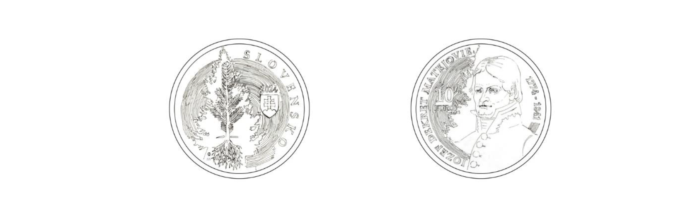

## 52

OZNÁMENIE

Národnej banky Slovenska

z 27. februára 2024

## o vydaní strieborných zberateľských euromincí v nominálnej hodnote 10 eur pri príležitosti 250. výročia narodenia Jozefa Dekreta Matejovie

1. Úvodné ustanovenia

- a) Národná banka Slovenska podľa § 17h ods. 1 zákona Národnej rady Slovenskej republiky č. 566/1992 Zb. o Národnej banke Slovenska v znení neskorších predpisov a podľa § 12 ods. 1 písm. b) zákona č. 400/2015 Z. z. o tvorbe právnych predpisov a o Zbierke zákonov Slovenskej republiky a o zmene a doplnení niektorých zákonov v znení neskorších predpisov oznamuje, že vydáva do obehu strieborné zberateľské euromince v nominálnej hodnote 10 eur pri príležitosti 250. výročia narodenia Jozefa Dekreta Matejovie (ďalej len „zberateľská eurominca“).

- b) Zberateľská eurominca má štatút zákonného platidla len v Slovenskej republike.

- c) Zberateľská eurominca sa razí zo zliatiny obsahujúcej 900 dielov striebra a 100 dielov medi; jej hmotnosť je 18 g a priemer 34 mm. Pri razbe zberateľskej euromince je povolená horná a dolná odchýlka v priemere 0,1 mm; povolená horná odchýlka v hmotnosti je 0,4 g a v obsahu striebra 10/1 000.

2. Vzhľad zberateľskej euromince

- a) Na líci zberateľskej euromince je vyobrazený kruhový prierez kmeňom stromu v kompozícii so siluetou ihličnatého stromu a sadenicou. Vpravo od siluety je medzi letokruhmi štátny znak Slovenskej republiky, nad ktorým je letopočet „2024“. Názov štátu „SLOVENSKO“ je v opise v pravej časti mincového poľa. Značka Mincovne Kremnica, štátny podnik, ktorú tvorí skratka „MK“ umiestnená medzi dvoma razidlami, a štylizované iniciálky autora zberateľskej euromince Mgr. art. Martina Sabola „MS“ sú pri koreňoch sadenice.

- b) Na rube zberateľskej euromince je v kruhovom priereze kmeňa stromu umiestnená silueta časti ihličnatého stromu, vedľa ktorej je portrét Jozefa Dekreta Matejovie. Napravo od portrétu sú v opise letopočty jeho narodenia a úmrtia „1774“ a „1841“, ktoré sú oddelené grafickou značkou. Vľavo od siluety je medzi letokruhmi v dvoch riadkoch nominálna hodnota zberateľskej euromince „10 EURO“. V ľavej časti mincového poľa je v opise nápis „JOZEF DEKRET MATEJOVIE“.

- c) Na hrane zberateľskej euromince je nápis do hĺbky: „• PRIEKOPNÍK METÓD OBNOVY LESOV NA SLOVENSKU“.

- 

- Štát vydania: Slovenská republika

- Začiatok vydávania: máj 2024

Peter Kažimír v. r.
