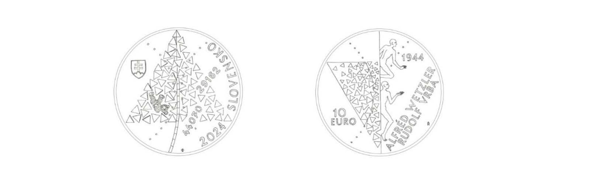

## 53

OZNÁMENIE

Národnej banky Slovenska

z 27. februára 2024

## o vydaní strieborných zberateľských euromincí v nominálnej hodnote 10 eur pri príležitosti 80. výročia podania Správy o nacistických vyhladzovacích táboroch Auschwitz a Birkenau Alfrédom Wetzlerom a Rudolfom Vrbom

1. Úvodné ustanovenia

- a) Národná banka Slovenska podľa § 17h ods. 1 zákona Národnej rady Slovenskej republiky č. 566/1992 Zb. o Národnej banke Slovenska v znení neskorších predpisov a podľa § 12 ods. 1 písm. b) zákona č. 400/2015 Z. z. o tvorbe právnych predpisov a o Zbierke zákonov Slovenskej republiky a o zmene a doplnení niektorých zákonov v znení neskorších predpisov oznamuje, že vydáva do obehu strieborné zberateľské euromince v nominálnej hodnote 10 eur pri príležitosti 80. výročia podania Správy o nacistických vyhladzovacích táboroch Auschwitz a Birkenau Alfrédom Wetzlerom a Rudolfom Vrbom (ďalej len „zberateľská eurominca“).

- b) Zberateľská eurominca má štatút zákonného platidla len v Slovenskej republike.

- c) Zberateľská eurominca sa razí zo zliatiny obsahujúcej 900 dielov striebra a 100 dielov medi; jej hmotnosť je 18 g a priemer 34 mm. Pri razbe zberateľskej euromince je povolená horná a dolná odchýlka v priemere 0,1 mm; povolená horná odchýlka v hmotnosti je 0,4 g a v obsahu striebra 10/1 000.

2. Vzhľad zberateľskej euromince

- a) Na líci zberateľskej euromince dominuje silueta veľkého trojuholníka zloženého z menších trojuholníkov odkazujúcich na systém označovania väzňov vo vyhladzovacích táboroch. Stredom veľkého trojuholníka vedie zvislá priamka rozdeľujúca mincové pole na dva polkruhy, na ktorú sa napája kartografická značka železničnej trate. Obidvoma polovicami mincového poľa vedú polkruhy vytvorené grafickými značkami predstavujúcimi schému strážnych miest vo vyhladzovacích táboroch. V ľavej časti trojuholníka je zobrazený medvedík symbolizujúci osobné predmety obetí vyhladzovacích táborov a v pravej časti trojuholníka sú vložené evidenčné väzenské čísla pridelené Alfrédovi Wetzlerovi a Rudolfovi Vrbovi „44070“ a „29162“. V ľavej hornej časti mincového poľa je štátny znak Slovenskej republiky. Vpravo je v opise letopočet „2024“ a názov štátu „SLOVENSKO“. Značka Mincovne Kremnica, štátny podnik, ktorú tvorí skratka „MK“ umiestnená medzi dvoma razidlami, je v spodnej časti mincového poľa.

- b) Na rube zberateľskej euromince je silueta neúplného trojuholníka zloženého z ďalších menších trojuholníkov, orientovaného opačne ako na lícnej strane zberateľskej euromince. Mincové pole v strede rozdeľuje zvislá priamka. V pravej časti mincového poľa sú dve mužské postavy symbolizujúce utekajúcich väzňov, doplnené letopočtom „1944“, menami a priezviskami „ALFRÉD WETZLER“ a „RUDOLF VRBA“ v dvoch riadkoch a štylizovanými iniciálkami autora zberateľskej euromince akad. soch. Ivana Řeháka „IŘ“. Ľavou časťou mincového poľa vedie polkruh vytvorený grafickými značkami predstavujúcimi schému strážnych miest vo vyhladzovacích táboroch, ktorý sa čiastočne zrkadlí v pravej hornej časti mincového poľa. V ľavej spodnej časti mincového poľa je nominálna hodnota „10 EURO“.

- c) Na hrane zberateľskej euromince je nápis do hĺbky: „• NIČ NEPREKONÁ ODVAHU ČLOVEKA POSTAVIŤ SA ZLU“.

- 

- Štát vydania: Slovenská republika

- Začiatok vydávania: apríl 2024

Peter Kažimír v. r.
