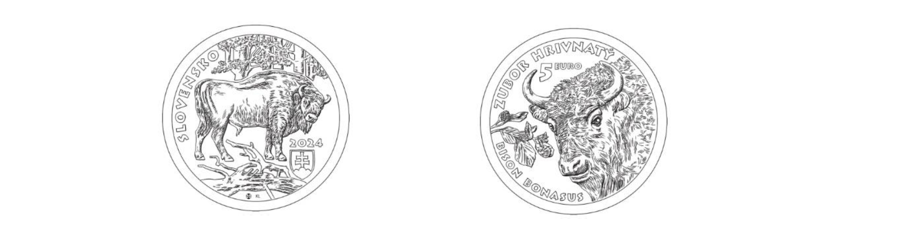

## 76

OZNÁMENIE

Národnej banky Slovenska

z 8. apríla 2024

## o vydaní zberateľských euromincí z obyčajných kovov v nominálnej hodnote 5 eur s tematikou Fauna a flóra na Slovensku – zubor hrivnatý

1. Úvodné ustanovenia

- a) Národná banka Slovenska podľa § 17h ods. 1 zákona Národnej rady Slovenskej republiky č. 566/1992 Zb. o Národnej banke Slovenska v znení neskorších predpisov a podľa § 12 ods. 1 písm. b) zákona č. 400/2015 Z. z. o tvorbe právnych predpisov a o Zbierke zákonov Slovenskej republiky a o zmene a doplnení niektorých zákonov v znení neskorších predpisov oznamuje, že vydáva do obehu zberateľské euromince z obyčajných kovov v nominálnej hodnote 5 eur s tematikou Fauna a flóra na Slovensku – zubor hrivnatý (ďalej len „zberateľská eurominca“).

- b) Zberateľská eurominca má štatút zákonného platidla len v Slovenskej republike.

- c) Zberateľská eurominca sa razí z mosadze MS63 (Cu63Zn37); jej hmotnosť je 19,1 g a priemer 34 mm. Pri razbe zberateľskej euromince je povolená horná a dolná odchýlka v priemere

- 0,1 mm; povolená horná odchýlka v hmotnosti je 0,76 g.

2. Vzhľad zberateľskej euromince

- a) Na líci zberateľskej euromince je zobrazený samec zubra hrivnatého v kompozícii so stromami v pozadí a s padnutými konármi v popredí. Vpravo od kompozície je štátny znak Slovenskej republiky, nad ktorým je letopočet „2024“. V ľavej časti mincového poľa je v opise názov štátu „SLOVENSKO“. Značka Mincovne Kremnica, štátny podnik, ktorú tvorí skratka „MK“ umiestnená medzi dvoma razidlami, a štylizované iniciálky autora zberateľskej euromince Karola Lička „KL“ sú v spodnej časti mincového poľa.

- b) Na rube zberateľskej euromince je hlava zubra hrivnatého. Nad ňou je nominálna hodnota zberateľskej euromince „5 EURO“. V hornej časti mincového poľa je v opise slovenský názov „ZUBOR HRIVNATÝ“ a spodnej časti latinský názov „BISON BONASUS“. Názvy od seba graficky oddeľuje vetvička s bukovými listami a bukvicami.

- c) Hrana zberateľskej euromince je vrúbkovaná.

- 

- Štát vydania: Slovenská republika

- Začiatok vydávania: júl 2024

Peter Kažimír v. r.
