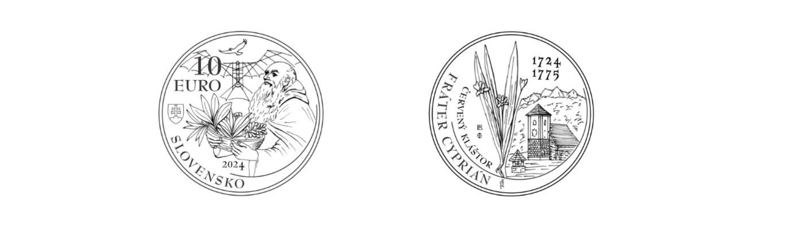

## 77

OZNÁMENIE

Národnej banky Slovenska

z 8. apríla 2024

## o vydaní strieborných zberateľských euromincí v nominálnej hodnote 10 eur pri príležitosti 300. výročia narodenia frátra Cypriána z Červeného Kláštora

1. Úvodné ustanovenia

- a) Národná banka Slovenska podľa § 17h ods. 1 zákona Národnej rady Slovenskej republiky č. 566/1992 Zb. o Národnej banke Slovenska v znení neskorších predpisov a podľa § 12 ods. 1 písm. b) zákona č. 400/2015 Z. z. o tvorbe právnych predpisov a o Zbierke zákonov Slovenskej republiky a o zmene a doplnení niektorých zákonov v znení neskorších predpisov oznamuje, že vydáva do obehu strieborné zberateľské euromince v nominálnej hodnote 10 eur pri príležitosti 300. výročia narodenia frátra Cypriána z Červeného Kláštora (ďalej len „zberateľská eurominca“).

- b) Zberateľská eurominca má štatút zákonného platidla len v Slovenskej republike.

- c) Zberateľská eurominca sa razí zo zliatiny obsahujúcej 900 dielov striebra a 100 dielov medi; jej hmotnosť je 18 g a priemer 34 mm. Pri razbe zberateľskej euromince je povolená horná a dolná odchýlka v priemere 0,1 mm; povolená horná odchýlka v hmotnosti je 0,4 g a v obsahu striebra 10/1 000.

2. Vzhľad zberateľskej euromince

- a) Na líci zberateľskej euromince je fiktívny portrét frátra Cypriána držiaceho slamenú ošatku s rastlinami, ktorý je v hornej časti doplnený konštrukciou lietajúceho stroja a letiacim orlom a v spodnej časti letopočtom „2024“. V ľavej časti mincového poľa je štátny znak Slovenskej republiky, nad ktorým je v dvoch riadkoch označenie nominálnej hodnoty „10 EURO“. Názov štátu „SLOVENSKO“ je v opise v dolnej časti mincového poľa.

- b) Na rube zberateľskej euromince je v kompozícii liečivá rastlina z Cypriánovho herbára, ktorú napravo dopĺňa časť areálu Červeného kláštora a dominantná časť Pienin – vrch Tri koruny. Nad kompozíciou sú v dvoch riadkoch letopočty narodenia a úmrtia frátra Cypriána „1724“ a „1775“. V ľavej časti mincového poľa sú štylizované iniciálky autora zberateľskej euromince Mgr. art. Romana Lugára „LR“ a pod nimi je značka Mincovne Kremnica, štátny podnik, ktorú tvorí skratka „MK“ umiestnená medzi dvoma razidlami. Naľavo od nich sú v opise v dvoch riadkoch názvy „ČERVENÝ KLÁŠTOR“ a „FRÁTER CYPRIÁN“.

- c) Na hrane zberateľskej euromince je nápis do hĺbky „– LEKÁRNIK – LIEČITEĽ – BOTANIK – MAJSTER TISÍCICH REMESIEL“.

- 

Štát vydania: Slovenská republika

Začiatok vydávania: jún 2024

Peter Kažimír v. r.
