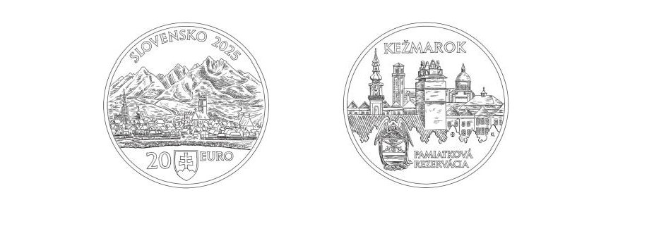

## 112

OZNÁMENIE

Národnej banky Slovenska

z 29. apríla 2025

## o vydaní strieborných zberateľských euromincí v nominálnej hodnote 20 eur s tematikou Pamiatková rezervácia Kežmarok

1. Úvodné ustanovenia

- a) Národná banka Slovenska podľa § 17h ods. 1 zákona Národnej rady Slovenskej republiky č. 566/1992 Zb. o Národnej banke Slovenska v znení neskorších predpisov a podľa § 12 ods. 1 písm. b) zákona č. 400/2015 Z. z. o tvorbe právnych predpisov a o Zbierke zákonov Slovenskej republiky a o zmene a doplnení niektorých zákonov v znení neskorších predpisov oznamuje, že vydáva do obehu strieborné zberateľské euromince v nominálnej hodnote 20 eur s tematikou Pamiatková rezervácia Kežmarok (ďalej len „zberateľská eurominca“).

- b) Zberateľská eurominca má štatút zákonného platidla len v Slovenskej republike.

- c) Zberateľská eurominca sa razí zo zliatiny obsahujúcej 925 dielov striebra a 75 dielov medi; jej hmotnosť je 33,63 g a priemer 40 mm. Pri razbe zberateľskej euromince je povolená horná a dolná odchýlka v priemere 0,1 mm; povolená horná odchýlka v hmotnosti je 0,4 g a v obsahu striebra 10/1 000.

2. Vzhľad zberateľskej euromince

- a) Na averze mince je zobrazená historická panoráma mesta Kežmarok, ktorú tvorí kompozícia významných architektonických dominánt mesta v popredí a masív Vysokých Tatier v pozadí. V hornej časti mincového poľa je v opise nápis „SLOVENSKO“ a za ním letopočet „2025“. V spodnej časti mincového poľa je uvedená nominálna hodnota „20 EURO“, pričom medzi číselným vyjadrením hodnoty a označením meny je štátny znak Slovenskej republiky.

- b) Na reverze mince je za atikou Kežmarského hradu kompozícia významných architektonických pamiatok mesta Kežmarok. V popredí je Bazilika sv. Kríža, za ňou sú meštianske domy, veža radnice a Nový evanjelický kostol. V hornej časti mincového poľa je názov mesta „KEŽMAROK“ a v spodnej časti mincového poľa je v dvoch riadkoch nápis „PAMIATKOVÁ REZERVÁCIA“. Vľavo od neho je erb mesta. V pravej časti kompozície sú iniciálky autora mince Karola Lička „KL“. Značka Mincovne Kremnica, štátny podnik, ktorú tvorí skratka „MK“ umiestnená medzi dvoma razidlami, je v kompozícii pri veži Baziliky sv. Kríža.

- c) Na hrane zberateľskej euromince je reliéfny nápis „NAJKRAJŠIE HISTORICKÉ MESTÁ“. Začiatok a koniec textu je oddelený štylizovaným kľúčom.

- 

Štát vydania: Slovenská republika

Začiatok vydávania: jún 2025

Peter Kažimír v. r.
