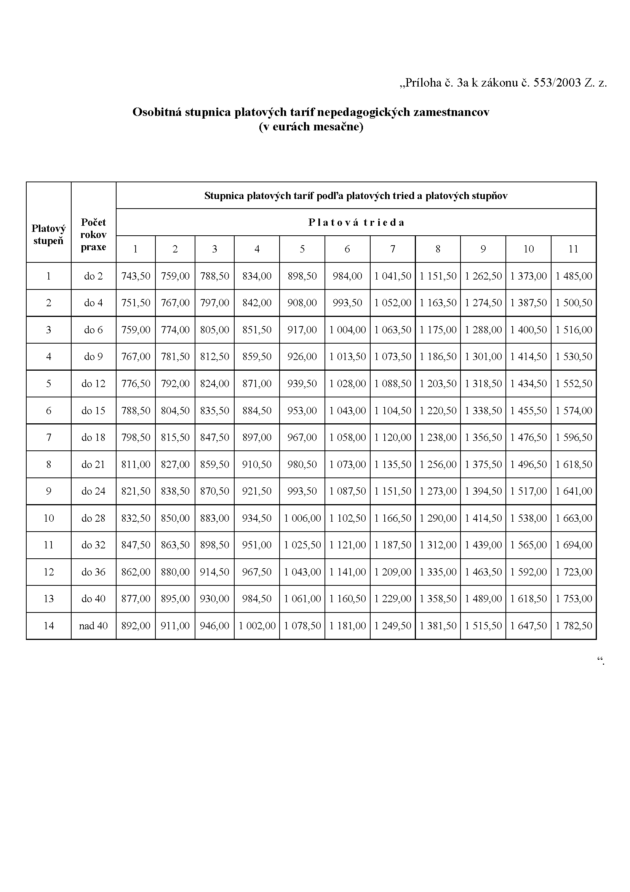

# Čl. I

Zákon č. 553/2003 Z. z. o odmeňovaní niektorých zamestnancov pri výkone práce vo verejnom záujme a o zmene a doplnení niektorých zákonov v znení zákona č. 369/2004 Z. z., zákona č. 81/2005 Z. z., zákona č. 131/2005 Z. z., zákona č. 628/2005 Z. z., zákona č. 231/2006 Z. z., zákona č. 348/2007 Z. z., zákona č. 519/2007 Z. z., zákona č. 385/2008 Z. z., zákona č. 474/2008 Z. z., zákona č. 317/2009 Z. z., zákona č. 400/2009 Z. z., zákona č. 102/2010 Z. z., zákona č. 151/2010 Z. z., zákona č. 390/2011 Z. z., zákona č. 62/2012 Z. z., zákona č. 438/2012 Z. z., nálezu Ústavného súdu Slovenskej republiky č. 288/2013 Z. z., zákona č. 462/2013 Z. z., zákona č. 325/2014 Z. z., zákona č. 32/2015 Z. z., zákona č. 392/2015 Z. z., zákona č. 217/2016 Z. z., zákona č. 243/2017 Z. z., zákona č. 63/2018 Z. z., zákona č. 318/2018 Z. z., zákona č. 138/2019 Z. z., zákona č. 224/2019 Z. z., zákona č. 381/2019 Z. z., zákona č. 470/2019 Z. z., zákona č. 395/2021 Z. z., zákona č. 414/2021 Z. z., zákona č. 264/2022 Z. z., zákona č. 389/2022 Z. z., zákona č. 182/2023 Z. z., zákona č. 295/2024 Z. z., zákona č. 376/2024 Z. z. a zákona č. 154/2025 Z. z. sa mení a dopĺňa takto:

- 3. V § 7 ods. 1 sa za tretiu vetu vkladá nová štvrtá veta, ktorá znie: „Osobitná stupnica platových taríf zamestnancov pri výkone práce vo verejnom záujme, ktorí vykonávajú pracovné činnosti v škole, školskom zariadení, centre pre deti a rodiny, rehabilitačnom stredisku pre zrakovo postihnutých zriadenom Ministerstvom práce, sociálnych vecí a rodiny Slovenskej republiky alebo na vysokej škole, a nie sú pedagogickými zamestnancami, odbornými zamestnancami alebo učiteľmi vysokých škôl a výskumnými a vývojovými zamestnancami (ďalej len „nepedagogickí zamestnanci“), je uvedená v prílohe č. 3a.“.

- 5. V § 23 ods. 1 písm. a) sa za slová „č. 3“ vkladajú slová „a osobitnú stupnicu platových taríf nepedagogických zamestnancov uvedenú v prílohe č. 3a“.

- 7. V § 28 ods. 2 druhej vete sa slová „č. 4“ nahrádzajú slovami „č. 3a, 4“.

- 11. Za prílohu č. 3 sa vkladá príloha č. 3a, ktorá vrátane nadpisu znie:

- 

- 13. Príloha č. 4 vrátane nadpisu znie:

- „Príloha č. 4 k zákonu č. 553/2003 Z. z.

- Platové tarify pedagogických zamestnancov a odborných zamestnancov

- (v eurách mesačne)

- Stupnica platových taríf | |

- Platová trieda | Pracovná trieda | Platová tarifa

- 4 | 1 | 1 004,00

- | 2 | 1 073,50

- 5 | 1 | 1 111,50

- | 2 | 1 186,00

- 6 | 1 | 1 243,00

- | 2 | 1 327,00

- 7 | 1 | 1 356,50

- | 2 | 1 446,50

- 8 | 1 | 1 519,50

- | 2 | 1 621,00

- 9 | 1 | 1 700,50

- | 2 | 1 815,50

- “.

- 15. Príloha č. 5 vrátane nadpisu znie:

- 
