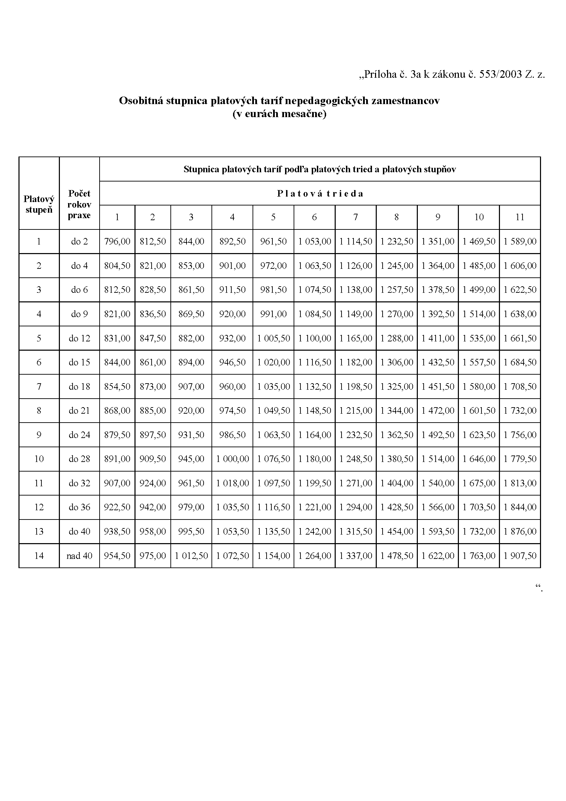
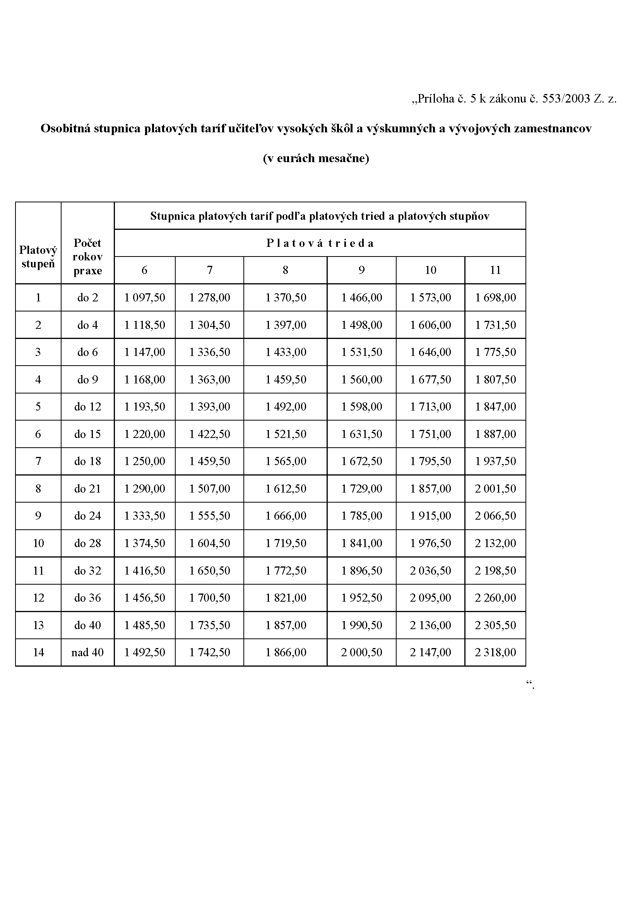
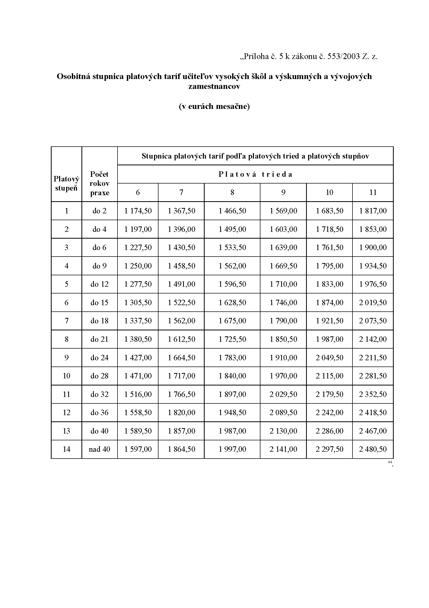

# Čl. I

Zákon č. 553/2003 Z. z. o odmeňovaní niektorých zamestnancov pri výkone práce vo verejnom záujme a o zmene a doplnení niektorých zákonov v znení zákona č. 369/2004 Z. z., zákona č. 81/2005 Z. z., zákona č. 131/2005 Z. z., zákona č. 628/2005 Z. z., zákona č. 231/2006 Z. z., zákona č. 348/2007 Z. z., zákona č. 519/2007 Z. z., zákona č. 385/2008 Z. z., zákona č. 474/2008 Z. z., zákona č. 317/2009 Z. z., zákona č. 400/2009 Z. z., zákona č. 102/2010 Z. z., zákona č. 151/2010 Z. z., zákona č. 390/2011 Z. z., zákona č. 62/2012 Z. z., zákona č. 438/2012 Z. z., nálezu Ústavného súdu Slovenskej republiky č. 288/2013 Z. z., zákona č. 462/2013 Z. z., zákona č. 325/2014 Z. z., zákona č. 32/2015 Z. z., zákona č. 392/2015 Z. z., zákona č. 217/2016 Z. z., zákona č. 243/2017 Z. z., zákona č. 63/2018 Z. z., zákona č. 318/2018 Z. z., zákona č. 138/2019 Z. z., zákona č. 224/2019 Z. z., zákona č. 381/2019 Z. z., zákona č. 470/2019 Z. z., zákona č. 395/2021 Z. z., zákona č. 414/2021 Z. z., zákona č. 264/2022 Z. z., zákona č. 389/2022 Z. z., zákona č. 182/2023 Z. z., zákona č. 295/2024 Z. z., zákona č. 376/2024 Z. z. a zákona č. 154/2025 Z. z. sa mení a dopĺňa takto:

- 1. V § 4 sa odsek 1 dopĺňa písmenom z), ktoré znie:

- „z)

- príplatok za hodnotenie pedagogického zamestnanca a odborného zamestnanca.“.

- 2. V § 4 ods. 4 prvej vete sa slová „v) a x)“ nahrádzajú slovami „v), x) a z)“.

- 3. V § 7 ods. 1 sa za tretiu vetu vkladá nová štvrtá veta, ktorá znie: „Osobitná stupnica platových taríf zamestnancov pri výkone práce vo verejnom záujme, ktorí vykonávajú pracovné činnosti v škole, školskom zariadení, centre pre deti a rodiny, rehabilitačnom stredisku pre zrakovo postihnutých zriadenom Ministerstvom práce, sociálnych vecí a rodiny Slovenskej republiky alebo na vysokej škole, a nie sú pedagogickými zamestnancami, odbornými zamestnancami alebo učiteľmi vysokých škôl a výskumnými a vývojovými zamestnancami (ďalej len „nepedagogickí zamestnanci“), je uvedená v prílohe č. 3a.“.

- 4. Za § 13b sa vkladá § 13c, ktorý vrátane nadpisu znie:

- 㤠13c

- Príplatok za hodnotenie pedagogického zamestnanca a odborného zamestnanca

- (1)

- Pedagogickému zamestnancovi alebo odbornému zamestnancovi, ktorý získal v hodnotení výsledok vynikajúca úroveň a kvalita alebo veľmi dobrá úroveň a kvalita podľa osobitného predpisu,30ab) patrí príplatok za hodnotenie pedagogického zamestnanca a odborného zamestnanca najmenej v sume uvedenej v prílohe č. 4 a najviac v sume 50 % z platovej tarify platovej triedy a pracovnej triedy, do ktorej je zaradený. V odôvodnenom prípade hodnom osobitného zreteľa možno priznať príplatok za hodnotenie pedagogického zamestnanca a odborného zamestnanca aj pedagogickému zamestnancovi alebo odbornému zamestnancovi, ktorý získal v hodnotení podľa osobitného predpisu30ab) výsledok štandardná úroveň a kvalita, najviac v sume 25 % z platovej tarify platovej triedy a pracovnej triedy, do ktorej je zaradený. Priznaním príplatku za hodnotenie pedagogického zamestnanca a odborného zamestnanca nie je dotknutý osobný príplatok podľa § 10. Pravidlá pre priznanie príplatku za hodnotenie pedagogického zamestnanca a odborného zamestnanca prerokuje riaditeľ v pedagogickej rade, ak je zriadená.

- (2)

- Príplatok za hodnotenie pedagogického zamestnanca a odborného zamestnanca prizná zamestnávateľ od prvého dňa kalendárneho mesiaca nasledujúceho po mesiaci, v ktorom bolo vykonané hodnotenie. Riaditeľovi školy alebo riaditeľovi školského zariadenia prizná príplatok za hodnotenie pedagogického zamestnanca a odborného zamestnanca podľa prvej vety zriaďovateľ.

- (3)

- Ak pedagogický zamestnanec alebo odborný zamestnanec nevykonáva prácu z dôvodu materskej dovolenky, otcovskej dovolenky alebo rodičovskej dovolenky, zamestnávateľ mu prizná príplatok za hodnotenie pedagogického zamestnanca a odborného zamestnanca od prvého dňa návratu do práce podľa sumy, ktorá mu bola priznaná na základe posledného vykonaného hodnotenia a zohľadňuje dobu vyplácania príplatku za hodnotenie pedagogického zamestnanca a odborného zamestnanca pred nástupom na materskú dovolenku, otcovskú dovolenku alebo na rodičovskú dovolenku.

- (4)

- Príplatok za hodnotenie pedagogického zamestnanca a odborného zamestnanca zamestnávateľ vypláca do posledného dňa mesiaca, v ktorom sa vykoná nové hodnotenie pedagogického zamestnanca alebo odborného zamestnanca. Ak sa vykoná nové hodnotenie pedagogického zamestnanca alebo odborného zamestnanca po uplynutí 12 mesiacov od predchádzajúceho hodnotenia, príplatok za hodnotenie pedagogického zamestnanca a odborného zamestnanca sa vypláca počas 12 mesiacov.

- (5)

- Ak pedagogický zamestnanec alebo odborný zamestnanec nastúpi do pracovného pomeru k inému zamestnávateľovi, nepatrí mu príplatok za hodnotenie pedagogického zamestnanca a odborného zamestnanca, ktorý priznal predchádzajúci zamestnávateľ; to neplatí, ak ide o prechod práv a povinností z pracovnoprávnych vzťahov podľa § 28 ods. 1 Zákonníka práce.

- (6)

- Zamestnávateľ odoberie príplatok za hodnotenie pedagogického zamestnanca a odborného zamestnanca od prvého dňa mesiaca nasledujúceho po mesiaci, v ktorom sa zamestnávateľ dozvedel, že pedagogický zamestnanec alebo odborný zamestnanec porušil závažne pracovnú disciplínu, alebo ho môže odobrať, ak pedagogický zamestnanec alebo odborný zamestnanec menej závažne porušil pracovnú disciplínu. Riaditeľovi školy alebo riaditeľovi školského zariadenia odoberie príplatok za hodnotenie pedagogického zamestnanca a odborného zamestnanca podľa prvej vety zriaďovateľ.

- (7)

- Príplatok za hodnotenie pedagogického zamestnanca a odborného zamestnanca sa určí pevnou sumou zaokrúhlenou na 50 eurocentov nahor.“.

  - Poznámka pod čiarou k odkazu 30ab znie:

  - „30ab) § 70 ods. 6 písm. a) a b) zákona č. 138/2019 Z. z. v znení zákona č. 191/2025 Z. z.“.

- 5. V § 23 ods. 1 písm. a) sa za slová „č. 3“ vkladajú slová „a osobitnú stupnicu platových taríf nepedagogických zamestnancov uvedenú v prílohe č. 3a“.

- 6. V § 28 odsek 1 znie:

- „(1)

- Nariadenie vlády ustanoví zvýšené stupnice platových taríf alebo zvýšené sumy príplatku za hodnotenie pedagogického zamestnanca a odborného zamestnanca a termín ich účinnosti v nadväznosti na kolektívnu zmluvu vyššieho stupňa;36) to neplatí pre platové tarify zamestnancov pri výkone práce vo verejnom záujme v zahraničí, platové tarify nepedagogických zamestnancov v zahraničí, platové tarify pedagogických zamestnancov a odborných zamestnancov v zahraničí a platové tarify učiteľov vysokých škôl a výskumných a vývojových zamestnancov v zahraničí. Ak sa zvýšenie platových taríf alebo zvýšenie súm príplatku za hodnotenie pedagogického zamestnanca a odborného zamestnanca nedohodne v kolektívnej zmluve vyššieho stupňa, rozsah ich zvýšenia a termín účinnosti sa ustanoví v zákone o štátnom rozpočte.“.

- 7. V § 28 ods. 2 druhej vete sa slová „č. 4“ nahrádzajú slovami „č. 3a, 4“.

- 8. V § 28 odsek 2 znie:

- „(2)

- Zvýšené platové tarify vo zvýšených stupniciach platových taríf a zvýšené sumy príplatku za hodnotenie pedagogického zamestnanca a odborného zamestnanca sa zaokrúhľujú na 50 eurocentov nahor. Základná stupnica platových taríf uvedená v prílohe č. 3, osobitné stupnice platových taríf uvedené v prílohách č. 3a, 4 a 5 a sumy príplatku za hodnotenie pedagogického zamestnanca a odborného zamestnanca uvedené v prílohe č. 4 strácajú platnosť ustanovením zvýšených stupníc platových taríf alebo zvýšených súm príplatku za hodnotenie pedagogického zamestnanca a odborného zamestnanca podľa odseku 1.“.

- 9. Za § 28 sa vkladá § 28a, ktorý znie:

- 㤠28a

- (1)

- Opatrenie, ktoré vydá ministerstvo zahraničných vecí, ustanoví zvýšené stupnice platových taríf zamestnancov pri výkone práce vo verejnom záujme v zahraničí, platových taríf pedagogických zamestnancov a odborných zamestnancov v zahraničí, platových taríf nepedagogických zamestnancov v zahraničí a platových taríf učiteľov vysokých škôl a výskumných a vývojových zamestnancov v zahraničí. Opatrenie sa vyhlási uverejnením jeho úplného znenia v Zbierke zákonov Slovenskej republiky.

- (2)

- Stupnice platových taríf a platové tarify zamestnancov pri výkone práce vo verejnom záujme v zahraničí platné k 31. decembru sa od 1. januára nasledujúceho kalendárneho roka zvyšujú opatrením podľa odseku 1 o mieru medziročného rastu spotrebiteľských cien uplatňovanú v New Yorku za kalendárny rok, ktorý predchádza kalendárnemu roku, v ktorom sa platový koeficient určuje. Miera medziročného rastu spotrebiteľských cien podľa prvej vety sa zaokrúhľuje na jedno desatinné miesto. Zvýšené stupnice platových taríf a platové tarify sa zaokrúhľujú na 50 eurocentov nahor. Ak nedôjde k medziročnému rastu spotrebiteľských cien podľa prvej vety, stupnice platových taríf a platové tarify od 1. januára nasledujúceho kalendárneho roka zostávajú zachované.“.

- 10. Za § 32j sa vkladá § 32k, ktorý vrátane nadpisu znie:

- 㤠32k

- Prechodné ustanovenia k úpravám účinným od 1. januára 2026

- (1)

- Zamestnávateľ prizná od 1. januára 2026 príplatok za hodnotenie pedagogického zamestnanca a odborného zamestnanca pedagogickému zamestnancovi alebo odbornému zamestnancovi, ktorému zamestnávateľ vykonal hodnotenie pedagogického zamestnanca alebo odborného zamestnanca do 31. decembra 2025. Zriaďovateľ prizná od 1. januára 2026 príplatok za hodnotenie pedagogického zamestnanca a odborného zamestnanca riaditeľovi školy alebo riaditeľovi školského zariadenia, ktorému zriaďovateľ vykonal hodnotenie pedagogického zamestnanca alebo odborného zamestnanca do 31. decembra 2025.

- (2)

- Príplatok za hodnotenie pedagogického zamestnanca a odborného zamestnanca podľa odseku 1 sa do 31. augusta 2027 vypláca mesačne v sume uvedenej v prílohe č. 4 z platovej tarify platovej triedy a pracovnej triedy, do ktorej je zaradený.

- (3)

- Postup podľa § 13c sa použije prvýkrát od 1. septembra 2027 za hodnotenie pedagogického zamestnanca a odborného zamestnanca vykonané v školskom roku 2026/2027.

- (4)

- Základom pre prvé zvýšenie stupnice platových taríf pedagogických zamestnancov a odborných zamestnancov po 1. januári 2026 je súčet platovej tarify platovej triedy a pracovnej triedy, do ktorej je zaradený, a príplatku za hodnotenie pedagogického zamestnanca a odborného zamestnanca podľa predpisov účinných od 1. januára 2026.

- (5)

- Pri zvýšení platových taríf podľa § 28a v roku 2026 sa použijú stupnice platových taríf účinné k 31. decembru 2025 vynásobené číslom

- a)

- 0,905 pre základnú stupnicu platových taríf zamestnancov pri výkone práce vo verejnom záujme a osobitnú stupnicu platových taríf nepedagogických zamestnancov,

- b)

- 0,966 pre osobitnú stupnicu platových taríf učiteľov vysokých škôl a výskumných a vývojových zamestnancov,

- c)

- 0,8575 pre platové tarify pedagogických zamestnancov a odborných zamestnancov.“.

- 11. Za prílohu č. 3 sa vkladá príloha č. 3a, ktorá vrátane nadpisu znie:

- 

- 12. Príloha č. 3a vrátane nadpisu znie:

- 

- 13. Príloha č. 4 vrátane nadpisu znie:

- „Príloha č. 4 k zákonu č. 553/2003 Z. z.

- Platové tarify pedagogických zamestnancov a odborných zamestnancov

- (v eurách mesačne)

- Stupnica platových taríf | |

- Platová trieda | Pracovná trieda | Platová tarifa

- 4 | 1 | 1 004,00

- | 2 | 1 073,50

- 5 | 1 | 1 111,50

- | 2 | 1 186,00

- 6 | 1 | 1 243,00

- | 2 | 1 327,00

- 7 | 1 | 1 356,50

- | 2 | 1 446,50

- 8 | 1 | 1 519,50

- | 2 | 1 621,00

- 9 | 1 | 1 700,50

- | 2 | 1 815,50

- “.

- 14. Príloha č. 4 vrátane nadpisu znie:

- „Príloha č. 4 k zákonu č. 553/2003 Z. z.

- Platové tarify pedagogických zamestnancov a odborných zamestnancov a príplatok

- za hodnotenie pedagogického zamestnanca a odborného zamestnanca

- (v eurách mesačne)

- Stupnica platových taríf | | |

- Platová trieda | Pracovná trieda | Platová tarifa | Príplatok za hodnotenie pedagogického zamestnanca a odborného zamestnanca

- 4 | 1 | 1 054,50 | 20,50

- | 2 | 1 127,50 | 21,50

- 5 | 1 | 1 167,50 | 22,50

- | 2 | 1 245,50 | 24,00

- 6 | 1 | 1 305,50 | 25,00

- | 2 | 1 393,50 | 27,00

- 7 | 1 | 1 424,50 | 27,50

- | 2 | 1 519,00 | 29,00

- 8 | 1 | 1 595,50 | 30,50

- | 2 | 1 702,50 | 32,50

- 9 | 1 | 1 786,00 | 34,50

- | 2 | 1 906,50 | 36,50

- “.

- 15. Príloha č. 5 vrátane nadpisu znie:

- 

- 16. Príloha č. 5 vrátane nadpisu znie:

- 
