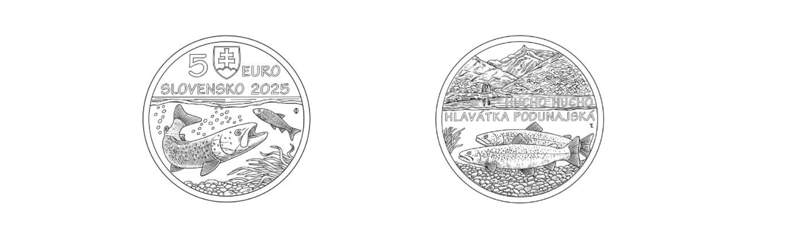

## 198

OZNÁMENIE

Národnej banky Slovenska

z 10. júna 2025

## o vydaní zberateľských euromincí z obyčajných kovov v nominálnej hodnote 5 eur s tematikou Fauna a flóra na Slovensku – hlavátka podunajská

1. Úvodné ustanovenia

- a) Národná banka Slovenska podľa § 17h ods. 1 zákona Národnej rady Slovenskej republiky č. 566/1992 Zb. o Národnej banke Slovenska v znení neskorších predpisov a podľa § 12 ods. 1 písm. b) zákona č. 400/2015 Z. z. o tvorbe právnych predpisov a o Zbierke zákonov Slovenskej republiky a o zmene a doplnení niektorých zákonov v znení neskorších predpisov oznamuje, že vydáva do obehu zberateľské euromince z obyčajných kovov v nominálnej hodnote 5 eur s tematikou Fauna a flóra na Slovensku – hlavátka podunajská (ďalej len „zberateľská eurominca“).

- b) Zberateľská eurominca má štatút zákonného platidla len v Slovenskej republike.

- c) Zberateľská eurominca sa razí z mosadze MS63 (Cu63Zn37); jej hmotnosť je 19,1 g a priemer 34 mm. Pri razbe zberateľskej euromince je povolená horná a dolná odchýlka v priemere 0,1 mm; povolená horná odchýlka v hmotnosti je 0,76 g.

2. Vzhľad zberateľskej euromince

- a) Na averze zberateľskej euromince je v kompozícii hlavátka podunajská vo svojom prirodzenom prostredí – pod hladinou, loviaca menšiu rybu. Kompozíciu dopĺňajú vodné rastliny a kamienky na dne. Nad hladinou je názov štátu „SLOVENSKO“ a letopočet „2025“. V hornej časti mincového poľa je štátny znak Slovenskej republiky, ktorý rozdeľuje označenie nominálnej hodnoty tak, že vľavo od neho je vyjadrenie číselnej hodnoty „5“ a vpravo nápis „EURO“. Značka Mincovne Kremnica, štátny podnik, ktorú tvorí skratka MK umiestnená medzi dvoma razidlami je pri pravom okraji zberateľskej euromince.

- b) Na reverze zberateľskej euromince je zobrazená scenéria horskej krajiny s riekou. Nad hladinou rieky je latinský názov „HUCHO HUCHO“ a pod hladinou je slovenský názov „HLAVÁTKA PODUNAJSKÁ“. V spodnej časti mincového poľa sú vyobrazené dve hlavátky podunajské plávajúce nad kamenistým dnom s vodnými rastlinami. Štylizované iniciálky autora zberateľskej euromince Tomáša Lamača, DiS. „TL“ sú pri pravom okraji zberateľskej euromince.

- c) Hrana zberateľskej euromince je vrúbkovaná.

- 

- Štát vydania: Slovenská republika

- Začiatok vydávania: september 2025

Peter Kažimír v. r.
