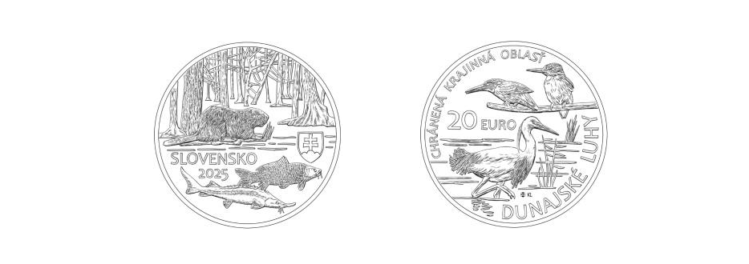

## 199

OZNÁMENIE

Národnej banky Slovenska

z 10. júna 2025

## o vydaní strieborných zberateľských euromincí v nominálnej hodnote 20 eur s tematikou Chránená krajinná oblasť Dunajské Luhy

1. Úvodné ustanovenia

- a) Národná banka Slovenska podľa § 17h ods. 1 zákona Národnej rady Slovenskej republiky č. 566/1992 Zb. o Národnej banke Slovenska v znení neskorších predpisov a podľa § 12 ods. 1 písm. b) zákona č. 400/2015 Z. z. o tvorbe právnych predpisov a o Zbierke zákonov Slovenskej republiky a o zmene a doplnení niektorých zákonov v znení neskorších predpisov oznamuje, že vydáva do obehu strieborné zberateľské euromince v nominálnej hodnote 20 eur s tematikou Chránená krajinná oblasť Dunajské Luhy (ďalej len „zberateľská eurominca“).

- b) Zberateľská eurominca má štatút zákonného platidla len v Slovenskej republike.

- c) Zberateľská eurominca sa razí zo zliatiny obsahujúcej 925 dielov striebra a 75 dielov medi; jej hmotnosť je 33,63 g a priemer 40 mm. Pri razbe zberateľskej euromince je povolená horná a dolná odchýlka v priemere 0,1 mm; povolená horná odchýlka v hmotnosti je 0,4 g a v obsahu striebra 10/1 000.

2. Vzhľad zberateľskej euromince

- a) Na averze mince je zobrazený bobor vodný sediaci na brehu rieky v prirodzenom prostredí lužného lesa. V spodnej časti mincového poľa kompozíciu dopĺňajú zástupcovia dvoch druhov rýb žijúcich v oblasti Dunajských luhov – jesetera malého a divého kapra. Nápis „SLOVENSKO“ je v ľavej spodnej časti mincového poľa. Pod ním je letopočet „2025“. V pravej časti mincového poľa je štátny znak Slovenskej republiky.

- b) Na reverze mince je volavka striebristá, nad ktorou sú dva jedince rybárika riečneho sediace na konári. Kompozíciu dopĺňa vodná vegetácia a vlniaca sa hladina. Vľavo od volavky je nominálna hodnota „20 EURO“. V hornej časti mincového poľa je v opise nápis „CHRÁNENÁ KRAJINNÁ OBLASŤ“ a v dolnej časti je v opise nápis „DUNAJSKÉ LUHY“. Značka Mincovne Kremnica, štátny podnik, ktorú tvorí skratka „MK“ umiestnená medzi dvoma razidlami a iniciálky autora mince Karola Lička „KL“ sú vpravo od volavky.

- c) Na hrane zberateľskej euromince je reliéfny nápis „OCHRANA PRÍRODY A KRAJINY“. Začiatok a koniec textu je oddelený vyobrazením štylizovaného kvetu.

- 

- Štát vydania: Slovenská republika

- Začiatok vydávania: september 2025

Peter Kažimír v. r.
