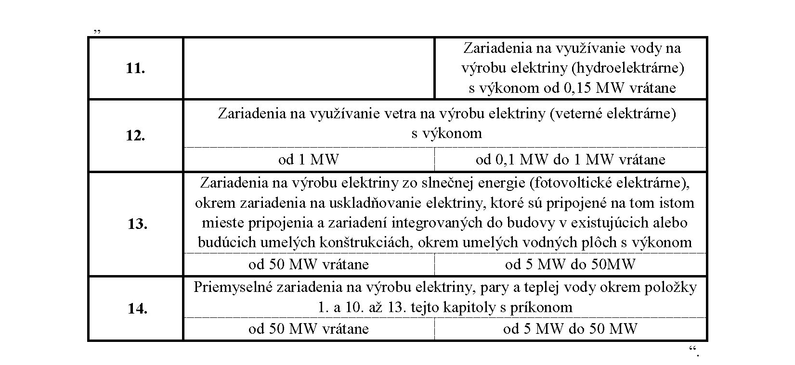
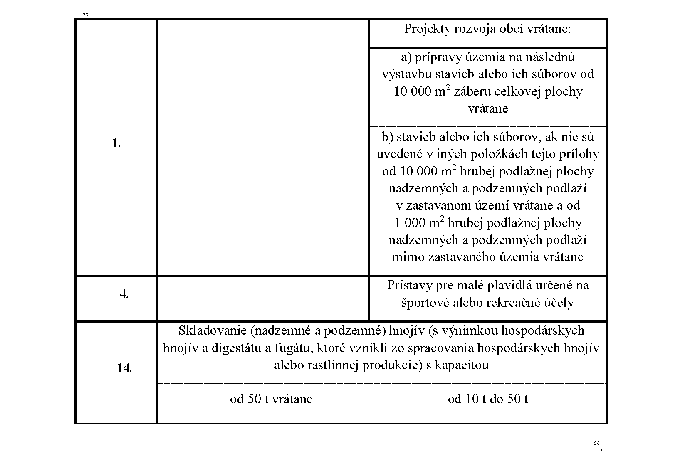

# Čl. I

Zákon č. 24/2006 Z. z. o posudzovaní vplyvov na životné prostredie a o zmene a doplnení niektorých zákonov v znení zákona č. 275/2007 Z. z., zákona č. 454/2007 Z. z., zákona č. 287/2009 Z. z., zákona č. 117/2010 Z. z., zákona č. 145/2010 Z. z., zákona č. 258/2011 Z. z., zákona č. 408/2011 Z. z., zákona č. 345/2012 Z. z., zákona č. 448/2012 Z. z., zákona č. 39/2013 Z. z., zákona č. 180/2013 Z. z., zákona č. 314/2014 Z. z., zákona č. 128/2015 Z. z., zákona č. 125/2016 Z. z., zákona č. 312/2016 Z. z., zákona č. 142/2017 Z. z., zákona č. 177/2018 Z. z., zákona č. 460/2019 Z. z., zákona č. 74/2020 Z. z., zákona č. 198/2020 Z. z., zákona č. 363/2021 Z. z., zákona č. 372/2021 Z. z., zákona č. 172/2022 Z. z., zákona č. 69/2023 Z. z., zákona č. 272/2023 Z. z., zákona č. 142/2024 Z. z., zákona č. 350/2024 Z. z. a zákona č. 26/2025 Z. z. sa mení a dopĺňa takto:

- 1. V § 3 písm. l) sa za slová „uvedené inak“ vkladá čiarka a pripájajú sa tieto slová: „a ak ide o zisťovacie konanie a posudzovanie vplyvov navrhovanej činnosti alebo jej zmeny, týkajúcich sa prevádzok podľa osobitného predpisu,5) je ním Slovenská inšpekcia životného prostredia“.

  - Poznámka pod čiarou k odkazu 5 znie:

  - „5) § 2 písm. d) a r) zákona č. 39/2013 Z. z. o integrovanej prevencii a kontrole znečisťovania životného prostredia a o zmene a doplnení niektorých zákonov v znení neskorších predpisov.“.

- 2. V § 3 písm. n) sa na konci čiarka nahrádza bodkočiarkou a pripájajú sa tieto slová: „ak ide o zjednotené povoľovanie,6a) je ním Slovenská inšpekcia životného prostredia,“.

  - Poznámka pod čiarou k odkazu 6a znie:

  - „6a) § 29a zákona č. 39/2013 Z. z. v znení zákona č. 269/2025 Z. z.“.

- 3. § 3 sa dopĺňa písmenom y), ktoré znie:

- „y)

- nulový variant je aktuálny stav zložiek životného prostredia dotknutého územia a opis predpokladu jeho pravdepodobného vývoja na základe dostupných informácií, ak je možné pri vynaložení primeraného úsilia posúdiť prirodzené zmeny pre prípad, že sa strategický dokument alebo jeho zmena neschváli, alebo ak sa navrhovaná činnosť alebo jej zmena nezrealizuje.“.

- 4. V § 18 sa vypúšťa odsek 6.

  - Doterajšie odseky 7 a 8 sa označujú ako odseky 6 a 7.

- 5. V § 18 odsek 7 znie:

- „(7)

- Predmetom zisťovacieho konania nie je činnosť, ktorá predstavuje

- a)

- renováciu v rozsahu obnovy alebo modernizácie, ak jej výsledkom nie je zmena kapacitných parametrov ani rozšírenie navrhovanej činnosti,

- b)

- inštaláciu najlepšej dostupnej techniky podľa osobitného predpisu,21) ktorej jediným výsledkom je zníženie negatívnych vplyvov na životné prostredie a nedochádza k zvýšeniu kapacitných parametrov,

- c)

- takú zmenu posúdenej alebo povolenej navrhovanej činnosti, ktorej výsledkom je zníženie podlahovej plochy bez navýšenia zastavanej plochy stavebnými objektami a bez zmeny priestorového usporiadania a umiestnenia stavebných objektov na posúdenom území alebo

- d)

- modernizáciu zariadení na výrobu elektriny zo slnečnej energie, ktorá nezahŕňa využitie dodatočného priestoru a je v súlade s podmienkami určenými v konaniach podľa tohto zákona pre pôvodne navrhovanú činnosť.“.

- 6. V § 19 ods. 6 druhá veta znie:

- „Ak príslušný orgán rozhodne, že navrhovaná činnosť alebo jej zmena má podliehať posudzovaniu podľa tohto zákona, postupuje sa ďalej podľa § 23 ods. 4.“.

- 7. § 22 sa dopĺňa odsekom 7, ktorý znie:

- „(7)

- Informáciu o navrhovanej činnosti alebo jej zmene, ktorá nemá náležitosti podľa odseku 4, vráti príslušný orgán do siedmich pracovných dní navrhovateľovi na doplnenie a určí rozsah a lehotu jej doplnenia.“.

- 8. V § 23 ods. 1 sa za slová „Príslušný orgán zašle“ vkladá slovo „úplnú“.

- 9. V § 23 ods. 4 sa na konci pripája táto veta: „Príslušný orgán zároveň doručí rozsah hodnotenia navrhovateľovi, rezortnému orgánu, povoľujúcemu orgánu, dotknutému orgánu a dotknutej obci, na ktorej území sa má navrhovaná činnosť alebo jej zmena realizovať.“.

- 10. V § 25 odsek 2 znie:

- „(2)

- Doručovanie v zisťovacom konaní a v konaní o posudzovaní vplyvov dotknutému orgánu, rezortnému orgánu, povoľujúcemu orgánu, dotknutej obci a navrhovateľovi sa realizuje podľa osobitného predpisu.25a) Všetky úkony príslušného orgánu vo vzťahu k doručovaniu verejnosti a dotknutej verejnosti sa realizujú prostredníctvom zverejňovania úkonov v centrálnom informačnom systéme, pričom za deň doručenia sa považuje deň zverejnenia.“.

- 11. V § 29 sa za odsek 1 vkladá nový odsek 2, ktorý znie:

- „(2)

- Zámer alebo oznámenie o zmene navrhovanej činnosti, ktoré nemá potrebné náležitosti podľa predchádzajúceho odseku, vráti príslušný orgán do siedmich pracovných dní navrhovateľovi na doplnenie a určí rozsah a lehotu jeho doplnenia.“.

  - Doterajšie odseky 2 až 20 sa označujú ako odseky 3 až 21.

- 12. V § 29 ods. 4 sa slová „odseku 4“ nahrádzajú slovami „odseku 5“.

- 13. V § 29 ods. 5 sa slová „odseku 3“ nahrádzajú slovami „odseku 4“.

- 14. V § 29 ods. 6 sa slová „odseku 4“ nahrádzajú slovami „odseku 5“.

- 15. V § 29 ods. 7 sa slová „odsekov 4 a 5“ nahrádzajú slovami „odsekov 5 a 6“ a slová „odseku 4“ sa nahrádzajú slovami „odseku 5“.

- 16. V § 29 ods. 8 sa slová „odsekov 4 a 5“ nahrádzajú slovami „odsekov 5 a 6“.

- 17. V § 29 ods. 9 sa slová „odsekov 4 a 5“ nahrádzajú slovami „odsekov 5 a 6“.

- 18. V § 29 ods. 11 sa na konci pripája táto veta:

- „Záväzné stanovisko zo zisťovacieho konania je rozhodnutie o tom, či navrhovaná činnosť alebo jej zmena má byť predmetom posudzovania vplyvov podľa tohto zákona.“.

- 19. V § 29 ods. 12 sa slová „odseku 6“ nahrádzajú slovami „odseku 7“ a za slová „ak ide o strategickú investíciu podľa osobitného predpisu2b)“ sa vkladajú slová „alebo navrhovanú činnosť alebo jej zmenu v prevažujúcom verejnom záujme pre obnoviteľné zdroje energie,25aa) alebo navrhovanú činnosť alebo jej zmenu využívajúcu vietor na výrobu elektriny v rámci osobitnej oblasti25ab) akceleračných zón“.

  - Poznámky pod čiarou k odkazom 25aa a 25ab znejú:

  - „25aa) § 4c zákona č. 309/2009 Z. z. o podpore obnoviteľných zdrojov energie a vysoko účinnej kombinovanej výroby a o zmene a doplnení niektorých zákonov v znení zákona č. 259/2025 Z. z.

  - 25ab) § 2 ods. 1 písm. r) zákona č. 309/2009 Z. z. v znení zákona č. 259/2025 Z. z.“.

- 20. V § 29 odseky 16 až 18 znejú:

- „(16)

- Ak v záväznom stanovisku zo zisťovacieho konania príslušný orgán rozhodol, že sa navrhovaná činnosť alebo jej zmena nebude posudzovať podľa tohto zákona, záväzné stanovisko zo zisťovacieho konania po nadobudnutí právoplatnosti oprávňuje navrhovateľa podať návrh na začatie povoľovacieho konania k navrhovanej činnosti alebo jej zmeny podľa osobitných predpisov.25b)

- (17)

- Záväzné stanovisko zo zisťovacieho konania obsahuje hlavné dôvody, pre ktoré príslušný orgán rozhodol, že sa navrhovaná činnosť alebo jej zmena nebude posudzovať podľa tohto zákona s odkazom na príslušné kritériá uvedené v prílohe č. 10 tohto zákona, ako aj vlastnosti navrhovanej činnosti alebo jej zmeny a opatrenia, ktorými sa má zabrániť alebo predísť významným nepriaznivým vplyvom na životné prostredie. Záväzné stanovisko zo zisťovacieho konania musí obsahovať

- a)

- výrok, ktorý obsahuje rozhodnutie vo veci s uvedením ustanovenia právneho predpisu, podľa ktorého sa rozhodlo,

- b)

- odôvodnenie, ktorého obsahom sú skutočnosti predstavujúce podklad pre rozhodnutie, správna úvaha príslušného orgánu pri aplikácii právnych predpisov, pri hodnotení dôkazov a jednotlivých tvrdení, pri vysporiadaní sa s návrhmi a námietkami predloženými v konaní a vyjadreniami k podkladom rozhodnutia; odôvodnenie obsahuje taktiež vysporiadanie sa s vyjadreniami podľa odseku 5,

- c)

- poučenie o možnosti podať opravný prostriedok, lehotu a orgán, na ktorý možno opravný prostriedok podať; poučenie obsahuje aj údaj, či rozhodnutie možno preskúmať súdom,

- d)

- uvedenie orgánu, ktorý rozhodnutie vydal, a dátum vydania rozhodnutia.

- (18)

- Záväzné stanovisko zo zisťovacieho konania sa vyhotovuje v elektronickej podobe, príslušný orgán postupuje podľa osobitného predpisu.25a) Záväzné stanovisko zo zisťovacieho konania v prípade, že sa vyhotovuje v písomnej podobe, musí obsahovať úradnú pečiatku a podpis s uvedením mena, priezviska a funkcie oprávnenej osoby.“.

- 21. V § 29 sa vypúšťa odsek 19.

  - Doterajšie odseky 20 a 21 sa označujú ako odseky 19 a 20.

- 22. V § 29 ods. 19 prvej vete sa za slová „v záväznom stanovisku“ vkladajú slová „zo zisťovacieho konania“.

- 23. V § 29 ods. 20 sa za slová „môže žalobou“ vkladajú slová „podľa § 178 ods. 3 Správneho súdneho poriadku“ a slová „odseku 15“ sa nahrádzajú slovami „odseku 16“.

- 24. Za § 29a sa vkladá § 30, ktorý vrátane nadpisu znie:

- 㤠30

- Opravné prostriedky proti záväznému stanovisku zo zisťovacieho konania

- (1)

- Proti záväznému stanovisku zo zisťovacieho konania môže podať odvolanie navrhovateľ, dotknutá verejnosť a dotknutá obec, na ktorej území sa má navrhovaná činnosť alebo jej zmena realizovať.

- (2)

- Navrhovateľ a dotknutá obec, na ktorej území sa má navrhovaná činnosť alebo jej zmena realizovať, môžu podať odvolanie v lehote 15 dní odo dňa doručenia záväzného stanoviska zo zisťovacieho konania. Dotknutá verejnosť môže podať odvolanie v lehote 15 dní odo dňa zverejnenia záväzného stanoviska zo zisťovacieho konania v centrálnom informačnom systéme. Odvolanie sa podáva na príslušnom orgáne, ktorý napadnuté rozhodnutie vydal. Uplynutím lehoty na podanie odvolania nadobúda záväzné stanovisko zo zisťovacieho konania právoplatnosť.

- (3)

- Príslušný orgán, ktorý vydal napadnuté záväzné stanovisko zo zisťovacieho konania, bezodkladne

- a)

- informuje o podanom odvolaní v centrálnom informačnom systéme a na úradnej tabuli, ak ju má zriadenú,

- b)

- upovedomí dotknutú obec, na ktorej území sa má navrhovaná činnosť alebo jej zmena realizovať, a navrhovateľa o obsahu podaného odvolania,

- c)

- vyzve dotknutú obec, na ktorej území sa má navrhovaná činnosť alebo jej zmena realizovať, a navrhovateľa, aby sa v lehote desať dní odo dňa doručenia výzvy k podanému odvolaniu vyjadrili.

- (4)

- Príslušný orgán po uplynutí lehoty podľa odseku 3 písm. c) predloží bezodkladne, najneskôr však do desiatich dní, podané odvolanie spolu s administratívnym spisom vrátane doručených vyjadrení svojmu najbližšie nadriadenému orgánu.

- (5)

- Na vyjadrenia doručené po uplynutí lehoty podľa odseku 3 písm. c) odvolací orgán neprihliada. Včas podané odvolanie má odkladný účinok.

- (6)

- Odvolacím orgánom je orgán najbližšieho vyššieho stupňa nadriadený príslušnému orgánu, ktorý napadnuté rozhodnutie vydal. Ak je prvostupňovým orgánom ministerstvo, o odvolaní rozhoduje minister na základe návrhu ním ustanovenej osobitnej komisie.

- (7)

- V odvolaní odvolateľ uvedie, v čom spočíva rozpor s právnymi predpismi alebo nesprávnosť rozhodnutia alebo konania, ktoré záväznému stanovisku zo zisťovacieho konania predchádzalo. Odvolanie smeruje proti výrokovej časti záväzného stanoviska zo zisťovacieho konania.

- (8)

- Odvolací orgán preskúma napadnuté rozhodnutie v celom rozsahu; ak je to nevyhnutné, doterajšie konanie doplní, prípadne zistené vady odstráni. Odvolací orgán rozhodne o riadne doručenom odvolaní proti vydanému záväznému stanovisku zo zisťovacieho konania v lehote do 21 dní odo dňa, kedy mu bolo odvolanie spolu s administratívnym spisom postúpené.

- (9)

- Ak odvolací orgán zistí, že záväzné stanovisko zo zisťovacieho konania bolo vydané v rozpore s právnymi predpismi alebo je vecne nesprávne,

- a)

- záväzné stanovisko zo zisťovacieho konania zmení, alebo

- b)

- záväzné stanovisko zo zisťovacieho konania zruší a vec vráti príslušnému orgánu na ďalšie konanie a nové rozhodnutie.

- (10)

- Ak odvolací orgán zruší záväzné stanovisko zo zisťovacieho konania a vec vráti príslušnému orgánu na ďalšie konanie a nové rozhodnutie, príslušný orgán je viazaný právnym názorom odvolacieho orgánu. Ak odvolací orgán zruší záväzné stanovisko zo zisťovacieho konania a vráti vec na ďalšie konanie a nové rozhodnutie, je povinný v odôvodnení rozhodnutia uviesť aj to, ako má príslušný orgán vo veci ďalej postupovať.

- (11)

- Ak odvolací orgán zruší záväzné stanovisko zo zisťovacieho konania a vec vráti príslušnému orgánu na nové konanie a rozhodnutie, príslušný orgán vydá nové záväzné stanovisko zo zisťovacieho konania do 30 dní odo dňa doručenia rozhodnutia odvolacieho orgánu spolu s administratívnym spisom.

- (12)

- Odvolací orgán odvolanie zamietne a záväzné stanovisko zo zisťovacieho konania potvrdí ako vecne správne, ak nezistí rozpor s právnymi predpismi.

- (13)

- Proti rozhodnutiu odvolacieho orgánu nemožno podať odvolanie. Rozhodnutie odvolacieho orgánu príslušný orgán, ktorý napadnuté rozhodnutie vydal, bezodkladne zverejní v centrálnom informačnom systéme. Rozhodnutie odvolacieho orgánu je právoplatné dňom jeho zverejnenia.

- (14)

- Ak odvolateľ vzal podané odvolanie späť, konanie o odvolaní sa zastaví dňom doručenia späťvzatia odvolania. Ten, kto odvolanie vzal späť, nemôže opätovne podať v tej istej veci odvolanie. Pri viacerých odvolateľoch sa odvolacie konanie zastaví dňom doručenia späťvzatia odvolania posledného z odvolateľov. Dňom nasledujúcim po zastavení konania nadobúda napadnuté záväzné stanovisko zo zisťovacieho konania právoplatnosť. O skutočnosti, že konanie bolo zastavené, odvolací orgán informuje spôsobom podľa § 25 ods. 2 a túto skutočnosť vyznačí v administratívnom spise. Odvolanie je možné vziať späť do vydania rozhodnutia odvolacieho orgánu.

- (15)

- Odvolateľ má právo nahliadať do spisu, robiť si z neho výpisy, odpisy a kópie.

- (16)

- Odvolanie je podané včas aj vtedy, ak bolo najneskôr v posledný deň lehoty na podanie odvolania podľa odseku 2 odovzdané na poštovú prepravu alebo odoslané príslušnému orgánu, ktorý vydal napadnuté rozhodnutie podľa osobitného predpisu.25a)“.

- 25. V § 31 ods. 5 sa na konci pripája táto veta:

- „Neúplnú správu o hodnotení činnosti príslušný orgán bezodkladne vráti navrhovateľovi a vyzve ho na doplnenie, pričom určí rozsah doplnenia a lehotu na predloženie doplnenej správy o hodnotení činnosti.“.

- 26. V § 31 ods. 6 sa za slová „Dňom doručenia“ vkladá slovo „úplnej“.

- 27. V § 37 ods. 2 sa za slová „navrhovanú činnosť podľa osobitného predpisu,2c)“ vkladajú slová „alebo navrhovanú činnosť alebo jej zmenu v prevažujúcom verejnom záujme pre obnoviteľné zdroje energie,25aa) alebo navrhovanú činnosť alebo jej zmenu využívajúcu vietor na výrobu elektriny v rámci osobitnej oblasti25ab) akceleračných zón“.

- 28. V § 38 odsek 8 znie:

- „(8)

- Ak navrhovateľ podá návrh na začatie povoľovacieho konania, pričom územie alebo navrhovaná činnosť alebo jej zmena, ktorej sa toto konanie týka, bola predmetom konania o posudzovaní vplyvov na životné prostredie a v záverečnom stanovisku príslušný orgán vyslovil nesúhlas s realizáciou navrhovanej činnosti alebo jej zmeny alebo využívania územia, povoľujúci orgán konanie zastaví.“.

- 29. Za § 39 sa vkladá § 39a, ktorý vrátane nadpisu znie:

- 㤠39a

- Osobitné konania pre zjednotené povoľovanie

- (2)

- Ak je predmetom posudzovania vplyvov navrhovaná činnosť alebo jej zmena, ktorá je osobitnou prevádzkou podľa osobitného predpisu,33) alebo osobitnou prevádzkou podľa osobitného predpisu33) využívajúcu vietor na výrobu elektriny v rámci osobitnej oblasti25ab) akceleračných zón, pre ktorú má byť vydané rozhodnutie o stavebnom zámere podľa § 60 Stavebného zákona, vykoná príslušný orgán posúdenie vplyvov na životné prostredie a povolenie navrhovanej činnosti alebo jej zmeny v konaní o vydanie zjednoteného povolenia, ak navrhovateľ nenavrhne inak. Príslušný orgán postupuje podľa osobitného predpisu35) a požiadavky na zjednotené povoľovanie vyplývajúce z tohto zákona sa použijú v rámci povoľovania podľa osobitného predpisu.32)

- (3)

- Ak navrhovateľ navrhne v konaní podľa odseku 1 alebo odseku 2 rozdielny postup, je povinný o to požiadať príslušný orgán v sprievodnej dokumentácii. V prípade, že navrhovateľ nepredloží písomné oznámenie o inom postupe, vyjadruje súhlas s postupom uvedeným v odseku 1 alebo odseku 2.

- (5)

- Ak je predmetom posudzovania vplyvov navrhovaná činnosť alebo jej zmena, ktorá je osobitnou prevádzkou podľa osobitného predpisu,33) alebo osobitnou prevádzkou podľa osobitného predpisu33) využívajúcu vietor na výrobu elektriny v rámci osobitnej oblasti25ab) akceleračných zón, pre ktorú má byť vydané rozhodnutie o stavebnom zámere podľa § 60 Stavebného zákona,

- a)

- zjednotené povoľovanie začína dňom doručenia žiadosti s náležitosťami podľa § 50 Stavebného zákona, ktorej súčasťou je aj správa o hodnotení činnosti vypracovaná podľa § 31 ods. 1 a prílohy č. 11,

- b)

- príslušný orgán do 40 dní overí úplnosť správy o hodnotení činnosti a postupuje podľa § 33 ods. 1,

- c)

- príslušný orgán neuplatní postup podľa § 33 ods. 2 a § 36,

- d)

- príslušný orgán vydá záverečné stanovisko, ktoré je súčasťou rozhodnutia zo zjednoteného povoľovania v lehote podľa osobitného predpisu.35ae)

- (6)

- Ak je predmetom posudzovania vplyvov navrhovaná činnosť alebo jej zmena, ktorá je osobitnou prevádzkou podľa osobitného predpisu33) alebo osobitnou prevádzkou podľa osobitného predpisu33) využívajúcu vietor na výrobu elektriny v rámci osobitnej oblasti25ab) akceleračných zón, pre ktorú má byť vydané rozhodnutie o stavebnom zámere podľa § 60 Stavebného zákona, pričom ide o veternú energiu, príslušný orgán je viazaný stanoviskom dotknutej obce smerujúcemu voči vyjadreniu súhlasu so stavebným zámerom, stanoviskom Úradu pre reguláciu sieťových odvetví smerujúcemu k stabilite cien elektriny a stanoviskom prevádzkovateľa prenosovej sústavy35af) smerujúcemu k súhlasu s pripojením nového zariadenia na výrobu elektriny do prenosovej sústavy z pohľadu stability prenosovej sústavy; ak je stanovisko niektorého dožiadaného orgánu nesúhlasné, príslušný orgán je ním viazaný, a to aj v prípade súhlasného stanoviska ďalšieho dožiadaného orgánu.

- (7)

- Stanoviská podľa predchádzajúceho odseku sú dožiadané orgány povinné doručiť príslušnému orgánu bezodkladne, najneskôr však do 30 dní odo dňa doručenia žiadosti od príslušného orgánu.“.

  - Poznámky pod čiarou k odkazom 31 až 35af znejú:

  - „31) § 2 písm. d) zákona č. 39/2013 Z. z. v znení neskorších predpisov.

  - 32) Zákon č. 39/2013 Z. z. v znení neskorších predpisov.

  - 33) § 2 písm. r) zákona č. 39/2013 Z. z. v znení zákona č. 269/2025 Z. z.

  - 35) § 7 zákona č. 39/2013 Z. z. v znení neskorších predpisov.

  - 35a) § 11 ods. 4 zákona č. 39/2013 Z. z. v znení neskorších predpisov.

  - 35aa) § 6 zákona č. 39/2013 Z. z. v znení neskorších predpisov.

  - 35ab) § 15 ods. 4 zákona č. 39/2013 Z. z.

  - 35ac) § 15 ods. 5 zákona č. 39/2013 Z. z.

  - 35ad) § 29b zákona č. 39/2013 Z. z. v znení zákona č. 269/2025 Z. z.

  - 35ae) § 29c ods. 2 zákona č. 39/2013 Z. z. v znení zákona č. 269/2025 Z. z.

  - 35af) § 3 písm. b) druhý bod zákona č. 251/2012 Z. z. o energetike a o zmene a doplnení niektorých zákonov v znení neskorších predpisov.“.

- 30. V § 46 ods. 1 písm. a) sa slová „v prílohe č. 9“ nahrádzajú slovami „v prílohe č. 9a“.

- 31. V § 53 sa odsek 1 dopĺňa písmenom d), ktoré znie:

- „d)

- Slovenská inšpekcia životného prostredia.“.

- 32. § 54 až 56 vrátane nadpisov znejú:

- 㤠54

- Ministerstvo

- (1)

- Ministerstvo je ústredný orgán štátnej správy pre zisťovacie konanie, posudzovanie vplyvov na životné prostredie a konanie o podnete podľa § 19.

- (2)

- Ministerstvo

- a)

- vykonáva štátnu správu a riadi jej výkon podľa odseku 1,

- b)

- plní úlohy kontaktného bodu, ak ide o konanie presahujúce štátne hranice,

- c)

- zabezpečuje konanie pre strategické dokumenty podľa § 4 s medzinárodným dosahom okrem strategických dokumentov s celoštátnym dosahom,

- d)

- spolupracuje s rezortným orgánom v konaniach pre strategické dokumenty s celoštátnym dosahom v rozsahu podľa § 17,

- e)

- poskytuje odbornú pomoc pri uplatňovaní tohto zákona,

- f)

- vykonáva zisťovacie konanie pre zmeny navrhovanej činnosti podľa § 18 ods. 2 písm. c), okrem zisťovacieho konania, ak ide o činnosť podľa osobitného predpisu,5)

- g)

- rozhoduje na základe podnetu podľa § 19 o posudzovaní činností uvedených v prílohe č. 8, ktoré nedosahujú prahovú hodnotu,

- h)

- určuje, ktorý okresný úrad v sídle kraja je príslušným orgánom, ak má strategický dokument dosah na územie viacerých krajov,

- i)

- určuje, ktorý okresný úrad v sídle kraja je príslušným orgánom na posudzovanie navrhovanej činnosti, ak má navrhovaná činnosť dosah na územie viacerých krajov,

- j)

- zabezpečuje konanie podľa tohto zákona pre strategické dokumenty a navrhované činnosti presahujúce štátne hranice,

- k)

- zabezpečuje posudzovanie navrhovaných činností a ich zmien uvedených v prílohe č. 8 časti A, alebo ak to vyplynie z rozhodnutia zo zisťovacieho konania alebo zo záväzného stanoviska zo zisťovacieho konania, okrem navrhovaných činností alebo ich zmien týkajúcich sa prevádzok podľa osobitného predpisu,5)

- l)

- zabezpečuje konanie podľa tohto zákona pre ďalšie navrhované činnosti, pre ktoré je príslušným orgánom okresný úrad v sídle kraja, ak si túto pôsobnosť v jednotlivých prípadoch vyhradí,

- m)

- vedie centrálnu evidenciu všetkých posúdených strategických dokumentov a navrhovaných činností a zabezpečuje centrálny informačný systém posudzovania vplyvov na životné prostredie,

- n)

- zabezpečuje uchovávanie dokumentácie v dokumentačnom centre,

- o)

- zabezpečuje odbornú spôsobilosť osôb na posudzovanie vplyvov na životné prostredie,

- p)

- vedie, aktualizuje a zverejňuje zoznam odborne spôsobilých osôb na posudzovanie vplyvov na životné prostredie,

- q)

- určuje spracovateľov odborného posudku podľa § 13 a 36,

- r)

- je správnym orgánom v konaní o tom, kto znáša niektoré náklady podľa § 59 ods. 2,

- s)

- určuje spoločné posudzovanie viacerých navrhovaných činností, ak sú v prevádzkovej alebo priestorovej súvislosti podľa § 20 ods. 2,

- t)

- zúčastňuje sa konzultácií podľa § 63,

- u)

- poskytuje Európskej komisii informácie o skúsenostiach získaných pri uplatňovaní tohto zákona tak, aby mohla byť včas a kvalitne zabezpečená správa vydávaná Európskou komisiou,

- v)

- do 16. mája 2023 a potom každých šesť rokov oznamuje Európskej komisii informácie, ktoré má k dispozícii, a to najmä informácie o

- 1.

- počte navrhovaných činností alebo ich zmien uvedených v prílohe č. 8, ktoré podliehali posudzovaniu vplyvov,

- 2.

- zozname posudzovaných navrhovaných činností alebo ich zmien podľa položiek v prílohe č. 8,

- 3.

- počte navrhovaných činností alebo ich zmien, ktoré podliehali zisťovaciemu konaniu,

- 4.

- odhadoch dopadov na posudzovanie vplyvov vrátane dopadov tohto zákona na malé a stredné podniky,

- w)

- je príslušným orgánom na uznávanie odbornej kvalifikácie v oblasti posudzovania vplyvov na životné prostredie,

- x)

- je odvolacím orgánom vo veciach, v ktorých v prvom stupni rozhoduje okresný úrad v sídle kraja,

- y)

- vykonáva kontrolu a vyhodnocuje súlad projektov uchádzajúcich sa o zdroje z európskych štrukturálnych a investičných fondov so zákonom,

- z)

- určuje, ktorý okresný úrad je príslušným orgánom, ak sa navrhovaná činnosť alebo jej zmena nachádza na rozmedzí dvoch okresov a dvoch krajov súčasne,

- aa)

- rozhoduje o predĺžení lehoty na rozhodnutie odvolacieho orgánu, ak vo veci je v prvom stupni príslušný rozhodovať okresný úrad,

- ab)

- zabezpečuje zisťovacie konanie navrhovaných činností a ich zmien uvedených v prílohe č. 8 časti B, pre ktoré je príslušným orgánom okresný úrad, ak si túto pôsobnosť vyhradí,

- ac)

- zabezpečuje konanie podľa § 18 ods. 1 písm. i).

- § 55

- Okresný úrad v sídle kraja

- Okresný úrad v sídle kraja ako orgán štátnej správy

- a)

- vykonáva konanie podľa tohto zákona pre strategické dokumenty podľa § 4 s dosahom na územie kraja, v ktorom má sídlo,

- b)

- vykonáva zisťovacie konanie strategických dokumentov podľa § 7 a navrhovaných činností podľa § 29 s dosahom na územie kraja, v ktorom má sídlo, okrem zisťovacieho konania pre zmeny navrhovanej činnosti podľa § 18 ods. 2 písm. c) a navrhovaných činností alebo ich zmien podľa osobitného predpisu,5)

- c)

- vykonáva posudzovanie strategického dokumentu a navrhovanej činnosti, ak taká povinnosť vyplynie zo zisťovacieho konania vykonaného podľa písmena b), okrem posudzovania navrhovanej činnosti alebo jej zmeny podľa osobitného predpisu,5)

- d)

- vykonáva posudzovanie navrhovaných činností podľa § 18 ods. 1 písm. g) s dosahom na územie kraja,

- e)

- je správnym orgánom v konaní o pochybnostiach, či niektoré náklady znáša obstarávateľ a navrhovateľ podľa § 59 ods. 2,

- f)

- určí, ktorý okresný úrad je príslušným orgánom na konanie, ak má strategický dokument dosah na viacero okresov v územnom obvode okresného úradu,

- g)

- určí, ktorý okresný úrad je príslušným orgánom na konanie, ak má navrhovaná činnosť alebo jej zmena dosah na viacero okresov v územnom obvode okresného úradu,

- h)

- zúčastňuje sa konzultácií podľa § 63,

- i)

- poskytuje informácie o konaniach podľa písmen a) až d) do centrálneho informačného systému,

- j)

- zabezpečuje uchovávanie dokumentácie po ukončení konania podľa písmen a) až d) a na požiadanie z nej poskytuje informácie,

- k)

- určuje spracovateľov odborného posudku podľa § 13 a § 36.

- § 56

- Okresný úrad

- Okresný úrad ako orgán štátnej správy

- a)

- vykonáva posudzovanie strategických dokumentov podľa § 4 s dosahom na svoj územný obvod,

- b)

- vykonáva zisťovacie konanie strategických dokumentov podľa § 7 a navrhovaných činností alebo ich zmien podľa § 29 s dosahom na územie okresu, v ktorom má sídlo, okrem zisťovacieho konania pre zmeny navrhovanej činnosti podľa § 18 ods. 2 písm. c) a navrhovaných činností alebo ich zmien podľa osobitného predpisu,5)

- c)

- vykonáva posudzovanie strategických dokumentov a navrhovaných činností alebo ich zmien, ak taká povinnosť vyplynie zo zisťovacieho konania vykonaného podľa písmena b), okrem posudzovania navrhovaných činností podľa osobitného predpisu,5)

- d)

- je správnym orgánom v konaní o pochybnostiach, či niektoré náklady znáša obstarávateľ a navrhovateľ podľa § 59 ods. 2,

- e)

- zúčastňuje sa konzultácií podľa § 63,

- f)

- poskytuje informácie o konaniach podľa písmen a) až c) do centrálneho informačného systému,

- g)

- zabezpečuje uchovávanie dokumentácie po ukončení konania podľa písmen a) až c) a na požiadanie z nej poskytuje informácie,

- h)

- určuje spracovateľov odborného posudku podľa § 13 a 36.“.

- 33. Za § 56 sa vkladá § 56a, ktorý vrátane nadpisu znie:

- 㤠56a

- Slovenská inšpekcia životného prostredia

- Ak ide o navrhovanú činnosť alebo jej zmenu, ktorou je prevádzka podľa osobitného predpisu,5) Slovenská inšpekcia životného prostredia

- a)

- vykonáva zisťovacie konanie,

- b)

- vykonáva posudzovanie vplyvov,

- c)

- vykonáva posudzovanie vplyvov, ak to vyplynulo zo zisťovacieho konania,

- d)

- poskytuje informácie o konaniach podľa písmen a) až c) do centrálneho informačného systému,

- e)

- zabezpečuje uchovávanie dokumentácie podľa písmen a) až c) po ukončení procesu a na požiadanie z nej poskytuje informácie,

- f)

- je správnym orgánom v konaní o tom, kto znáša niektoré náklady podľa § 59 ods. 2,

- g)

- zúčastňuje sa konzultácií podľa § 63.“.

- 34. V § 61 ods. 1 sa za slová „§ 5, 9, 13, 22,“ vkladajú slová „29 ods. 1,“.

- 35. V § 63 odsek 1 znie:

- „(1)

- Príslušný orgán pri posudzovaní vplyvov strategických dokumentov alebo navrhovaných činností alebo ich zmien alebo pri postupe podľa § 7 zabezpečí vykonanie konzultácií s povoľujúcim orgánom alebo schvaľujúcim orgánom, rezortným orgánom, dotknutým orgánom, dotknutou obcou a dotknutou verejnosťou počas celého procesu posudzovania vplyvov.“.

- 36. V § 63 ods. 3 sa za slová „výsledky konzultácií“ vkladajú slová „v odôvodnení rozhodnutia zo zisťovacieho konania podľa § 7 alebo“.

- 37. V § 64 písm. f) sa na konci pripájajú tieto slová: „a 30“.

- 38. Za § 64 sa vkladajú § 64a a 64b, ktoré vrátane nadpisov znejú:

- 㤠64a

- Vynútiteľnosť lehôt

- (1)

- Ak dôjde k nedodržaniu lehôt ustanovených pre konania podľa tohto zákona, pri ktorých bolo na základe písomného podania navrhovateľa, dotknutej obce doručeného orgánu kontroly postupom podľa osobitného predpisu25a) zistené, že zo strany príslušného orgánu došlo k nesprávnemu úradnému postupu, je príslušný orgán povinný vykonať nápravu bezodkladne a o vykonanej náprave informovať orgán kontroly.39a) Podanie podľa predchádzajúcej vety môže smerovať len voči konaniam, ktoré boli začaté po 1. novembri 2025.

- (2)

- Orgán kontroly je po prešetrení priebehu a stavu jednotlivého konania podľa tohto zákona oprávnený podať nadriadenému orgánu príslušného orgánu návrh na určenie sankcie. Ak je prvostupňovým orgánom ministerstvo, orgánom kontroly je minister, ktorý rozhoduje na základe návrhu ním ustanovenej osobitnej komisie.

- (3)

- Nadriadený orgán prešetrí konanie príslušného orgánu v lehote do 90 dní od doručenia podania podľa odseku 1 najneskôr do jedného roka odo dňa uplynutia nedodržanej lehoty ustanovenej týmto zákonom.

- (4)

- Nadriadený orgán príslušného orgánu je na základe výsledkov prešetrenia oprávnený vydať písomné rozhodnutie o uložení napomenutia spolu s náležitým odôvodnením.“.

  - § 64b Splnomocňovacie ustanovenia

  - Všeobecne záväzný právny predpis, ktorý vydá ministerstvo, ustanoví osobitné podrobnosti a kritériá vo vzťahu k osobitným oblastiam25ab) akceleračných zón vo vzťahu k veternej energii, ktorým sa určí metodika pre rozvoj veternej energetiky v Slovenskej republike – príprava akceleračných zón vhodných na rozvoj veternej energie.“.

    - Poznámka pod čiarou k odkazu 39a znie:

    - „39a) § 4 zákona č. 180/2013 Z. z. o organizácii miestnej štátnej správy a o zmene a doplnení niektorých zákonov v znení neskorších predpisov.

    - § 2 ods. 1 písm. b) zákona č. 525/2003 Z. z. o štátnej správe starostlivosti o životné prostredie a o zmene a doplnení niektorých zákonov v znení neskorších predpisov.“.

- 39. Za § 65ia sa vkladá § 65ib, ktorý vrátane nadpisu znie:

- 㤠65ib

- Prechodné ustanovenie k úpravám účinným od 1. novembra 2025

- Konania pre osobitné prevádzky podľa osobitného predpisu,33) ktoré boli začaté a právoplatne neukončené do 31. októbra 2025, sa dokončia podľa tohto zákona v znení účinnom v čase začatia konania.“.

- 41. V prílohe č. 8 kapitole č. 4 položky č. 11 až 14 znejú:

- 

- 42. V prílohe č. 8 sa kapitola č. 4 dopĺňa položkou č. 15, ktorá znie:

- „

- 15. | | Priemyselné zariadenia na vedenie pary, plynu a teplej vody so svetlosťou od 300 mm vrátane alebo súvislou dĺžkou od 5 km vrátane

- “.

- 43. V prílohe č. 8 kapitole č. 9 položka č. 14 znie:

- „

- 14. | | Ostatná výroba, neuvedená v iných kapitolách tejto prílohy so záberom plochy od 3 000 m2 vrátane

- “.

- 44. V prílohe č. 8 kapitole č. 9 položka č. 16 sa vypúšťa.

- 45. V prílohe č. 8 kapitole č. 12 položka č. 9 znie:

- „

- 9. | | Prístaviská a prekladiská

- “.

- 46. V prílohe č. 8 kapitole č. 13 položky č. 1, 4 a 14 znejú:

- 
