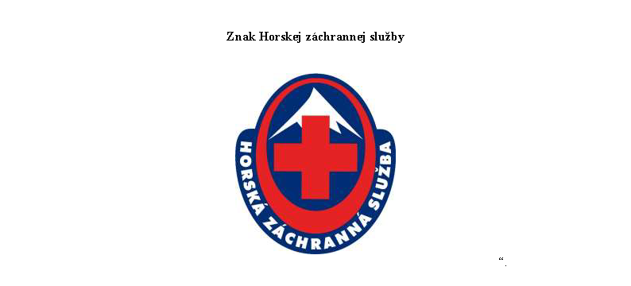

# Čl. I

Zákon č. 544/2002 Z. z. o Horskej záchrannej službe v znení zákona č. 515/2003 Z. z., zákona č. 567/2005 Z. z., zákona č. 358/2007 Z. z., zákona č. 519/2007 Z. z., zákona č. 445/2008 Z. z., zákona č. 192/2009 Z. z., zákona č. 58/2014 Z. z., zákona č. 274/2015 Z. z., zákona č. 73/2020 Z. z. a zákona č. 456/2022 Z. z. sa mení a dopĺňa takto:

- 1. V § 1 sa vypúšťajú slová „(ďalej len „horská služba“)“.

- 2. § 2 sa dopĺňa odsekmi 6 až 8, ktoré znejú:

- „(6)

- Horská záchranná služba pri svojej činnosti používa označenie „Horská záchranná služba“ a znak Horskej záchrannej služby, ktorý je uvedený v prílohe.

- (7)

- Osobe, ktorá nevykonáva úlohy Horskej záchrannej služby, sa zakazuje používať označenie „Horská záchranná služba“ v ústnom vyhlásení, v označení budov, na odeve, v písomnom styku, v názve webového sídla a na vozidle vo všetkých tvaroch vrátane zmien v jeho diakritike a so začiatočným malým písmenom.

- (8)

- Osobe, ktorá nevykonáva úlohy Horskej záchrannej služby, sa zakazuje používať znak Horskej záchrannej služby v označení budov, na odeve, v písomnom styku, v názve webového sídla a na vozidle.“.

- 3. V § 2a ods. 1 sa za slovo „činnosť“ vkladajú slová „v horských oblastiach, na lyžiarskych tratiach a v jaskyniach“.

- 4. V § 2a sa za odsek 1 vkladá nový odsek 2, ktorý znie:

- „(2)

- Záchrannou činnosťou je aj vyslobodzovanie osoby v tiesni použitím lanovej techniky v neprístupných oblastiach alebo ťažko prístupných oblastiach mimo horských oblastí.“.

  - Doterajší odsek 2 sa označuje ako odsek 3.

- 5. V § 2b ods. 4 prvej vete sa za slovo „predsedníctvo“ vkladá čiarka a slová „disciplinárna komisia, odvolacia komisia“.

- 6. V § 2b ods. 4 sa za druhú vetu vkladajú nová tretia veta až siedma veta, ktoré znejú: „Disciplinárna komisia je etický a disciplinárny orgán asociácie, ktorý má najmenej troch členov a vykonáva disciplinárnu právomoc v disciplinárnom konaní v prvom stupni. Odvolacia komisia je odvolací orgán asociácie, ktorý má najmenej troch členov, vykonáva disciplinárnu právomoc v disciplinárnom konaní v druhom stupni a rozhoduje o odvolaniach proti rozhodnutiam v konaní o uznaní odbornej spôsobilosti na výkon horskej vodcovskej činnosti získanej v zahraničí.4a) Členom disciplinárnej komisie alebo odvolacej komisie nemôže byť predseda alebo člen predsedníctva. Podrobnosti o zložení a činnosti disciplinárnej komisie a odvolacej komisie v disciplinárnom konaní upravuje disciplinárny poriadok asociácie, ktorý schvaľuje snem asociácie. Podrobnosti o zložení a činnosti odvolacej komisie v odvolacom konaní upravujú stanovy asociácie.“.

  - Poznámka pod čiarou k odkazu 4a znie:

  - „4a) Zákon č. 422/2015 Z. z. o uznávaní dokladov o vzdelaní a o uznávaní odborných kvalifikácií a o zmene a doplnení niektorých zákonov v znení neskorších predpisov.“.

- 7. V § 2b ods. 4 poslednej vete sa slová „ustanovujú predpisy“ nahrádzajú slovami „upravujú stanovy“.

- 8. Za § 2b sa vkladá § 2ba, ktorý vrátane nadpisu znie:

- 㤠2ba

- Registrácia a členstvo v asociácii

- (1)

- Členstvo v asociácii je dobrovoľné.

- (2)

- Asociácia zapíše do zoznamu členov asociácie osobu, ktorá

- a)

- má odbornú spôsobilosť na výkon horskej vodcovskej činnosti podľa tohto zákona alebo má uznanú odbornú spôsobilosť podľa § 2c písm. f),

- b)

- doručí písomnú žiadosť o členstvo v asociácii.

- (3)

- Člen asociácie je platiteľom členského príspevku, ktorého výšku určuje snem asociácie. Podrobnosti o vzniku a zániku členstva upravujú stanovy asociácie.

- (4)

- Asociácia zapíše do zoznamu registrovaných osôb osobu, ktorá

- a)

- má odbornú spôsobilosť na výkon horskej vodcovskej činnosti podľa tohto zákona alebo má uznanú odbornú spôsobilosť podľa § 2c písm. f),

- b)

- doručí písomnú žiadosť o registráciu v asociácii.

- (5)

- Registrácia v asociácii je bezplatná. Podrobnosti o registrácii upravujú stanovy asociácie.

- (6)

- Člen asociácie má právo voliť a právo byť volený do orgánov asociácie. Registrovaná osoba nemá právo voliť a právo byť volená do orgánov asociácie.

- (7)

- Člen asociácie a registrovaná osoba podliehajú disciplinárnej právomoci asociácie podľa § 2ca.

- (8)

- Člen asociácie alebo registrovaná osoba musí byť poistená pre prípad zodpovednosti za škodu, ktorá by mohla vzniknúť pri poskytovaní horskej vodcovskej činnosti, minimálne s limitom poistného plnenia 1 000 000 eur. Poistenie musí trvať počas celej doby výkonu horskej vodcovskej činnosti.“.

- 9. V § 2c písm. j) sa slová „porušení povinností vyplývajúcich z § 11 ods. 2 písm. a)“ nahrádzajú slovami „výkone horskej vodcovskej činnosti“.

- 10. § 2c sa dopĺňa písmenami k) až o), ktoré znejú:

- „k)

- zastupuje Slovenskú republiku v medzinárodných organizáciách pôsobiacich v oblasti horskej vodcovskej činnosti,

- l)

- vydáva metodiku na získanie odbornej spôsobilosti na výkon horskej vodcovskej činnosti podľa § 11a,

- m)

- vydáva pokyny upravujúce požiadavky na bezpečnosť pri výkone horskej vodcovskej činnosti a zverejňuje ich na svojom webovom sídle,

- n)

- vedie zoznam členov asociácie a registrovaných osôb v rozsahu meno, priezvisko, štátna príslušnosť a zverejňuje ho na svojom webovom sídle,

- o)

- rozhoduje o disciplinárnych opatreniach za disciplinárne previnenie členov asociácie a registrovaných osôb.“.

- 11. Za § 2c sa vkladá § 2ca, ktorý vrátane nadpisu znie:

- 㤠2ca

- Disciplinárna zodpovednosť

- (1)

- Člen asociácie je disciplinárne zodpovedný za disciplinárne previnenie. Disciplinárnym previnením je porušenie

- a)

- pokynov podľa § 2c písm. m),

- b)

- niektorej z povinností ustanovených v § 2ba ods. 8 alebo § 2d ods. 3,

- c)

- stanov asociácie.

- (2)

- Registrovaná osoba je disciplinárne zodpovedná za disciplinárne previnenie. Disciplinárnym previnením je porušenie

- a)

- pokynov podľa § 2c písm. m),

- b)

- niektorej z povinností ustanovených v § 2ba ods. 8 alebo § 2d ods. 3.

- (3)

- Za disciplinárne previnenie podľa odseku 1 možno členovi asociácie uložiť tieto disciplinárne opatrenia:

- a)

- písomné napomenutie,

- b)

- pokutu do 1 000 eur,

- c)

- podmienečné vylúčenie z asociácie,

- d)

- pozastavenie členstva v asociácii a zákaz činnosti horského vodcu najdlhšie na dva roky.

- (4)

- Za disciplinárne previnenie podľa odseku 2 možno registrovanej osobe uložiť tieto disciplinárne opatrenia:

- a)

- písomné napomenutie,

- b)

- pokutu do 1 000 eur,

- c)

- vyškrtnutie zo zoznamu registrovaných osôb a zákaz činnosti horského vodcu najdlhšie na dva roky.

- (5)

- Výnosy z pokút sú príjmom asociácie.

- (6)

- O uložení disciplinárneho opatrenia rozhoduje v prvom stupni disciplinárna komisia.

- (7)

- Rozhodnutie o uložení disciplinárneho opatrenia musí byť písomné a musí obsahovať výrok, odôvodnenie a poučenie o opravnom prostriedku.

- (8)

- Proti rozhodnutiu o uložení disciplinárneho opatrenia môže podať odvolanie dotknutý člen asociácie alebo dotknutá registrovaná osoba v lehote 15 dní odo dňa oznámenia rozhodnutia. Odvolanie proti rozhodnutiu sa podáva písomne odvolacej komisii a má odkladný účinok.

- (9)

- O odvolaní proti rozhodnutiu o uložení disciplinárneho opatrenia rozhoduje odvolacia komisia. Odvolacia komisia môže napadnuté rozhodnutie potvrdiť alebo zrušiť a vec vrátiť na nové konanie a rozhodnutie. Ak odvolacia komisia napadnuté rozhodnutie zruší a vec vráti na nové konanie a rozhodnutie, disciplinárna komisia je názorom odvolacej komisie viazaná. Rozhodnutie odvolacej komisie je konečné a nemožno sa proti nemu odvolať. Rozhodnutie odvolacej komisie je preskúmateľné súdom.

- (10)

- Podrobnosti o disciplinárnom konaní upravuje disciplinárny poriadok asociácie, ktorý schvaľuje snem asociácie.

- (11)

- Na disciplinárne konanie sa nevzťahuje správny poriadok okrem základných pravidiel konania uvedených v § 3 správneho poriadku.“.

- 12. V § 2d ods. 1 sa na konci úvodnej vety pripájajú tieto slová: „vrátane kurzov technickej pomoci v horách“.

- 13. V § 2d ods. 1 písmeno a) znie:

- „a)

- na túrach chodeckých a túrach lezeckých na skale, ľade a snehu alebo v kombináciách uvedených terénov v prvom stupni a vyššom stupni horolezeckej obťažnosti podľa medzinárodnej stupnice medzinárodnej organizácie,“.

- 14. V § 2d odsek 2 znie:

- „(2)

- Horskú vodcovskú činnosť môže vykonávať člen asociácie alebo registrovaná osoba, ktorá má platné osvedčenie o odbornej spôsobilosti na výkon horskej vodcovskej činnosti vydané asociáciou alebo jej bola uznaná odborná spôsobilosť podľa § 2c písm. f).“.

- 15. § 2d sa dopĺňa odsekom 3, ktorý znie:

- „(3)

- Osoba vykonávajúca horskú vodcovskú činnosť je povinná postupovať s odbornou starostlivosťou a v súlade s pokynmi asociácie podľa § 2c písm. m).“.

- 16. V § 2e sa za odsek 4 vkladá nový odsek 5, ktorý znie:

- „(5)

- Členstvo v asociácii sprievodcov je dobrovoľné. Člen asociácie sprievodcov je platiteľom členského príspevku, ktorého výšku určuje snem asociácie sprievodcov.“.

  - Doterajší odsek 5 sa označuje ako odsek 6.

- 17. V § 2g sa za odsek 1 vkladá nový odsek 2, ktorý znie:

- „(2)

- Horskou sprievodcovskou činnosťou je aj vedenie výcviku sprevádzaných osôb na chodníkoch a trasách podľa odseku 1, najmä lavínových kurzov, kurzov zameraných na bezpečný pohyb v horách a kurzov pohybu na verejne prístupných zaistených trasách.“.

  - Doterajší odsek 2 sa označuje ako odsek 3.

- 18. Za § 2g sa vkladajú § 2h a 2i, ktoré vrátane nadpisov znejú:

- 㤠2h

- Zriadenie a postavenie Národnej asociácie horských záchranárov

- (1)

- Zriaďuje sa Národná asociácia horských záchranárov (ďalej len „asociácia záchranárov“) so sídlom vo Vysokých Tatrách.

- (2)

- Asociácia záchranárov je samosprávna neštátna stavovská organizácia, ktorej poslaním je presadzovať a chrániť práva a oprávnené záujmy svojich členov a ochraňovať ich stavovskú česť, podieľať sa na zvyšovaní ich odbornej úrovne a plniť ďalšie úlohy podľa tohto zákona.

- (3)

- Asociácia záchranárov je právnická osoba.

- (4)

- Orgánmi asociácie záchranárov sú predseda, predsedníctvo a snem asociácie záchranárov. Snem asociácie záchranárov je najvyšším orgánom asociácie záchranárov, ktorý tvoria členovia asociácie záchranárov. Predsedníctvo je výkonným orgánom asociácie záchranárov. Štatutárnym orgánom je predseda, ktorý zastupuje asociáciu záchranárov navonok.

- (5)

- Asociácia záchranárov združuje osoby s odbornou spôsobilosťou na výkon záchrannej činnosti podľa tohto zákona.

- (6)

- Členstvo v asociácii záchranárov je dobrovoľné. Člen asociácie záchranárov je platiteľom členského príspevku, ktorého výšku určuje snem asociácie záchranárov.

- (7)

- Podrobnosti o činnosti asociácie záchranárov, práva a povinnosti členov asociácie záchranárov upravujú stanovy asociácie záchranárov, ktoré schvaľuje snem asociácie záchranárov.

- § 2i

- Pôsobnosť asociácie záchranárov

- Asociácia záchranárov najmä

- a)

- zastupuje svojich členov vo vzťahu k štátnym orgánom, orgánom územnej samosprávy a iným právnickým osobám,

- b)

- podieľa sa na zvyšovaní odbornej spôsobilosti svojich členov,

- c)

- vykonáva vstupný test, špecializovanú prípravu a školenie na získanie odbornej spôsobilosti na výkon záchrannej činnosti podľa § 2a ods. 2.“.

- 19. V § 4 sa odsek 1 dopĺňa písmenami i) a j), ktoré znejú:

- „i)

- vydáva stupeň lavínového nebezpečenstva,

- j)

- podieľa sa na tvorbe technických noriem ohľadne bezpečnosti v horských oblastiach a na lyžiarskych tratiach.“.

- 20. V § 4 ods. 2 sa pred písmeno a) vkladá nové písmeno a), ktoré znie:

- „a)

- prijíma a vyhodnocuje tiesňové volania týkajúce sa osoby v tiesni,“.

  - Doterajšie písmená a) až l) sa označujú ako písmená b) až m).

- 21. V § 4 ods. 2 písm. d) sa na konci pripájajú tieto slová: „ak § 2i písm. c) neustanovuje inak,“.

- 22. V § 4 ods. 2 sa za písmeno e) vkladajú nové písmená f) až h), ktoré znejú:

- „f)

- vykonáva špecializovanú prípravu a školenie osôb vykonávajúcich odbornú prípravu žiadateľov o získanie odbornej spôsobilosti na výkon záchrannej činnosti,

- g)

- vykonáva výcvik príslušníkov Horskej záchrannej služby a osôb, ktoré sa podieľajú na základe zmluvy na plnení úloh Horskej záchrannej služby,

- h)

- na výkon záchrannej činnosti a monitoring horských oblastí používa bezpilotné lietadlo na vykonanie letu v štátnom záujme,6a)“.

  - Doterajšie písmená f) až m) sa označujú ako písmená i) až p).

  - Poznámka pod čiarou k odkazu 6a znie:

  - „6a) § 1 ods. 3 zákona č. 143/1998 Z. z. o civilnom letectve (letecký zákon) a o zmene a doplnení niektorých zákonov v znení neskorších predpisov.“.

- 23. V § 4 ods. 2 písmeno i) znie:

- „i)

- zabezpečuje odbornú spôsobilosť osôb na výkon záchrannej činnosti a zabezpečuje materiálno-technické vybavenie osôb, ktoré sa podieľajú na základe zmluvy na plnení úloh Horskej záchrannej služby,“.

- 24. V § 4 ods. 4 druhej vete sa za slová „spojených so záchrannou činnosťou“ vkladá čiarka a slová „so zabezpečením odbornej spôsobilosti na výkon záchrannej činnosti“.

- 25. § 4 sa dopĺňa odsekom 6, ktorý znie:

- „(6)

- Horská záchranná služba môže pri vykonávaní letov podľa odseku 2 písm. h) vyhotovovať obrazové a iné záznamy. Takto vyhotovené záznamy, ktoré obsahujú osobné údaje, sa uchovávajú počas 48 hodín od ich vyhotovenia a môžu sa poskytnúť len súdom a orgánom činným v trestnom konaní; záznamy, ktoré neobsahujú osobné údaje, sa môžu uchovávať bez časového obmedzenia. Bezpilotné lietadlo musí byť viditeľne označené slovami „Horská záchranná služba“. Horská záchranná služba eviduje informácie o dôvode, dátume, dĺžke trvania letu a trati letu bezpilotného lietadla a o pilotovi na diaľku v rozsahu meno a priezvisko a dátum narodenia po dobu jedného roka od ich vzniku na účely vedenia dokumentácie o vykonaní letu bezpilotným lietadlom a o osobe, ktorá bezpilotný letecký systém použila.“.

- 26. Poznámka pod čiarou k odkazu 7 znie:

- „7) Článok 3 nariadenia Európskeho parlamentu a Rady (EÚ) 2016/424 z 9. marca 2016 o lanovkových zariadeniach a zrušení smernice 2000/9/ES (Ú. v. EÚ L 81, 31. 3. 2016.) v platnom znení.“.

- 27. Poznámka pod čiarou k odkazu 8 znie:

- „8) Zákon č. 253/1998 Z. z. o hlásení pobytu občanov Slovenskej republiky a registri obyvateľov Slovenskej republiky v znení neskorších predpisov.

- Zákon č. 404/2011 Z. z. o pobyte cudzincov a o zmene a doplnení niektorých zákonov v znení neskorších predpisov.“.

- 28. V § 8a ods. 6 sa číslo „15“ nahrádza číslom „18“.

- 29. V § 11 odsek 3 znie:

- „(3)

- Príjmy za výkon záchrannej činnosti a pátrania po nezvestnej osobe môže Horská záchranná služba použiť na úhradu nákladov spojených so záchrannou činnosťou, so zabezpečením odbornej spôsobilosti na výkon záchrannej činnosti a s obstaraním materiálno-technického vybavenia, jeho údržbou a prevádzkovaním súvisiaceho so záchrannou činnosťou, a to aj pre osoby, ktoré sa podieľajú na základe zmluvy na plnení úloh Horskej záchrannej služby.“.

- 30. V § 11a ods. 4 sa číslo „14“ nahrádza číslom „15“.

- 31. V § 11a odsek 8 znie:

- „(8)

- Osobitná odborná príprava podľa tohto zákona a uznanie odbornej spôsobilosti podľa osobitného predpisu4a) sa vykonáva za úhradu, ktorá zodpovedá nevyhnutným nákladom. Výšku úhrady určuje asociácia a je príjmom asociácie.“.

- 32. Nadpis § 12 znie: „Odborná spôsobilosť a zdravotná spôsobilosť na výkon záchrannej činnosti a odbornej činnosti“.

- 33. V § 12 odsek 2 znie:

- „(2)

- Odborná spôsobilosť sa získava úspešným absolvovaním vstupného testu, absolvovaním špecializovanej prípravy, absolvovaním školenia a úspešným vykonaním skúšky pred odbornou komisiou, ktorej členov vymenúva riaditeľ Horskej záchrannej služby.“.

- 34. V § 12 ods. 4 sa za slovo „vykonanie“ vkladajú slová „vstupného testu,“ a číslo „14“ sa nahrádza číslom „15“.

- 35. V § 12 ods. 5 sa za slovo „vykonanie“ vkladajú slová „vstupného testu,“.

- 36. V § 12 ods. 7 sa číslo „24“ nahrádza číslom „36“.

- 37. V § 12 ods. 8 sa slovo „Špecializovaná“ nahrádza slovami „Vstupný test, špecializovaná“.

- 38. V § 12 ods. 9 sa na konci pripája táto veta: „Odborná spôsobilosť na výkon odbornej činnosti sa získava úspešným absolvovaním vstupného testu, absolvovaním špecializovanej prípravy, absolvovaním školenia a úspešným vykonaním skúšky pred odbornou komisiou, ktorej členov vymenúva riaditeľ Horskej záchrannej služby.“.

- 39. V § 12 ods. 10 sa za slovo „vykonanie“ vkladajú slová „vstupného testu,“.

- 40. V § 12 ods. 13 sa slová „odseky 2, 6 a 7“ nahrádzajú slovami „odseky 6 a 7“.

- 41. V § 12 sa za odsek 13 vkladá nový odsek 14, ktorý znie:

- „(14)

- Odseky 1 až 7 sa vzťahujú aj na odbornú spôsobilosť na výkon záchrannej činnosti podľa § 2a ods. 2. Žiadosť o vykonanie vstupného testu, špecializovanej prípravy, školenia a skúšky sa podáva asociácii záchranárov. Vstupný test, špecializovaná príprava a školenie sa vykonáva za úhradu nákladov. Výšku úhrady určuje asociácia záchranárov a je príjmom asociácie záchranárov.“.

  - Doterajšie odseky 14 a 15 sa označujú ako odseky 15 a 16.

- 42. V § 12 ods. 15 sa za slovo „činnosti“ vkladajú slová „a odbornej činnosti“.

- 43. V § 12 ods. 16 sa za slovo „rozsah“ vkladajú slová „vstupného testu,“.

- 44. V § 13 odsek 1 znie:

- „(1)

- Porušenie niektorej z povinností ustanovených v § 2d ods. 2, § 2g ods. 3, § 6 ods. 1, § 8a ods. 1 až 5, 7 a 8, § 9, § 11 ods. 2 písm. a) až d) a f) a § 12 ods. 7 a porušenie niektorého zo zákazov podľa § 2 ods. 7 a 8 je priestupok, za ktorý možno uložiť pokutu do 331 eur.“.

- 45. V § 14 ods. 1 sa za slovo „porušenie“ vkladajú slová „niektorej z“ a za číslo „10“ sa vkladajú slová „a za porušenie niektorého zo zákazov podľa § 2 ods. 7 a 8“.

- 46. V § 14 ods. 6 sa slová „všeobecný predpis o správnom konaní“ nahrádzajú slovami „správny poriadok“.

- 47. Za § 16c sa vkladá § 16d, ktorý vrátane nadpisu znie:

- 㤠16d

- Prechodné ustanovenia k úpravám účinným od 1. januára 2026

- (1)

- Osoba s odbornou spôsobilosťou na výkon horskej vodcovskej činnosti, ktorá nie je členom asociácie, a osoba, ktorá má uznanú odbornú spôsobilosť podľa § 2c písm. f) a nie je členom asociácie, môžu vykonávať horskú vodcovskú činnosť aj bez registrácie podľa § 2ba ods. 4 do 30. júna 2026.

- (2)

- Ustanovujúci snem asociácie záchranárov zvolá výkonný orgán Asociácie horských záchranárov tak, aby sa uskutočnil do 90 dní odo dňa nadobudnutia účinnosti tohto zákona. Zasadnutie ustanovujúceho snemu asociácie záchranárov vedie do zvolenia orgánov asociácie záchranárov predseda Asociácie horských záchranárov.“.

- 48. Slová „horská služba“ vo všetkých tvaroch sa v celom texte zákona, okrem § 15, nahrádzajú slovami „Horská záchranná služba“ v príslušnom tvare.

- 49. Zákon sa dopĺňa prílohou, ktorá vrátane nadpisu znie:

- „Príloha

- k zákonu č. 544/2002 Z. z.“.

- 
