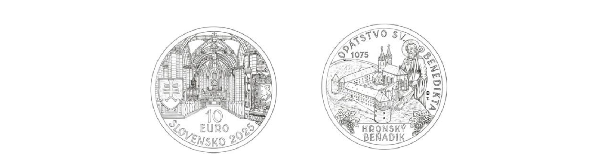

## 31

OZNÁMENIE

Národnej banky Slovenska

zo 4. februára 2025

## o vydaní strieborných zberateľských euromincí v nominálnej hodnote 10 eur pri príležitosti 950. výročia založenia Benediktínskeho opátstva v Hronskom Beňadiku

1. Úvodné ustanovenia

- a) Národná banka Slovenska podľa § 17h ods. 1 zákona Národnej rady Slovenskej republiky č. 566/1992 Zb. o Národnej banke Slovenska v znení neskorších predpisov a podľa § 12 ods. 1 písm. b) zákona č. 400/2015 Z. z. o tvorbe právnych predpisov a o Zbierke zákonov Slovenskej republiky a o zmene a doplnení niektorých zákonov v znení neskorších predpisov oznamuje, že vydáva do obehu strieborné zberateľské euromince v nominálnej hodnote 10 eur pri príležitosti 950. výročia založenia Benediktínskeho opátstva v Hronskom Beňadiku (ďalej len „zberateľská eurominca“).

- b) Zberateľská eurominca má štatút zákonného platidla len v Slovenskej republike.

- c) Zberateľská eurominca sa razí zo zliatiny obsahujúcej 900 dielov striebra a 100 dielov medi; jej hmotnosť je 18 g a priemer 34 mm. Pri razbe zberateľskej euromince je povolená horná a dolná odchýlka v priemere 0,1 mm; povolená horná odchýlka v hmotnosti je 0,4 g a v obsahu striebra 10/1 000.

2. Vzhľad zberateľskej euromince

- a) Na líci zberateľskej euromince je interiér kláštorného kostola Benediktínskeho opátstva v Hronskom Beňadiku so zobrazením gotického hlavného oltára, nad ktorým sa nachádza veľký kríž. Do vyobrazenia interiéru kláštora je vľavo vložený štátny znak Slovenskej republiky. V spodnej časti mincového poľa je v opise názov štátu „SLOVENSKO“ a letopočet „2025“, nad ktorými je v dvoch riadkoch nominálna hodnota „10 EURO“.

- b) Na rube zberateľskej euromince je kompozícia areálu Benediktínskeho opátstva v Hronskom Beňadiku, ktorú dopĺňa postava svätého Benedikta. Nad kompozíciou je v opise nápis „OPÁTSTVO SV. BENEDIKTA“ a pod ním je letopočet jeho založenia „1075“. V dolnej časti mincového poľa je v dvoch riadkoch text „HRONSKÝ BEŇADIK“, ktorý po oboch stranách dopĺňajú strapce vínnej révy. Vpravo od kompozície sú štylizované iniciálky autora výtvarného návrhu Tomáša Lamača, DiS. „TL“, a pod nimi značka Mincovne Kremnica, štátny podnik, ktorú tvorí skratka „MK“ umiestnená medzi dvoma razidlami.

- c) Na hrane zberateľskej euromince je nápis do hĺbky „• ORA ET LABORA – CRUX SACRA SIT MIHI LUX“.

- 

Štát vydania: Slovenská republika

Začiatok vydávania: marec 2025

Peter Kažimír v. r.
