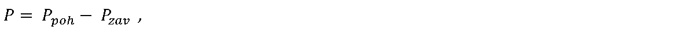

# Čl. I

Opatrenie Národnej banky Slovenska č. 180/2012 Z. z. o metódach a postupoch určenia hodnoty majetku v dôchodkovom fonde a doplnkovom dôchodkovom fonde v znení opatrenia č. 38/2013 Z. z. sa mení a dopĺňa takto:

- 1. § 1 sa dopĺňa písmenom j), ktoré znie:

- „j)

- cenným papierom alternatívneho investičného fondu cenný papier podľa § 81 ods. 1 písm. h) zákona.“.

- 2. § 5 vrátane nadpisu znie:

- 㤠5

- Určenie hodnoty prevoditeľného cenného papiera prijatého

- na obchodovanie na regulovanom trhu

- (1)

- Hodnota prevoditeľného cenného papiera10) prijatého na obchodovanie na regulovanom trhu sa určuje trhovou cenou prevoditeľného cenného papiera zverejnenou v deň, ku ktorému sa určuje hodnota prevoditeľného cenného papiera, ak § 13 alebo § 17 neustanovuje inak.

- (2)

- Ak trhová cena prevoditeľného dlhového cenného papiera je zverejnená v deň, ku ktorému sa hodnota prevoditeľného dlhového cenného papiera určuje, ale na základe rozhodnutia správcu a po dohode s depozitárom fondu nezodpovedá cene, ktorú možno za štandardných podmienok pri obchode s prevoditeľným dlhovým cenným papierom dosiahnuť, hodnota prevoditeľného dlhového cenného papiera sa určí s náležitou odbornou starostlivosťou po dohode s depozitárom fondu s prihliadnutím na zverejnenú trhovú cenu ako všeobecne trhovo akceptovaná cena stanovená informačným systémom alebo ako cena zverejnená iným relevantným obchodným miestom.10a)

- (3)

- Ak trhová cena prevoditeľného dlhového cenného papiera nie je zverejnená v deň, ku ktorému sa hodnota prevoditeľného dlhového cenného papiera určuje, hodnota prevoditeľného dlhového cenného papiera sa určí

- a)

- poslednou zverejnenou trhovou cenou, ak táto posledná zverejnená trhová cena nie je staršia ako tri obchodné dni vrátane dňa, ku ktorému sa hodnota prevoditeľného dlhového cenného papiera určuje, a nedošlo k ekonomickým zmenám na finančnom trhu alebo u emitenta tohto prevoditeľného dlhového cenného papiera, alebo

- b)

- s náležitou odbornou starostlivosťou po dohode s depozitárom fondu a s prihliadnutím na poslednú zverejnenú trhovú cenu ako všeobecne trhovo akceptovaná cena stanovená informačným systémom alebo ako cena zverejnená iným relevantným obchodným miestom, ak

- 1.

- posledná zverejnená trhová cena je staršia ako tri obchodné dni vrátane dňa, ku ktorému sa hodnota prevoditeľného dlhového cenného papiera určuje, a nedošlo k ekonomickým zmenám na finančnom trhu alebo u emitenta tohto prevoditeľného dlhového cenného papiera, alebo

- 2.

- na základe rozhodnutia správcu a po dohode s depozitárom fondu posledná zverejnená trhová cena nezodpovedá cene, ktorú možno za štandardných podmienok pri obchode s prevoditeľným dlhovým cenným papierom dosiahnuť.

- (4)

- Ak nie je možné určiť hodnotu prevoditeľného dlhového cenného papiera podľa odsekov 1 až 3, hodnota prevoditeľného dlhového cenného papiera sa určí teoretickou cenou podľa postupu uvedeného v prílohe č. 3.

- (5)

- Ak trhová cena prevoditeľného kapitálového cenného papiera a cenného papiera, ktorého hodnota je naviazaná na hodnotu finančných indexov (ďalej len „cenný papier ETF“),11) je zverejnená v deň, ku ktorému sa hodnota prevoditeľného kapitálového cenného papiera a cenného papiera ETF určuje, ale na základe rozhodnutia správcu a po dohode s depozitárom fondu nezodpovedá cene, ktorú možno za štandardných podmienok pri obchode s prevoditeľným kapitálovým cenným papierom a cenným papierom ETF dosiahnuť, hodnota prevoditeľného kapitálového cenného papiera a cenného papiera ETF sa určí s náležitou odbornou starostlivosťou po dohode s depozitárom fondu.

- (6)

- Ak trhová cena prevoditeľného kapitálového cenného papiera a cenného papiera ETF nie je zverejnená v deň, ku ktorému sa hodnota prevoditeľného kapitálového cenného papiera a cenného papiera ETF určuje, hodnota prevoditeľného kapitálového cenného papiera a cenného papiera ETF sa určuje

- a)

- poslednou zverejnenou trhovou cenou, ak táto posledná zverejnená trhová cena nie je staršia ako 10 obchodných dní vrátane dňa, ku ktorému sa hodnota prevoditeľného kapitálového cenného papiera a cenného papiera ETF určuje, a nedošlo k ekonomickým zmenám na finančnom trhu alebo u emitenta tohto prevoditeľného kapitálového cenného papiera alebo cenného papiera ETF,

- b)

- poslednou zverejnenou trhovou cenou rovnomerne znižovanou každý pracovný deň počas nasledujúcich 100 pracovných dní o pomernú časť z poslednej zverejnenej trhovej ceny, ak táto posledná zverejnená trhová cena je staršia ako 10 obchodných dní vrátane dňa, ku ktorému sa určuje hodnota prevoditeľného kapitálového cenného papiera a cenného papiera ETF, a nedošlo k ekonomickým zmenám na finančnom trhu alebo u emitenta tohto prevoditeľného kapitálového cenného papiera a cenného papiera ETF, najnižšie na hodnotu

- 1.

- rozdielu poslednej zverejnenej trhovej ceny a ročnej smerodajnej odchýlky trhovej ceny; ročnou smerodajnou odchýlkou trhovej ceny sa rozumie smerodajná odchýlka trhovej ceny prevoditeľného kapitálového cenného papiera a cenného papiera ETF, ak za posledných 365 dní mal prevoditeľný kapitálový cenný papier a cenný papier ETF zverejnenú trhovú cenu najmenej počas 30 obchodných dní, alebo

- 2.

- nula, alebo

- c)

- poslednou zverejnenou trhovou cenou podľa písmena a) alebo písmena b) zníženou o predpokladaný vplyv ekonomických zmien na jeho hodnotu, ak došlo k ekonomickým zmenám na finančnom trhu alebo u emitenta tohto prevoditeľného kapitálového cenného papiera a cenného papiera ETF; rozsah predpokladaného vplyvu ekonomických zmien sa určí po dohode s depozitárom fondu.

- (7)

- Ekonomickými zmenami podľa odsekov 3 a 6 sa rozumie vznik takých udalostí na finančnom trhu alebo u emitenta finančného nástroja, ktoré zapríčinia neštandardné správanie na finančnom trhu, pričom je odôvodnené predpokladať, že jeho vplyvom hodnota prevoditeľného cenného papiera určená štandardným postupom nezodpovedá reálnej hodnote príslušného finančného nástroja; reálnou hodnotou finančného nástroja je cena, ktorú je možné dosiahnuť pri obchode s finančným nástrojom v nezávislej transakcii medzi informovanými a dobrovoľne zúčastnenými zmluvnými stranami.“.

  - Poznámka pod čiarou k odkazu 10a znie:

  - „10a) § 3 ods. 3 písm. y) zákona č. 429/2002 Z. z. o burze cenných papierov v znení zákona č. 237/2017 Z. z.“.

- 3. Poznámka pod čiarou k odkazu 15 znie:

- „15) § 4 ods. 5 a 12 zákona č. 203/2011 Z. z. o kolektívnom investovaní v znení neskorších predpisov.“.

- 4. V § 8 ods. 4 sa slová „ods. 2 písm. b) prvého bodu“ nahrádzajú slovami „ods. 6 písm. a)“.

- 5. V poznámke pod čiarou k odkazu 18 sa citácia „§ 53 ods. 1 písm. c) a d) zákona č. 650/2004 Z. z. v znení neskorších predpisov.“ nahrádza citáciou „§ 53a ods. 3 a ods. 6 písm. c) zákona č. 650/2004 Z. z. v znení neskorších predpisov.“.

- 6. Za § 8 sa vkladá § 8a, ktorý vrátane nadpisu znie:

- 㤠8a

- Určenie hodnoty cenného papiera alternatívneho investičného fondu v majetku dôchodkového fondu

- (1)

- Pri určení hodnoty cenného papiera alternatívneho investičného fondu prijatého na obchodovanie na regulovanom trhu sa postupuje podľa § 5 ods. 1, 5 a ods. 6 písm. a). Hodnota cenného papiera alternatívneho investičného fondu prijatého na obchodovanie na regulovanom trhu, ktorú nie je možné určiť podľa prvej vety a hodnota cenného papiera alternatívneho investičného fondu neprijatého na obchodovanie na regulovanom trhu sa určí primerane podľa § 8 ods. 1, ak je frekvencia určenia hodnoty cenného papiera alternatívneho investičného fondu najmenej raz za kalendárny mesiac.

- (2)

- Hodnota cenného papiera alternatívneho investičného fondu, ktorú nie je možné určiť podľa odseku 1, sa určuje pri jeho nadobudnutí do majetku dôchodkového fondu obstarávacou cenou, pričom takto určená hodnota nemôže byť vyššia o viac ako 5 % ako hodnota určená v znaleckom posudku vyhotovenom nezávislým oceňovateľom podľa odseku 4, ktorého určil správca po dohode s depozitárom dôchodkového fondu.

- (3)

- Hodnotu cenného papiera alternatívneho investičného fondu podľa odseku 2 v majetku dôchodkového fondu určuje nezávislý oceňovateľ. Nezávislý oceňovateľ určuje hodnotu cenného papiera podľa prvej vety minimálne raz za polrok a vždy, ak nastanú významné skutočnosti, ktoré majú relevantný vplyv na hodnotu tohto cenného papiera, ak tieto skutočnosti neboli zohľadnené pri poslednom určení hodnoty tohto cenného papiera, pričom odôvodňuje výber použitej metódy. Na určenie hodnoty sa nevyžaduje znalecký posudok podľa osobitného predpisu.19)

- (4)

- Nezávislým oceňovateľom je osoba, ktorá spĺňa požiadavky na výkon činnosti znalca podľa osobitného predpisu,19) osoba s obdobným oprávnením podľa všeobecne záväzného právneho predpisu iného štátu, osoba uvedená v zahraničnom zozname oceňovateľov, ktorá vykonáva oceňovanie v súlade s medzinárodnými štandardmi oceňovania alebo osoba, ktorá má oprávnenie orgánu dohľadu členského štátu na určovanie hodnoty cenného papiera takého alternatívneho investičného fondu, ktorého hodnotu má určovať podľa tohto opatrenia.“.

  - Poznámka pod čiarou k odkazu 19 znie:

  - „19) Zákon č. 382/2004 Z. z. o znalcoch, tlmočníkoch a prekladateľoch a o zmene a doplnení niektorých zákonov v znení neskorších predpisov.“.

- 7. V § 9 ods. 1 sa vypúšťa odkaz 19.

- 8. V § 12 sa slová „ods. 1 a 2 písm. b)“ nahrádzajú slovami „ods. 1 a 6“.

- 9. V § 15 odsek 1 znie:

- „(1)

- Na určenie hodnoty pohľadávok a záväzkov sa použije ich menovitá hodnota ku dňu, ku ktorému sa hodnota pohľadávok a záväzkov určuje.“.

- 10. V § 15 sa za odsek 1 vkladá nový odsek 2, ktorý znie:

- „(2)

- Hodnota pohľadávky určená podľa odseku 1 sa znižuje o

- a)

- 10 % jej menovitej hodnoty, ak ide o pohľadávku po lehote splatnosti dlhšej ako 10 dní,

- b)

- 33 % jej menovitej hodnoty, ak ide o pohľadávku po lehote splatnosti dlhšej ako 30 dní,

- c)

- 66 % jej menovitej hodnoty, ak ide o pohľadávku po lehote splatnosti dlhšej ako 60 dní,

- d)

- 100 % jej menovitej hodnoty, ak ide o pohľadávku po lehote splatnosti dlhšej ako 90 dní.“.

  - Doterajšie odseky 2 a 3 sa označujú ako odseky 3 a 4.

- 11. V § 15 ods. 3 prvá veta znie: „Hodnota všetkých pohľadávok voči dlžníkovi, na ktorého majetok bol vyhlásený konkurz alebo bolo začaté reštrukturalizačné konanie23) alebo iné obdobné konanie podľa právneho poriadku štátu, v ktorom má dlžník sídlo, sa odo dňa, ku ktorému sa správca o týchto skutočnostiach dozvedel, určí s odbornou starostlivosťou na základe odhadu predpokladaného výťažku z pohľadávky po dohode s depozitárom fondu; informácia o dohode sa zasiela písomne Národnej banke Slovenska bez zbytočného odkladu.“.

- 12. V § 17 ods. 1 sa za slovo „fondu“ vkladá bodkočiarka a slová „a Národnou bankou Slovenska“ sa nahrádzajú slovami „informácia o dohode sa zasiela písomne Národnej banke Slovenska bez zbytočného odkladu“.

- 13. V prílohe č. 8 odsek 1 znie:

- „(1)

- Teoretická cena forwardu na dlhový cenný papier a na kapitálový cenný papier sa vypočíta spôsobom

- 

- kde

- P je teoretická cena forwardu,

- Ppoh je súčasná hodnota pohľadávok z forwardu,

- Pzav je súčasná hodnota záväzkov z forwardu.“.

- 14. V prílohe č. 8 odseku 3 sa vypúšťajú slová „P je teoretická cena forwardu,“.
