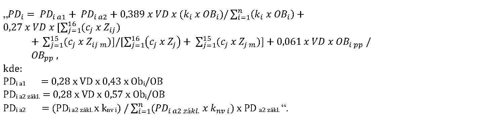

# Čl. I

Nariadenie vlády Slovenskej republiky č. 668/2004 Z. z. o rozdeľovaní výnosu dane z príjmov územnej samospráve v znení nariadenia vlády Slovenskej republiky č. 519/2006 Z. z., nariadenia vlády Slovenskej republiky č. 623/2007 Z. z., nariadenia vlády Slovenskej republiky č. 412/2008 Z. z., nariadenia vlády Slovenskej republiky č. 276/2010 Z. z., nariadenia vlády Slovenskej republiky č. 531/2010 Z. z., nariadenia vlády Slovenskej republiky č. 415/2012 Z. z., nariadenia vlády Slovenskej republiky č. 417/2014 Z. z., nariadenia vlády Slovenskej republiky č. 370/2016 Z. z., nariadenia vlády Slovenskej republiky č. 356/2017 Z. z., nariadenia vlády Slovenskej republiky č. 363/2020 Z. z., nariadenia vlády Slovenskej republiky č. 472/2022 Z. z. a nariadenia vlády Slovenskej republiky č. 415/2024 Z. z. sa mení takto:

- 1. V § 2 ods. 1 písm. a) sa číslo „28,8“ nahrádza číslom „28“.

- 2. V § 2 ods. 1 písm. b) sa číslo „40“ nahrádza číslom „38,9“.

- 3. V § 2 ods. 1 písm. c) sa číslo „24,9“ nahrádza číslom „27“.

- 4. Poznámka pod čiarou k odkazu 1 znie:

- „1) § 35 zákona č. 322/2025 Z. z. o financovaní škôl a školských zariadení.“.

- 5. V § 2 ods. 1 písm. d) sa číslo „6,3“ nahrádza číslom „6,1“.

- 6. V prílohe č. 4 vzorec znie:

- 
