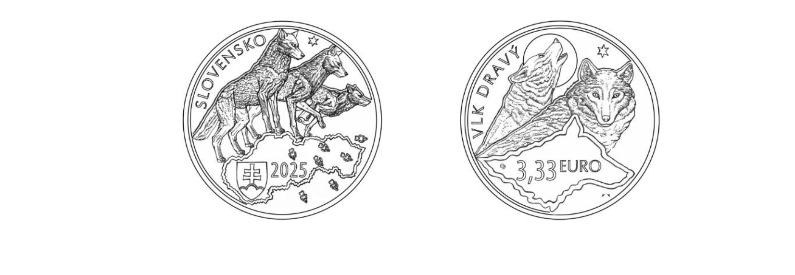
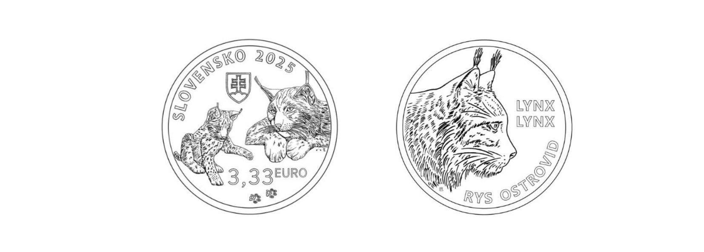
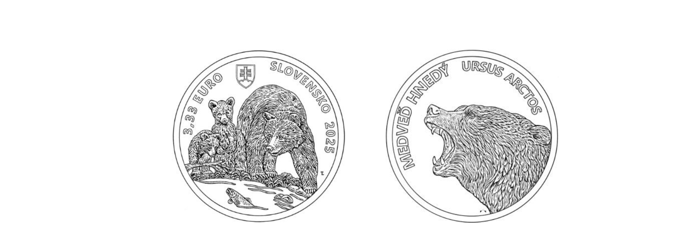

## 48

OZNÁMENIE

Národnej banky Slovenska

z 18. februára 2025

## o vydaní strieborných zberateľských euromincí v nominálnych hodnotách 3,33 eura s tematikou Fauna a flóra na Slovensku – vlk dravý, rys ostrovid a medveď hnedý

1. Úvodné ustanovenia

- a) Národná banka Slovenska podľa § 17h ods. 1 zákona Národnej rady Slovenskej republiky č. 566/1992 Zb. o Národnej banke Slovenska v znení neskorších predpisov a podľa § 12 ods. 1 písm. b) zákona č. 400/2015 Z. z. o tvorbe právnych predpisov a o Zbierke zákonov Slovenskej republiky a o zmene a doplnení niektorých zákonov v znení neskorších predpisov oznamuje, že vydáva do obehu strieborné zberateľské euromince v nominálnych hodnotách 3,33 eura s tematikou Fauna a flóra na Slovensku – vlk dravý, rys ostrovid a medveď hnedý (ďalej len „zberateľské euromince“).

- b) Zberateľské euromince majú štatút zákonného platidla len v Slovenskej republike.

- c) Zberateľské euromince sa razia zo striebra s rýdzosťou 999; ich hmotnosť je 31,1 g a priemer 40 mm. Pri razbe zberateľskej euromince je povolená horná a dolná odchýlka v priemere 0,1 mm.

- d) Hrana zberateľských euromincí je hladká.

2. Vzhľad striebornej zberateľskej euromince v nominálnej hodnote 3,33 eura s tematikou Fauna a flóra na Slovensku – vlk dravý

- a) Na líci zberateľskej euromince je v spodnej časti umiestnená silueta mapy Slovenskej republiky, do ktorej je vsadený štátny znak Slovenskej republiky a letopočet „2025“. Nad mapou je umiestnená trojica vlkov doplnená o ich stopy v siluete mapy aj mimo nej a o hviezdu v hornej časti mincového poľa. Nápis „SLOVENSKO“ je v opise v ľavej časti mincového poľa.

- b) Na rube zberateľskej euromince je kompozícia dvoch vlkov, z ktorých jeden vyje na mesiac. Kompozíciu dopĺňa hviezda na nočnej oblohe v hornej časti mincového poľa a silueta ďalšieho vlka v spodnej časti mincového poľa. Označenie nominálnej hodnoty „3,33 EURO“ je vo vnútri siluety. V ľavej časti mincového poľa je v opise nápis „VLK DRAVÝ“. Vľavo od nominálnej hodnoty sú štylizované iniciálky autora MgA. Josefa Oplištila. V pravej časti mincového poľa pod siluetou je značka Pressburg Mint – Bratislavská mincovňa s. r. o., ktorú tvorí štylizovaný Bratislavský hrad.

- 

3. Vzhľad striebornej zberateľskej euromince v nominálnej hodnote 3,33 eura s tematikou Fauna a flóra na Slovensku – rys ostrovid

- a) Na líci zberateľskej euromince je vyobrazené mláďa rysa ostrovida v kompozícii s dospelým jedincom, pod ktorým je značka Pressburg Mint – Bratislavská mincovňa s. r. o., ktorú tvorí štylizovaný Bratislavský hrad a štylizované iniciálky autora lícnej strany zberateľskej euromince Tomáša Lamača, DiS. „TL“. V hornej časti mincového poľa je v opise názov štátu „SLOVENSKO“ a letopočet „2025“. Pod nimi je štátny znak Slovenskej republiky. V spodnej časti mincového poľa sú dva odtlačky stôp rysa ostrovida a nad nimi je nominálna hodnota „3,33 EURO“.

- b) Na rube zberateľskej euromince je z profilu zobrazená hlava rysa ostrovida, ktorá je v pravej časti mincového poľa doplnená jeho latinským názvom v dvoch riadkoch „LYNX LYNX“. Pod hlavou rysa ostrovida sú štylizované iniciálky autora rubovej strany zberateľskej euromince Mgr. art. Romana Lugára „LR“. V spodnej časti mincového poľa je v opise slovenský názov „RYS OSTROVID“.

- 

4. Vzhľad striebornej zberateľskej euromince v nominálnej hodnote 3,33 eura s tematikou Fauna a flóra na Slovensku – medveď hnedý

- a) Na líci zberateľskej euromince je medvedica s dvomi mláďatami pri love rýb. Nad nimi je štátny znak Slovenskej republiky. Vľavo od neho je v opise nominálna hodnota zberateľskej euromince „3,33 EURO“. Vpravo od štátneho znaku je v opise názov štátu „SLOVENSKO“ a letopočet „2025“. Štylizované iniciálky autora zberateľskej euromince Tomáša Lamača, DiS. „TL“ sú pri pravom okraji zberateľskej euromince.

- b) Na rube zberateľskej euromince dominuje z profilu zobrazená hlava medveďa hnedého. V hornej časti mincového poľa je v opise slovenský názov „MEDVEĎ HNEDÝ“, na ktorý nadväzuje latinský názov „URSUS ARCTOS“. Značka Pressburg Mint – Bratislavská mincovňa s. r. o., ktorú tvorí štylizovaný Bratislavský hrad, je pri pravom okraji zberateľskej euromince.

- 

- Štát vydania: Slovenská republika

- Začiatok vydávania: apríl 2025

v z. Vladimír Dvořáček v. r.
