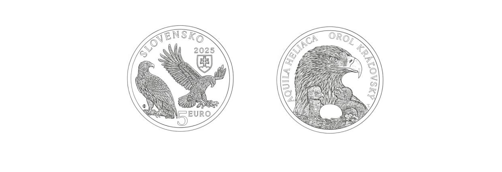

## 53

OZNÁMENIE

Národnej banky Slovenska

z 11. marca 2025

## o vydaní zberateľských euromincí z obyčajných kovov v nominálnej hodnote 5 eur s tematikou Fauna a flóra na Slovensku – orol kráľovský

1. Úvodné ustanovenia

- a) Národná banka Slovenska podľa § 17h ods. 1 zákona Národnej rady Slovenskej republiky č. 566/1992 Zb. o Národnej banke Slovenska v znení neskorších predpisov a podľa § 12 ods. 1 písm. b) zákona č. 400/2015 Z. z. o tvorbe právnych predpisov a o Zbierke zákonov Slovenskej republiky a o zmene a doplnení niektorých zákonov v znení neskorších predpisov oznamuje, že vydáva do obehu zberateľské euromince z obyčajných kovov v nominálnej hodnote 5 eur s tematikou Fauna a flóra na Slovensku – orol kráľovský (ďalej len „zberateľská eurominca“).

- b) Zberateľská eurominca má štatút zákonného platidla len v Slovenskej republike.

- c) Zberateľská eurominca sa razí z mosadze MS63 (Cu63Zn37); jej hmotnosť je 19,1 g a priemer 34 mm. Pri razbe zberateľskej euromince je povolená horná a dolná odchýlka v priemere

- 0,1 mm; povolená horná odchýlka v hmotnosti je 0,76 g.

2. Vzhľad zberateľskej euromince

- a) Na líci zberateľskej euromince je zobrazený orol kráľovský sediaci na konári a vpravo od neho orol kráľovský v letovej polohe s roztiahnutými krídlami, nad ktorým je štátny znak Slovenskej republiky a letopočet „2025“. V hornej časti mincového poľa je v opise názov štátu „SLOVENSKO“ a v spodnej časti mincového poľa je nominálna hodnota „5 EURO“. Vľavo od sediaceho orla je značka Mincovne Kremnica, štátny podnik, ktorú tvorí skratka „MK“ umiestnená medzi dvoma razidlami.

- b) Na rube zberateľskej euromince dominuje hlava orla kráľovského. V spodnej časti mincového poľa je orlie hniezdo s dvoma mláďatami a vajcom. Okolo hlavy orla je v opise latinský názov „AQUILA HELIACA“ a slovenský názov „OROL KRÁĽOVSKÝ“. Vpravo pri spodnom okraji zberateľskej euromince sú štylizované iniciálky autora Tomáša Lamača, Dis. „TL“.

- c) Hrana zberateľskej euromince je vrúbkovaná.

- 

- Štát vydania: Slovenská republika

- Začiatok vydávania: máj 2025

Peter Kažimír v. r.
