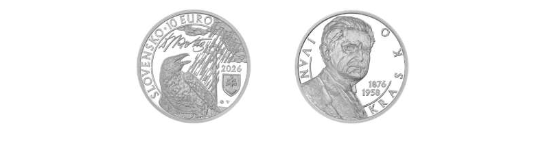

## 115

OZNÁMENIE

Národnej banky Slovenska

z 21. mája 2026

## o vydaní strieborných zberateľských euromincí v nominálnej hodnote 10 eur pri príležitosti 150. výročia narodenia Ivana Kraska

1. Úvodné ustanovenia

- a) Národná banka Slovenska podľa § 17h ods. 1 zákona Národnej rady Slovenskej republiky č. 566/1992 Zb. o Národnej banke Slovenska v znení neskorších predpisov a podľa § 12 ods. 1 písm. b) zákona č. 400/2015 Z. z. o tvorbe právnych predpisov a o Zbierke zákonov Slovenskej republiky a o zmene a doplnení niektorých zákonov v znení neskorších predpisov oznamuje, že vydáva do obehu strieborné zberateľské euromince v nominálnej hodnote 10 eur pri príležitosti 150. výročia narodenia Ivana Kraska (ďalej len „zberateľská eurominca“).

- b) Zberateľská eurominca má štatút zákonného platidla len v Slovenskej republike.

- c) Zberateľská eurominca sa razí zo zliatiny obsahujúcej 900 dielov striebra a 100 dielov medi; jej hmotnosť je 18 g a priemer 34 mm. Pri razbe zberateľskej euromince je povolená horná a dolná odchýlka v priemere 0,1 mm; povolená horná odchýlka v hmotnosti je 0,4 g a v obsahu striebra 10/1 000.

2. Vzhľad zberateľskej euromince

- a) Na líci zberateľskej euromince je vyobrazený havran v kompozícii s mrakom a silným prúdom dažďa padajúcim na kríž. V ľavej časti mincového poľa je v opise názov štátu „SLOVENSKO“ a nominálna hodnota „10 EURO“, ktoré sú od seba oddelené grafickou značkou a z vnútornej strany sú lemované grafickou líniou. Nad havranom je faksimile rodného mena Ivana Kraska – Ján Botto. V pravej časti mincového poľa je letopočet „2026“, pod ktorým je štátny znak Slovenskej republiky. Vpravo od havrana je značka Mincovne Kremnica, štátny podnik, ktorú tvorí skratka MK umiestnená medzi dvoma razidlami, a štylizované iniciálky autora zberateľskej euromince Mgr. art. Petra Valacha „PV“.

- b) Na rube zberateľskej euromince je portrét Ivana Kraska. Vpravo od neho sú v dvoch riadkoch letopočty narodenia a úmrtia „1876“ a „1958“. Portrét rozdeľuje v opise uvedené meno a priezvisko „IVAN“ a „KRASKO“. Meno a priezvisko je čiastočne lemované grafickou líniou.

- c) Na hrane zberateľskej euromince je nápis do hĺbky „• ZAKLADATEĽ MODERNEJ SLOVENSKEJ LYRIKY 20. STOROČIA“.

- 

- Štát vydania: Slovenská republika

- Začiatok vydávania: júl 2026

v z. Dušan Keketi v. r.
