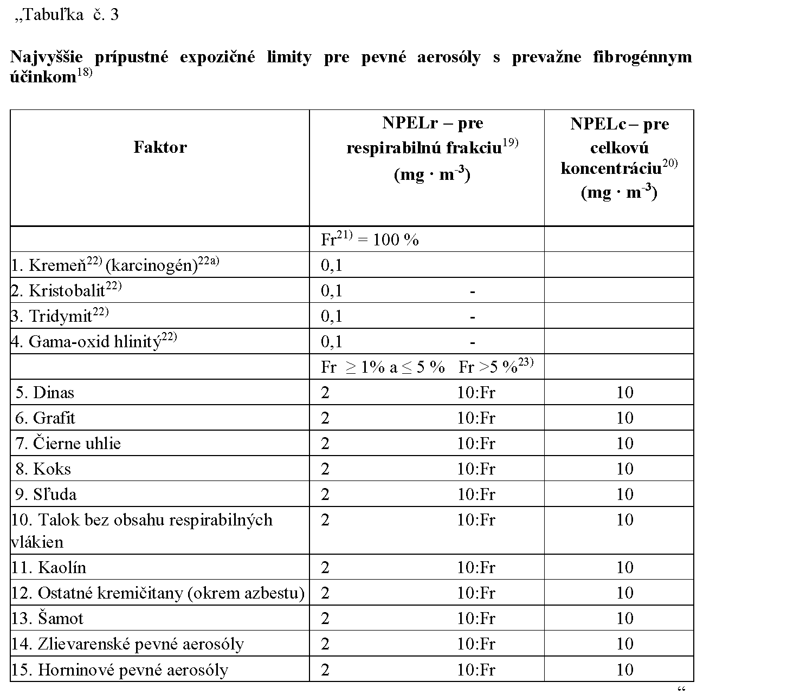

# Čl. I

Nariadenie vlády Slovenskej republiky č. 355/2006 Z. z. o ochrane zamestnancov pred rizikami súvisiacimi s expozíciou chemickým faktorom pri práci v znení nariadenia vlády Slovenskej republiky č. 300/2007 Z. z., nariadenia vlády Slovenskej republiky č. 471/2011 Z. z., nariadenia vlády Slovenskej republiky č. 82/2015 Z. z., nariadenia vlády Slovenskej republiky č. 33/2018 Z. z., nariadenia vlády Slovenskej republiky č. 236/2020 Z. z. a nariadenia vlády Slovenskej republiky č. 122/2024 Z. z. sa mení a dopĺňa takto:

- 1. V § 6 ods. 2 písm. d) sa slová „veľmi toxickými látkami a zmesami a toxickými látkami a zmesami,9a)“ nahrádzajú slovami „akútne toxickými látkami a zmesami,9a)“.

  - Poznámka pod čiarou k odkazu 9a znie:

  - „9a) § 16j ods. 3 zákona č. 355/2007 Z. z. v znení zákona č. 165/2026 Z. z.“.

- 2. V § 6 ods. 3 sa slová „veľmi toxickými látkami a zmesami a toxickými látkami a zmesami“ nahrádzajú slovami „akútne toxickými látkami a zmesami“.

- 3. V nadpise § 8 sa slová „veľmi toxických látok a zmesí a toxických látok a zmesí“ nahrádzajú slovami „akútne toxických látok a zmesí“.

- 4. V § 8 ods. 1 sa slová „toxické látky a zmesi alebo veľmi toxické látky a zmesi,3)“ nahrádzajú slovami „akútne toxické látky a zmesi uvedené v § 6 ods. 2 písm. d),“.

- 5. V § 8 odsek 2 znie:

- „(2)

- Akútne toxické látky a zmesi uvedené v § 6 ods. 2 písm. d) prvom bode možno skladovať v jednej miestnosti s inými látkami a zmesami, ktoré nie sú toxické, okrem látok uvedených v odseku 1, len ak sú uložené v uzamknutej schránke určenej výhradne na skladovanie akútne toxických látok a zmesí. Akútne toxické látky a zmesi uvedené v § 6 ods. 2 písm. d) prvom bode možno skladovať v jednej miestnosti, a to aj v jednej schránke, s akútne toxickými látkami a zmesami uvedenými v § 6 ods. 2 písm. d) druhom bode a treťom bode, ak sú uložené oddelene a je vylúčené ich vzájomné škodlivé pôsobenie alebo zámena a ak taký spôsob skladovania schválil príslušný orgán verejného zdravotníctva.21)“.

  - Poznámka pod čiarou k odkazu 21 znie:

  - „21) § 13 ods. 4 písm. e) zákona č. 355/2007 Z. z. v znení zákona č. 165/2026 Z. z.“.

- 6. V § 8 ods. 3 sa slová „toxické látky a zmesi“ nahrádzajú slovami „akútne toxické látky a zmesi uvedené v § 6 ods. 2 písm. d) druhom bode a treťom bode“ a vypúšťajú sa slová „písm. a) až f)“.

- 7. V § 8 ods. 4 sa slová „toxické látky a zmesi a veľmi toxické látky a zmesi“ nahrádzajú slovami „akútne toxické látky a zmesi uvedené v § 6 ods. 2 písm. d)“.

- 8. V § 8 odsek 5 znie:

- „(5)

- Za príjem, výdaj a evidenciu príjmu a výdaja akútne toxických látok a zmesí uvedených v § 6 ods. 2 písm. d) prvom bode zodpovedá zamestnanec s odbornou spôsobilosťou na prácu s akútne toxickými látkami a zmesami podľa osobitného predpisu.21a) Evidencia príjmu a výdaja akútne toxických látok a zmesí uvedených v § 6 ods. 2 písm. d) prvom bode sa musí viesť spôsobom, ktorý zaručí spoľahlivú evidenciu záznamov o každom príjme a výdaji týchto látok a zmesí. Nepoužité akútne toxické látky a zmesi uvedené v § 6 ods. 2 písm. d) prvom bode sa musia po ukončení pracovnej zmeny vrátiť do skladu.“.

  - Poznámka pod čiarou k odkazu 21a znie:

  - „21a) § 16j zákona č. 355/2007 Z. z. v znení zákona č. 165/2026 Z. z.“.

- 9. Za § 13b sa vkladá § 13c, ktorý vrátane nadpisu znie:

- 㤠13c

- Prechodné ustanovenie k úpravám účinným od 15. júla 2026

- V období od 15. júla 2026 do 31. decembra 2028 platí pre diizokyanáty hodnota najvyššie prípustného expozičného limitu v pracovnom ovzduší uvedená v prílohe č. 1 tabuľke č. 2a.“.

- 10. V prílohe č. 1 tabuľka č. 1 vrátane nadpisu znie:

- [Tabuľka č. 1 - Najvyššie prípustné expozičné limity plynov, pár a aerosólov s prevažne toxickým účinkom v pracovnom ovzduší (NPEL)](assets/f36f8dad092efd80bfab6c28f540cce58963b7ec81d34bc87f39021e3cb0b9c7.pdf)

- 11. V prílohe č. 1 sa za tabuľku č. 2 vkladá tabuľka č. 2a, ktorá vrátane nadpisu znie:

- „Tabuľka č. 2a

- Najvyššie prípustný expozičný limit v pracovnom ovzduší (NPEL), ktorý má ustanovené prechodné obdobie podľa § 13c

- Chemická látka | CAS1) | NPEL3) | | | | Poznámka

- | | priemerný4) | | krátkodobý5) | |

- | | ppm6) | mg · m-3 7) | ppm | mg · m-3 |

- Diizokyanáty10a) | - | - | 0,01 | - | 0,02 | NPEL do 31.12.2028

- “.

- 12. V prílohe č. 1 tabuľka č. 3 vrátane nadpisu znie:

- 

- 13. V prílohe č. 1 tabuľky č. 5 až 7 vrátane nadpisov znejú:

- „Tabuľka č. 5

- Najvyššie prípustné expozičné limity pre pevné aerosóly s prevažne nešpecifickým účinkom

- Faktor | NPELc20) ( mg · m-3)

- 1. Hnedé uhlie a lignit23) | 10

- 2. Vápenec, mramor23) | 10

- 3. Baryt23) | 10

- 4. Siderit23) | 10

- 5. Pevné aerosóly z umelého brusiva23) (karborundum, elektrit) | 10

- 6. Železo a jeho zliatiny25) | 6

- 7. Čadič tavený | 10

- 8. Pôdne pevné aerosóly | 10

- 9. Vysokopecná troska | 10

- 10. Oceliarska troska | 10

- 11. Popolček | 10

- 12. Škvara | 10

- 13. Magnezit | 10

- 14. Dolomit | 10

- 15. Kovové dentálne zliatiny | 10

- 16. Sadze (karcinogén)22a) | 2

- 17. Cement | 10

- 18. Inertný prach (častice nerozpustné vo vode, inde nezaradené) | 10

- Tabuľka č. 6

- Najvyššie prípustné expozičné limity pre pevné aerosóly s prevažne dráždivým účinkom

- Faktor | NPELc20) ( mg · m-3 )

- 1. Textilný pevný aerosól |

- bavlna | 2

- ľan | 2

- konope | 2

- hodváb | 2

- syntetické vlákna textilné | 4

- sisal | 6

- juta | 6

- kapok | 6

- 2. Živočíšny pevný aerosól |

- perie | 4

- vlna | 6

- srsť | 6

- ostatný živočíšny pevný aerosól | 6

- 3. Rastlinný pevný aerosól26) |

- múka | 4

- cukor | 6

- tabak | 4

- čaj | 4

- káva zelená | 2

- korenie | 2

- pevný aerosól obilný | 6

- pevný aerosól z dreva |

- a) exotické dreviny | 1

- b) ostatné dreviny | 8

- c) dub, buk27) (karcinogén)22a) | 2

- ostatný rastlinný pevný aerosól | 6

- 4. Iný pevný aerosól s dráždivým účinkom |

- z brúsenia a opracovania |

- a) fenolformaldehydových živíc | 5

- b) PVC | 5

- c) pneumatík | 3

- d) sklolaminátov | 5

- e) polyakrylátových živíc | 5

- f) epoxidových živíc | 2

- g) polyesterových živíc | 5

- h) polyetylénu | 5

- i) polypropylénu | 5

- j) polymérnych materiálov | 5

- k) polystyrénu | 5

- l) papiera | 6

- m) škrobu | 4

- Tabuľka č. 7

- Najvyššie prípustné expozičné limity pre minerálne vláknité pevné aerosóly

- Faktor | NPELc20) |

- | početná koncentrácia počet respirabilných vlákien28)· cm-3 | hmotnostná koncentrácia mg · m-3

- 1. Azbest29) (karcinogén)22a) | - | -

- 2. Umelé minerálne vlákna (napríklad čadičové, sklenené, troskové)30) | 2 | 4

- 3. Ohňovzdorné keramické vlákna31) (karcinogén)22a) | 0,3 | -

- “.

- 14. V prílohe č. 1 sa za vysvetlivku 10 vkladajú vysvetlivky 10a a 10b, ktoré znejú:

- „10a) Diizokyanáty merané ako NCO. NCO sa vzťahuje na izokyanátové funkčné skupiny zlúčenín diizokyanátu.

- 10b) S* - dermálna senzibilizácia a respiračná senzibilizácia. Chemická látka môže spôsobiť senzibilizáciu kože a dýchacích ciest.“.

- 15. V prílohe č. 1 sa za vysvetlivku 22 vkladá vysvetlivka 22a, ktorá znie:

- „22a) V tejto prílohe sú uvedené niektoré chemické faktory s karcinogénnym účinkom, ktoré upravuje nariadenie vlády Slovenskej republiky č. 121/2024 Z. z. o ochrane zdravia zamestnancov pred rizikami súvisiacimi s expozíciou karcinogénnym faktorom, mutagénnym faktorom alebo reprodukčne toxickým faktorom pri práci v znení nariadenia vlády Slovenskej republiky č. 186/2026 Z. z.“.

- 16. V prílohe č. 1 vysvetlivka 28 znie:

- „28) Za respirabilné vlákno sa považuje častica, ktorá vyhovuje súčasne všetkým týmto podmienkam:

- hrúbka vlákna < 3 µm,

- dĺžka vlákna > 5 µm,

- pomer (dĺžka : hrúbka) 3 : 1.“.

- 17. V prílohe č. 1 vysvetlivka 29 znie:

- „29) NPEL pre azbest a požiadavky na meranie azbestu ustanovuje nariadenie vlády Slovenskej republiky č. 185/2026 Z. z. o ochrane zamestnancov pred rizikami súvisiacimi s expozíciou azbestu pri práci.“.

- 18. Príloha č. 2 vrátane nadpisu znie:

- „[Príloha č. 2 k nariadeniu vlády č. 355/2006 Z. z. - BIOLOGICKÉ MEDZNÉ HODNOTY](assets/d866524c052c74b7045d5f5094fe137814ce349d77d460fb3e4cc8ca8e0d5a8e.pdf)“.

  - 19. V prílohe č. 2 vysvetlivky 4 a 5 znejú:

  - „4) V tejto prílohe sú uvedené niektoré chemické faktory s karcinogénnym účinkom alebo reprodukčne toxickým účinkom. Pre tieto chemické faktory platí, že dodržanie BMH nevylučuje riziko škodlivých zdravotných účinkov, preto sú určené ako základ pre biomonitoring exponovaných osôb a zdravotný dohľad vykonávaný lekárom pracovnej zdravotnej služby podľa § 13 a príloh č. 4 a 5 nariadenia vlády Slovenskej republiky č. 121/2024 Z. z. o ochrane zdravia zamestnancov pred rizikami súvisiacimi s expozíciou karcinogénnym faktorom, mutagénnym faktorom alebo reprodukčne toxickým faktorom pri práci v znení nariadenia vlády Slovenskej republiky č. 186/2026 Z. z.

  - 5) Záväzná BMH pre olovo a jeho anorganické zlúčeniny je uvedená v prílohe č. 4 nariadenia vlády Slovenskej republiky č. 121/2024 Z. z. o ochrane zdravia zamestnancov pred rizikami súvisiacimi s expozíciou karcinogénnym faktorom, mutagénnym faktorom alebo reprodukčne toxickým faktorom pri práci v znení nariadenia vlády Slovenskej republiky č. 186/2026 Z. z.“.

  - 20. Príloha č. 4 sa dopĺňa deviatym bodom, ktorý znie:

  - „9.

  - Smernica Európskeho parlamentu a Rady (EÚ) 2024/869 z 13. marca 2024, ktorou sa mení smernica Európskeho parlamentu a Rady (EÚ) 2004/37/ES a smernica Rady 98/24/ES, pokiaľ ide o limitné hodnoty pre olovo a jeho anorganické zlúčeniny a pre diizokyanáty (Ú. v. EÚ L, 2024/869, 19. 3. 2024).“.
