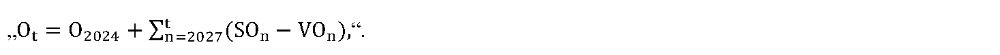
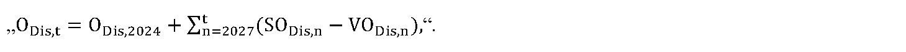
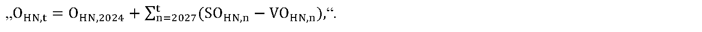

## 195

OZNÁMENIE

o oprave chyby vo vyhláške Úradu pre reguláciu sieťových odvetví č. 154/2024 Z. z., ktorou sa ustanovuje cenová regulácia v elektroenergetike a niektoré podmienky vykonávania regulovaných činností v elektroenergetike

1. V § 16 ods. 1 písm. b) treťom bode vzorec má správne znieť:

2. V § 19 ods. 5 písm. c) treťom bode vzorec má správne znieť:

3. V § 25 ods. 3 písm. b) treťom bode vzorec má správne znieť:

