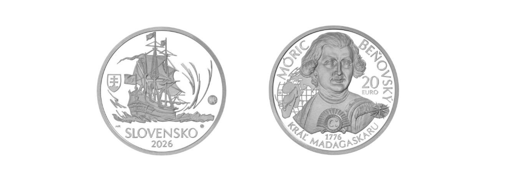

## 204

OZNÁMENIE

Národnej banky Slovenska

z 20. júla 2026

## o vydaní strieborných zberateľských euromincí v nominálnej hodnote 20 eur pri príležitosti 250. výročia vyhlásenia Mórica Beňovského za kráľa Madagaskaru

1. Úvodné ustanovenia

- a) Národná banka Slovenska podľa § 17h ods. 1 zákona Národnej rady Slovenskej republiky č. 566/1992 Zb. o Národnej banke Slovenska v znení neskorších predpisov a podľa § 12 ods. 1 písm. b) zákona č. 400/2015 Z. z. o tvorbe právnych predpisov a o Zbierke zákonov Slovenskej republiky a o zmene a doplnení niektorých zákonov v znení neskorších predpisov oznamuje, že vydáva do obehu strieborné zberateľské euromince v nominálnej hodnote 20 eur pri príležitosti 250. výročia vyhlásenia Mórica Beňovského za kráľa Madagaskaru (ďalej len „zberateľská eurominca“).

- b) Zberateľská eurominca má štatút zákonného platidla len v Slovenskej republike.

- c) Zberateľská eurominca sa razí zo zliatiny obsahujúcej 925 dielov striebra a 75 dielov medi; jej hmotnosť je 33,63 g a priemer 40 mm. Pri razbe zberateľskej euromince je povolená horná a dolná odchýlka v priemere 0,1 mm; povolená horná odchýlka v hmotnosti je 0,4 g a v obsahu striebra 10/1 000.

2. Vzhľad zberateľskej euromince

- a) Na líci zberateľskej euromince je uprostred mincového poľa dobová plachetnica na rozbúrených vlnách. Vľavo od nej je štátny znak Slovenskej republiky. V spodnej časti mincového poľa je názov štátu „SLOVENSKO“, pod ktorým je letopočet „2026“. Vpravo od plachetnice je štylizovaný lipový trojlístok meniaci sa pri naklonení na písmená „NBS“ predstavujúce skratku Národnej banky Slovenska. Štylizované iniciálky autora Miroslava Ronaia „MR“ sú vľavo od názvu štátu. Vpravo od neho je značka Mincovne Kremnica, štátny podnik, ktorú tvorí skratka „MK“ umiestnená medzi dvoma razidlami.

- b) Na rube euromince je portrét Mórica Beňovského. Vľavo od neho je na časti zobrazenej zemegule zväčšený Madagaskar a štylizovaný symbol typického madagaskarského zvieraťa – zebu. Štylizované iniciálky autora Branislava Ronaia „BR“ sú vľavo od Madagaskaru. Vpravo od portrétu je v dvoch riadkoch nominálna hodnota „20 EURO“ a kompas. Pod portrétom je zobrazený emblém tvorený ravenalou madagaskarskou a mesiacom s dvomi hviezdami. V hornej časti mincového poľa je v opise po stranách meno a priezvisko „MÓRIC BEŇOVSKÝ“. V spodnej časti mincového poľa je v opise nápis „KRÁĽ MADAGASKARU“ a nad ním letopočet „1776“.

- c) Na hrane zberateľskej euromince je reliéfny nápis „• ŠĽACHTIC CESTOVATEĽ DOBRODRUH“.

- 

- Štát vydania: Slovenská republika

- Začiatok vydávania: september 2026

v z. Dušan Jurčák v. r.
