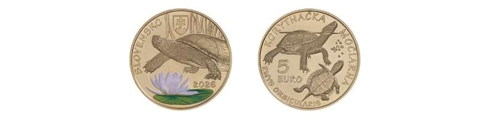

## 21

OZNÁMENIE

Národnej banky Slovenska

z 27. januára 2026

## o vydaní zberateľských euromincí z obyčajných kovov v nominálnej hodnote 5 eur s tematikou Fauna a flóra na Slovensku – korytnačka močiarna

1. Úvodné ustanovenia

- a) Národná banka Slovenska podľa § 17h ods. 1 zákona Národnej rady Slovenskej republiky č. 566/1992 Zb. o Národnej banke Slovenska v znení neskorších predpisov a podľa § 12 ods. 1 písm. b) zákona č. 400/2015 Z. z. o tvorbe právnych predpisov a o Zbierke zákonov Slovenskej republiky a o zmene a doplnení niektorých zákonov v znení neskorších predpisov oznamuje, že vydáva do obehu zberateľské euromince z obyčajných kovov v nominálnej hodnote 5 eur s tematikou Fauna a flóra na Slovensku – korytnačka močiarna (ďalej len „zberateľská eurominca“).

- b) Zberateľská eurominca má štatút zákonného platidla len v Slovenskej republike.

- c) Zberateľská eurominca sa razí z mosadze MS63 (Cu63Zn37); jej hmotnosť je 19,1 g a priemer 34 mm. Pri razbe zberateľskej euromince je povolená horná a dolná odchýlka v priemere 0,1 mm; povolená horná odchýlka v hmotnosti je 0,76 g.

2. Vzhľad zberateľskej euromince

- a) Na averze zberateľskej euromince je korytnačka močiarna (Emys orbicularis) vo svojom prirodzenom prostredí. V spodnej časti mincového poľa je farebne zobrazené lekno biele. Nad korytnačkou je štátny znak Slovenskej republiky a pod ňou letopočet „2026“. V ľavej časti mincového poľa je v opise nápis „SLOVENSKO“.

- b) Na reverze zberateľskej euromince sú v kompozícii dva jedince korytnačky močiarnej plávajúce vo vode. V ľavej časti mincového poľa je v dvoch riadkoch označenie nominálnej hodnoty „5 EURO“. V hornej časti mincového poľa je v opise nápis „KORYTNAČKA MOČIARNA“, ktorý je v spodnej časti doplnený latinským názvom „EMYS ORBICULARIS“. Detail bubliniek v pravej časti kompozície evokuje vodné prostredie. Medzi bublinkami sú štylizované iniciálky autora zberateľskej euromince Karola Lička a značka Mincovne Kremnica, štátny podnik, ktorú tvorí skratka MK umiestnená medzi dvoma razidlami.

- c) Hrana zberateľskej euromince je vrúbkovaná.

- 

- Štát vydania: Slovenská republika

- Začiatok vydávania: marec 2026

Peter Kažimír v. r.
