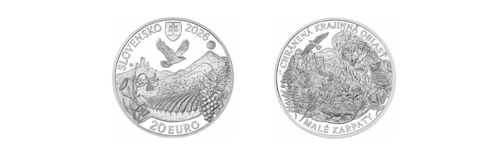

## 230

OZNÁMENIE

Národnej banky Slovenska

z 31. augusta 2026

## o vydaní strieborných zberateľských euromincí v nominálnej hodnote 20 eur s tematikou Chránená krajinná oblasť Malé Karpaty

1. Úvodné ustanovenia

- a) Národná banka Slovenska podľa § 17h ods. 1 zákona Národnej rady Slovenskej republiky č. 566/1992 Zb. o Národnej banke Slovenska v znení neskorších predpisov a podľa § 12 ods. 1 písm. b) zákona č. 400/2015 Z. z. o tvorbe právnych predpisov a o Zbierke zákonov Slovenskej republiky a o zmene a doplnení niektorých zákonov v znení neskorších predpisov oznamuje, že vydáva do obehu strieborné zberateľské euromince v nominálnej hodnote 20 eur s tematikou Chránená krajinná oblasť Malé Karpaty (ďalej len „zberateľská eurominca“).

- b) Zberateľská eurominca má štatút zákonného platidla len v Slovenskej republike.

- c) Zberateľská eurominca sa razí zo zliatiny obsahujúcej 925 dielov striebra a 75 dielov medi; jej hmotnosť je 33,63 g a priemer 40 mm. Pri razbe zberateľskej euromince je povolená horná a dolná odchýlka v priemere 0,1 mm; povolená horná odchýlka v hmotnosti je 0,4 g a v obsahu striebra 10/1 000.

2. Vzhľad zberateľskej euromince

- a) Na líci zberateľskej euromince je kompozícia prvkov typických pre Chránenú krajinnú oblasť Malé Karpaty s vinohradmi na úpätí pohoria, ponad ktoré prelieta orol kráľovský. V ľavej časti mincového poľa je kvet ľalie zlatohlavej a v pozadí silueta zrúcaniny Čachtického hradu. Vedľa nej je značka Mincovne Kremnica, štátny podnik, ktorú tvorí skratka „MK“ umiestnená medzi dvoma razidlami. V pravej časti mincového poľa je vyobrazený strapec hrozna ako symbol tradičného vinohradníctva Malých Karpát. V hornej časti zberateľskej euromince je nápis „SLOVENSKO“ a letopočet „2026“, ktoré sú oddelené štátnym znakom Slovenskej republiky. Vpravo od letopočtu je štylizovaný lipový trojlístok meniaci sa pri naklonení na písmená „NBS“ predstavujúce skratku Národnej banky Slovenska. V spodnej časti zberateľskej euromince je v opise nominálna hodnota „20 EURO“.

- b) Na rube zberateľskej euromince je Chránená krajinná oblasť Malé Karpaty so štylizovanými malokarpatskými skalnými mestami a lesnými porastmi. V hornej časti mincového poľa je letiaci sokol rároh. Na pravej strane kompozície sú netopiere a výr skalný. V spodnej časti mincového poľa sú typické druhy rastlín, motýľ a jašterica. V hornej časti je v opise nápis „CHRÁNENÁ KRAJINNÁ OBLASŤ“ a v spodnej časti nápis „MALÉ KARPATY“. Štylizované iniciálky autora zberateľskej euromince Tomáša Lamača, DiS. „TL“ sú pri ľavom okraji zberateľskej euromince.

- c) Na hrane zberateľskej euromince je reliéfny nápis „OCHRANA PRÍRODY A KRAJINY“. Začiatok a koniec textu je oddelený vyobrazením štylizovaného kvetu.

- 

- Štát vydania: Slovenská republika

- Začiatok vydávania: október 2026

Peter Kažimír v. r.
