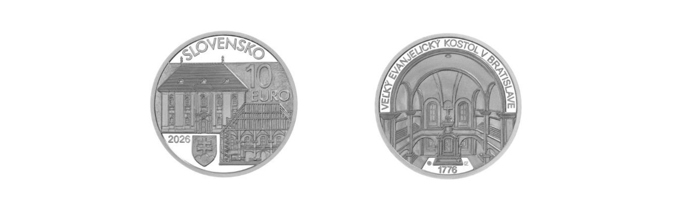

## 236

OZNÁMENIE

Národnej banky Slovenska

zo 14. septembra 2026

## o vydaní strieborných zberateľských euromincí v nominálnej hodnote 10 eur pri príležitosti 250. výročia posviacky Veľkého evanjelického kostola na Panenskej ulici v Bratislave

1. Úvodné ustanovenia

- a) Národná banka Slovenska podľa § 17h ods. 1 zákona Národnej rady Slovenskej republiky č. 566/1992 Zb. o Národnej banke Slovenska v znení neskorších predpisov a podľa § 12 ods. 1 písm. b) zákona č. 400/2015 Z. z. o tvorbe právnych predpisov a o Zbierke zákonov Slovenskej republiky a o zmene a doplnení niektorých zákonov v znení neskorších predpisov oznamuje, že vydáva do obehu strieborné zberateľské euromince v nominálnej hodnote 10 eur pri príležitosti 250. výročia posviacky Veľkého evanjelického kostola na Panenskej ulici v Bratislave (ďalej len „zberateľská eurominca“).

- b) Zberateľská eurominca má štatút zákonného platidla len v Slovenskej republike.

- c) Zberateľská eurominca sa razí zo zliatiny obsahujúcej 900 dielov striebra a 100 dielov medi; jej hmotnosť je 18 g a priemer 34 mm. Pri razbe zberateľskej euromince je povolená horná a dolná odchýlka v priemere 0,1 mm; povolená horná odchýlka v hmotnosti je 0,4 g a v obsahu striebra 10/1 000.

2. Vzhľad zberateľskej euromince

- a) Na líci zberateľskej euromince sú dva pohľady súvisiace s Veľkým evanjelickým kostolom. V ľavej časti mincového poľa je zobrazený pohľad na dobovú grafiku priečelia i strechy kostola a v pravej dolnej časti je zobrazený pohľad na historický nákres projektu kostola vo forme pozdĺžneho rezu. Vpravo od vyobrazenia priečelia kostola je v dvoch riadkoch označenie nominálnej hodnoty zberateľskej euromince „10 EURO“. V dolnej časti mincového poľa je štátny znak Slovenskej republiky a naľavo od neho letopočet „2026“. V hornej časti mincového poľa je v kruhopise nápis „SLOVENSKO“.

- b) Na rube zberateľskej euromince je zobrazený interiér Veľkého evanjelického kostola s charakteristickou priestorovou kompozíciou stĺpov, empor a klenieb. Dominantou interiéru je oltár umiestnený v centrálnej časti. V hornej časti mincového poľa je v kruhopise nápis „VEĽKÝ EVANJELICKÝ KOSTOL V BRATISLAVE“. V dolnej časti mincového poľa je letopočet posviacky kostola „1776“. Naľavo od letopočtu je značka Mincovne Kremnica, štátny podnik, ktorú tvorí skratka „MK“ umiestnená medzi dvoma razidlami, a napravo od letopočtu sú štylizované iniciálky autora zberateľskej euromince ak. soch. Zbyňka Fojtů „ZF“.

- c) Na hrane zberateľskej euromince je nápis do hĺbky „• POSTAVENÉ SO SÚHLASMI MÁRIE TERÉZIE A JOZEFA II.“.

Štát vydania: Slovenská republika

Začiatok vydávania: november 2026

Peter Kažimír v. r.
