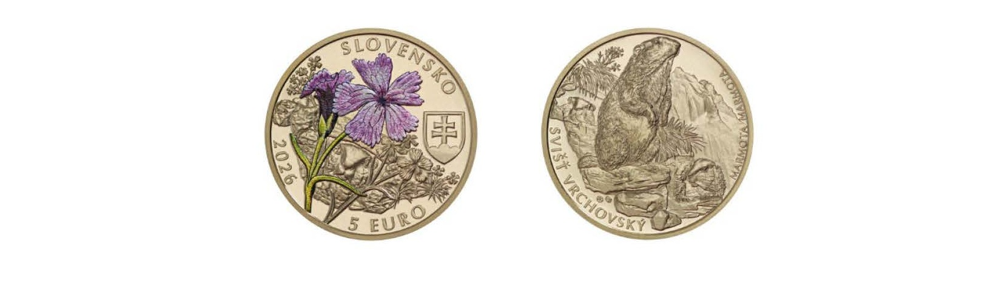

## 277

OZNÁMENIE

Národnej banky Slovenska

zo 6. októbra 2026

## o vydaní zberateľských euromincí z obyčajných kovov v nominálnej hodnote 5 eur s tematikou Fauna a flóra na Slovensku – svišť vrchovský

1. Úvodné ustanovenia

- a) Národná banka Slovenska podľa § 17h ods. 1 zákona Národnej rady Slovenskej republiky č. 566/1992 Zb. o Národnej banke Slovenska v znení neskorších predpisov a podľa § 12 ods. 1 písm. b) zákona č. 400/2015 Z. z. o tvorbe právnych predpisov a o Zbierke zákonov Slovenskej republiky a o zmene a doplnení niektorých zákonov v znení neskorších predpisov oznamuje, že vydáva do obehu zberateľské euromince z obyčajných kovov v nominálnej hodnote 5 eur s tematikou Fauna a flóra na Slovensku – svišť vrchovský (ďalej len „zberateľská eurominca“).

- b) Zberateľská eurominca má štatút zákonného platidla len v Slovenskej republike.

- c) Zberateľská eurominca sa razí z mosadze MS63 (Cu63Zn37); jej hmotnosť je 19,1 g a priemer 34 mm. Pri razbe zberateľskej euromince je povolená horná a dolná odchýlka v priemere 0,1 mm; povolená horná odchýlka v hmotnosti je 0,76 g.

2. Vzhľad zberateľskej euromince

- a) Na líci zberateľskej euromince je kompozícia vysokohorskej flóry s dominantným rozkvitnutým kvetom klinčeka lesklého vo farebnom prevedení. Kvet dopĺňajú rozvetvené výhonky a ďalšie rastlinné motívy typické pre vysokohorské prostredie. V rámci kompozície je skrytý z nory pozerajúci svišť vrchovský. Vpravo sa nachádza štátny znak Slovenskej republiky. V hornej časti mincového poľa je v opise názov štátu „SLOVENSKO“ a v ľavej časti je v opise letopočet razby „2026“. Nominálna hodnota „5 EURO“ je v opise v spodnej časti mincového poľa.

- b) Na rube zberateľskej euromince je na skalnom výbežku svišť vrchovský so zdvihnutou hlavou zobrazený pri strážení. Za ním vytŕča hlavu druhý jedinec a napravo od neho vystupuje z terénu ďalší jedinec svišťa vrchovského. Pozadie tvorí horský skalnatý masív doplnený charakteristickou horskou flórou. Vpravo je v kruhopise latinský názov „MARMOTA MARMOTA“ a vľavo slovenský názov „SVIŠŤ VRCHOVSKÝ“, nad ktorým sú štylizované iniciálky autora MgA. Josefa Oplištila „JO“ a značka Mincovne Kremnica, štátny podnik, ktorú tvorí skratka „MK“ umiestnená medzi dvoma razidlami.

- c) Hrana zberateľskej euromince je vrúbkovaná.

- 

Štát vydania: Slovenská republika

Začiatok vydávania: december 2026

v z. Dušan Keketi v. r.
