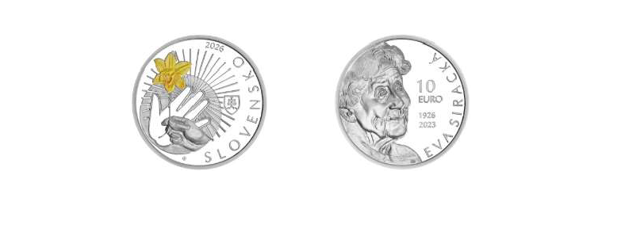

## 59

OZNÁMENIE

Národnej banky Slovenska

z 30. marca 2026

## o vydaní strieborných zberateľských euromincí v nominálnej hodnote 10 eur pri príležitosti 100. výročia narodenia Evy Sirackej

1. Úvodné ustanovenia

- a) Národná banka Slovenska podľa § 17h ods. 1 zákona Národnej rady Slovenskej republiky č. 566/1992 Zb. o Národnej banke Slovenska v znení neskorších predpisov a podľa § 12 ods. 1 písm. b) zákona č. 400/2015 Z. z. o tvorbe právnych predpisov a o Zbierke zákonov Slovenskej republiky a o zmene a doplnení niektorých zákonov v znení neskorších predpisov oznamuje, že vydáva do obehu strieborné zberateľské euromince v nominálnej hodnote 10 eur pri príležitosti 100. výročia narodenia Evy Sirackej (ďalej len „zberateľská eurominca“).

- b) Zberateľská eurominca má štatút zákonného platidla len v Slovenskej republike.

- c) Zberateľská eurominca sa razí zo zliatiny obsahujúcej 900 dielov striebra a 100 dielov medi; jej hmotnosť je 18 g a priemer 34 mm. Pri razbe zberateľskej euromince je povolená horná a dolná odchýlka v priemere 0,1 mm; povolená horná odchýlka v hmotnosti je 0,4 g a v obsahu striebra 10/1 000.

2. Vzhľad zberateľskej euromince

- a) Na líci zberateľskej euromince je v kompozícií štylizovaná otvorená dlaň, cez ktorú je umiestnená ruka držiaca žltý narcis. Kompozíciu dopĺňa schematické vyžarovanie röntgenových lúčov, do ktorých je v pravej časti vložený štátny znak Slovenskej republiky. V pravej časti mincového poľa je v opise nápis „SLOVENSKO“ a nad ním je v hornej časti mincového poľa letopočet „2026“. V spodnej časti mincového poľa je značka Mincovne Kremnica, štátny podnik, ktorú tvorí skratka MK umiestnená medzi dvoma razidlami.

- b) Na rube zberateľskej euromince je portrét Evy Sirackej. Vpravo od neho je v dvoch riadkoch nominálna hodnota „10 EURO“. Pod ňou sú v dvoch riadkoch letopočty narodenia a úmrtia Evy Sirackej „1926“ a „2023“. V pravej časti mincového poľa je v opise meno a priezvisko „EVA SIRACKÁ“. Štylizované iniciálky autora zberateľskej euromince Mgr. art. Martina Sabola „MS“ sú v spodnej časti mincového poľa.

- c) Na hrane zberateľskej euromince je nápis do hĺbky „• ZAKLADATEĽKA A PREZIDENTKA LIGY PROTI RAKOVINE“.

- 

- Štát vydania: Slovenská republika

- Začiatok vydávania: máj 2026

Peter Kažimír v. r.
